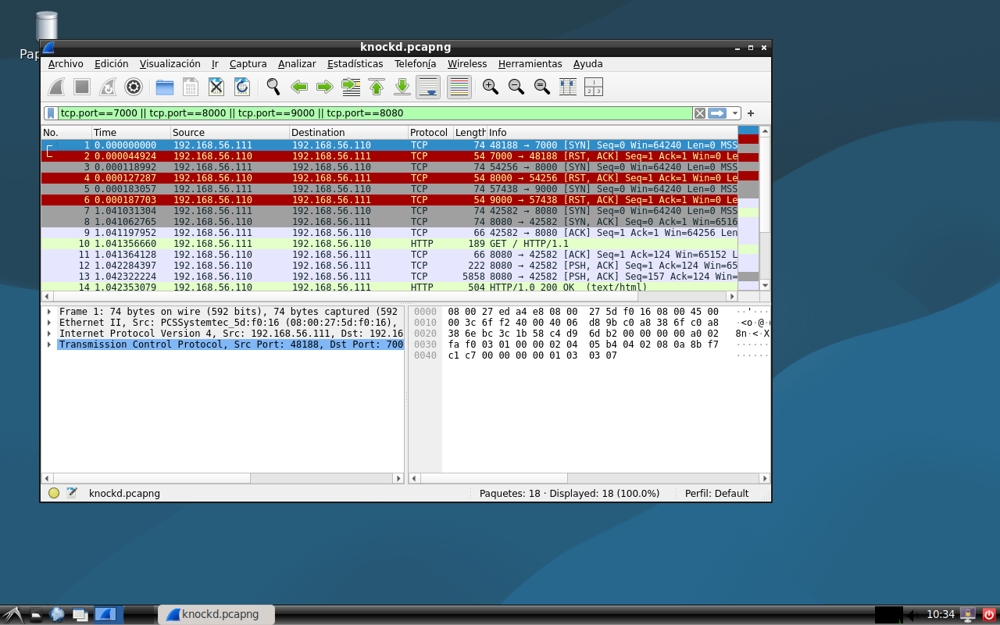
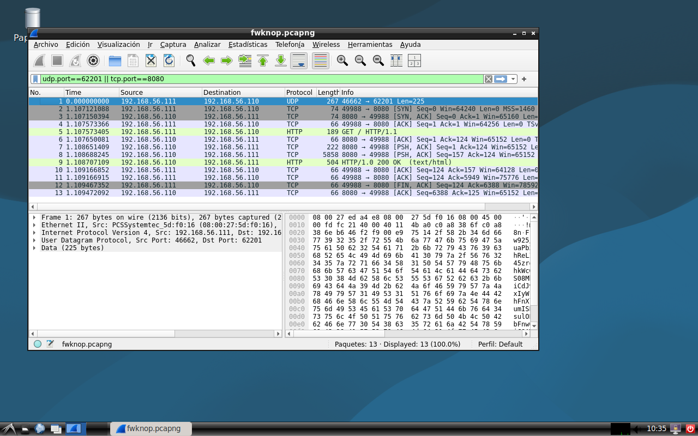

# 1. Introducción

## 1.1. Concepto

El **port knocking** es una técnica de ocultación de servicios: el cortafuegos mantiene un servicio cerrado por defecto y solo lo abre cuando el cliente envía antes una **secuencia de paquetes** a una serie de puertos previamente acordados. La información de autenticación viaja, por tanto, en las **cabeceras** de varios paquetes.

La **Single Packet Authorization** (SPA) es la evolución: toda la información de autenticación y la petición de acceso viajan en el **payload de un único paquete**, cifrado y autenticado con HMAC. El servidor lo verifica y, si es correcto, abre el servicio durante un tiempo limitado.

El proyecto se enmarca en la idea de **seguridad por oscuridad**: el servicio no es visible para un escaneo normal, pero la oscuridad **no sustituye** a la autenticación ni al cifrado. Bien implantada, es una capa de defensa en profundidad; mal entendida, da una falsa sensación de seguridad.

## 1.2. Características y objetivos

- **Ocultar** el servicio a escaneos y bots (no responde a `SYN`).
- **Reducir la superficie de ataque**: menor exposición a vulnerabilidades y fuerza bruta.
- **Conceder acceso temporal** a una IP concreta, con caducidad.
- **Registrar** los intentos y los accesos.
- **No sustituir** la autenticación del servicio (SSH, HTTPS, VPN): es una capa adicional.

## 1.3. Componentes

| Componente | Función |
| --- | --- |
| Cliente | Envía la secuencia (`knock`) o el paquete SPA (`fwknop`). |
| Demonio | Escucha la secuencia o el paquete y valida la petición. |
| Cortafuegos | Mantiene el servicio en `DROP` y abre la regla temporal. |
| Claves | Compartidas (Rijndael + HMAC) o GnuPG en SPA. |
| Registro | `syslog`/`journald` con accesos, errores y *replays*. |

## 1.4. Funcionamiento

### Port knocking clásico

El cliente envía paquetes a los puertos de la secuencia (por ejemplo, `7000, 8000, 9000`). El demonio los observa y, si llegan en orden y dentro de la ventana, ejecuta una orden que inserta una regla `ACCEPT` para la IP de origen. Pasado un tiempo, la regla se elimina.

### Single Packet Authorization

1. El cliente construye un paquete con datos aleatorios, usuario, marca de tiempo, versión, tipo de mensaje y la petición (`IP, tcp/8080`).
2. Añade un digest SHA-256 y un **HMAC**.
3. Cifra el conjunto con Rijndael en CBC y lo codifica en base64.
4. Lo envía en **un solo datagrama UDP** al puerto 62201.
5. `fwknopd` comprueba el HMAC, descifra, valida la marca de tiempo y el **digest de replay**, y añade una regla temporal a la cadena `FWKNOP_INPUT`.

La diferencia clave es que en SPA no hay secuencia que descubrir ni paquetes que reutilizar: el paquete es único, cifrado y autenticado.

## 1.5. Ejemplos de uso

- Proteger **SSH** en servidores expuestos a Internet.
- Ocultar el panel de administración de una aplicación web.
- Dar acceso temporal a una **VPN** o a un servicio interno.
- Servicios industriales o IoT con recursos limitados.
- Reducir ruido de bots y fuerza bruta en infraestructuras cloud.

## 1.6. Vulnerabilidades y ataques

| Ataque | Port knocking | SPA |
| --- | --- | --- |
| Descubrimiento de la secuencia | Sí: la secuencia viaja en claro | No hay secuencia |
| Replay | Sí, si se reenvía la secuencia | No: digest + marca de tiempo |
| Suplantación de IP | Posible según la red | El paquete va cifrado y autenticado |
| DoS | Fácil inundar la secuencia | Posible, pero no revela el servicio |
| Fuerza bruta | Contra la secuencia | Contra la clave HMAC |
| NAT | La IP origen puede cambiar | Igual: se cifra la IP a permitir |
| Falsa seguridad | Alta si no se combina con autenticación | Menor, pero no es autenticación del servicio |

Otras limitaciones: dependencia del cliente, gestión de claves, ventana de tiempo, accesibilidad desde redes con NAT, y que un compromiso de la clave compartida permite abrir el servicio.

## 1.7. Sustitutos y alternativas

| Alternativa | Ventaja | Inconveniente |
| --- | --- | --- |
| **VPN** (WireGuard, IPsec) | Cifra todo el tráfico y autentica | Más compleja; no es acceso puntual |
| **Bastion / jump host** | Punto único auditado | Un solo punto de fallo |
| **mTLS** | Autenticación fuerte de cliente | Requiere PKI y gestión de certificados |
| **fail2ban / rate limit** | Mitiga fuerza bruta | No oculta el servicio |
| **ACL de firewall** | Simple y robusto | Poco flexible para IPs cambiantes |
| **Zero Trust** | Política por identidad y contexto | Implantación costosa |

El port knocking y SPA son **complementos** de estas medidas, no sustitutos.

# 2. Herramientas seleccionadas

## 2.1. knockd

`knockd` es el demonio clásico de port knocking. Escucha una secuencia de puertos y ejecuta órdenes al completarse. Es sencillo, pero la secuencia viaja en claro y no tiene protección criptográfica.

Configuración usada en el laboratorio:

```ini
[options]
    UseSyslog
    interface = enp0s8

[openHTTP]
    sequence = 7000,8000,9000
    seq_timeout = 10
    command = /usr/sbin/iptables -I PROTECTED 1 -s %IP% -p tcp --dport 8080 -j ACCEPT
    tcpflags = syn
    cmd_timeout = 10
    stop_command = /usr/sbin/iptables -D PROTECTED -s %IP% -p tcp --dport 8080 -j ACCEPT
```

## 2.2. fwknop

`fwknop` implementa SPA. El cliente cifra y autentica la petición; el servidor `fwknopd` la valida y modifica el cortafuegos. Versión usada: **2.6.11**.

Configuración del servidor (`/etc/fwknop/access.conf`):

```text
SOURCE: 192.168.56.111
REQUIRE_SOURCE_ADDRESS: Y
OPEN_PORTS: tcp/8080
KEY_BASE64: azmRu/iYFPGFFU0zaJJWx+rPsV1qcH6sXblVwrHLgT8=
HMAC_KEY_BASE64: mnousYvDpEjPYKGbwgVOTUsW/cogxGf+021r9+0cbh2dP6KgG0AKpJ8FqeAEM8ddaQdfx/WwCUyUztIiaRQhxA==
FW_ACCESS_TIMEOUT: 10
```

El paquete Debian de Debian 13 no incluye soporte de `libpcap`; `fwknopd` arranca en **modo servidor UDP** y escucha en el puerto 62201. El comportamiento es equivalente para el laboratorio.

## 2.3. Comparativa

| Característica | knockd | fwknop (SPA) |
| --- | --- | --- |
| Información en | Cabeceras (secuencia) | Payload de un paquete |
| Cifrado | No | Rijndael/AES |
| Autenticación | Secuencia compartida | HMAC + clave |
| Replay | No protege | Digest + timestamp |
| Visibilidad en Wireshark | Secuencia completa | Un datagrama cifrado |
| Complejidad | Baja | Media |
| Uso recomendado | Docencia / defensa básica | Producción |

# 3. Demostración

## 3.1. Entorno de pruebas

| VM | Hostname | IP (host-only) | Rol |
| --- | --- | --- | --- |
| VM1 | `bocata-jamon` | `192.168.56.110` | Servidor: `knockd`, `fwknopd` y servicio HTTP |
| VM2 | `bocata-jamon2` | `192.168.56.111` | Cliente: `knock`, `fwknop` |

- Debian 13, `knockd 0.8`, `fwknop 2.6.11`, `iptables 1.8.11` (backend `nft`).
- Servicio protegido: **HTTP en el puerto 8080** (`python3 -m http.server`).
- Se protege el 8080 en lugar del 22 para no perder la sesión SSH de administración; el procedimiento es idéntico para SSH.

## 3.2. Instalación

```bash
# VM1 (servidor)
sudo apt-get install iptables knockd fwknop-server

# VM2 (cliente)
sudo apt-get install knockd fwknop-client
```

## 3.3. Cortafuegos

Se crea una cadena `PROTECTED` con política por defecto `DROP` para el servicio y se salta a ella desde `INPUT`:

```bash
sudo iptables -N PROTECTED
sudo iptables -A PROTECTED -j DROP
sudo iptables -I INPUT 1 -p tcp --dport 8080 -j PROTECTED
```

`fwknopd` añade su propia cadena `FWKNOP_INPUT` al principio de `INPUT`; sus reglas `ACCEPT` se evalúan antes del `DROP` de `PROTECTED`.

## 3.4. knockd

```bash
sudo systemctl enable --now knockd
sudo systemctl restart knockd
```

El demonio escucha en `enp0s8` y espera la secuencia `7000,8000,9000` con `tcpflags = syn`.

## 3.5. fwknop

Generación de claves en el cliente:

```bash
fwknop --key-gen
# KEY_BASE64: ...
# HMAC_KEY_BASE64: ...
```

El servidor usa `KEY_BASE64` y `HMAC_KEY_BASE64` en `access.conf`. El cliente envía la petición con:

```bash
fwknop -A tcp/8080 -a 192.168.56.111 -D 192.168.56.110 --use-hmac \
  --key-base64-rijndael '...' --key-base64-hmac '...'
```

## 3.6. Puesta en marcha

```bash
sudo systemctl status knockd fwknop-server
sudo fwknopd --fw-list
sudo iptables -S INPUT
sudo iptables -S PROTECTED
sudo iptables -S FWKNOP_INPUT
```

## 3.7. Casos de uso y resultados

| Prueba | Resultado |
| --- | --- |
| Sin knock ni SPA | HTTP **falla** (timeout) |
| Secuencia `7000,8000,9000` | HTTP **200**; regla `ACCEPT` en `PROTECTED` |
| Tras 10 s | Regla eliminada; HTTP **falla** |
| SPA correcta | HTTP **200**; regla en `FWKNOP_INPUT` |
| Tras 10 s | Regla eliminada; HTTP **falla** |
| SPA con HMAC incorrecta | HTTP **falla**; `Non-corresponding HMAC` |
| Replay del mismo paquete | `Replay detected`; no se abre una segunda regla |

Salida real de las pruebas:

```text
### 1. Sin knock: HTTP debe fallar
FAIL

### 2. Secuencia knockd 7000,8000,9000
HTTP: 200
-A PROTECTED -s 192.168.56.111/32 -p tcp -m tcp --dport 8080 -j ACCEPT
-A PROTECTED -j DROP

### 3. Timeout de knockd (10 s)
HTTP: FAIL
-A PROTECTED -j DROP

### 4. SPA fwknop correcta
HTTP: 200
-A FWKNOP_INPUT -s 192.168.56.111/32 -p tcp -m tcp --dport 8080 \
  -m comment --comment _exp_1795685785 -j ACCEPT

### 5. Timeout de fwknop (10 s)
HTTP: FAIL

### 6. SPA con HMAC incorrecta
HTTP: FAIL
Non-corresponding HMAC for this stanza

### 7. Replay
Replay detected from source IP: 192.168.56.111 ...
```

## 3.8. Capturas y análisis

### knockd

{ width=95% }

En la captura se ven los tres `SYN` a `7000`, `8000` y `9000`, respondidos con `RST/ACK`, y después la conexión a `8080` con `GET / HTTP/1.1` y `200 OK`. La secuencia es **completamente visible**: cualquiera que capture el tráfico puede reproducirla.

### fwknop

{ width=95% }

En la captura aparece **un solo datagrama UDP** de 225 bytes al puerto `62201`, seguido de la conexión a `8080` y el `200 OK`. No se ve la secuencia ni la IP solicitada: el contenido va cifrado y autenticado.

### Comparación

- **knockd**: tres paquetes en claro, fáciles de identificar y replicar.
- **fwknop**: un paquete cifrado, con HMAC y protección de replay; mucho menos visible y más robusto.

# 4. Conclusiones

- El **port knocking** reduce la exposición, pero es **seguridad por oscuridad**: la secuencia es visible y reutilizable.
- **SPA** mejora el modelo con cifrado, HMAC, marca de tiempo y protección de replay; es la opción recomendable.
- Ninguna de las dos técnicas **autentica al usuario** del servicio: deben combinarse con SSH con claves, mTLS, VPN o MFA.
- La protección debe aplicarse con una **política por defecto `DROP`** y reglas temporales; el `conntrack` mantiene las conexiones ya establecidas.
- En producción conviene usar **fwknop + nftables**, rotación de claves, registro centralizado y monitorización de *replays* y fallos de HMAC.
- El laboratorio demuestra que la diferencia entre ambos enfoques no es teórica: se ve en Wireshark y en el comportamiento del cortafuegos.

# 5. Bibliografía

1. M. Rash, *Single Packet Authorization: A Comprehensive Guide to Strong Service Concealment with fwknop*, cipherdyne.org, 2016. <https://www.cipherdyne.org/fwknop/docs/fwknop-tutorial.html>
2. Proyecto fwknop, <https://www.cipherdyne.org/fwknop/>.
3. `knockd(1)` y documentación de ZeroFlux, <https://www.zeroflux.org/projects/knock>.
4. Páginas de manual `fwknop(8)` y `fwknopd(8)`, paquete Debian `fwknop-server` 2.6.11.
5. NIST SP 800-41 Rev. 1, *Guidelines on Firewalls and Firewall Policy*, 2009.
6. M. Rash, *Linux Firewalls: Attack Detection and Response*, No Starch Press, 2007.
7. Paquetes Debian `fwknop-server`, `fwknop-client` y `knockd` (Debian 13).

# 6. Tiempos dedicados

| Fase | Horas |
| --- | ---: |
| Documentación (conceptos, comparativa, redacción) | 6 |
| Implementación (VM, cortafuegos, knockd, fwknop, pruebas) | 3 |
| Presentación (guion y diapositivas) | 2 |
| **Total** | **11** |
