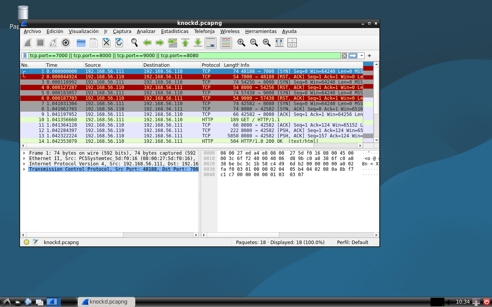
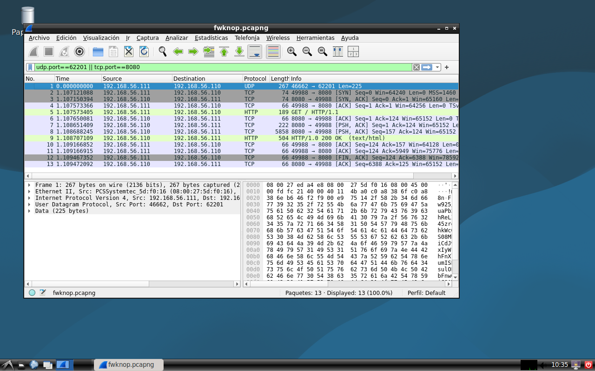

## El problema

- Los servicios expuestos (SSH, paneles, VPN) reciben escaneos y fuerza bruta constantes.
- Un puerto abierto revela la tecnología y las versiones.
- **Ocultar** el servicio reduce la superficie de ataque.
- Pero la oscuridad **no sustituye** a la autenticación.

## Port knocking

- El cortafuegos mantiene el servicio en `DROP`.
- El cliente envía una **secuencia de paquetes** a puertos acordados.
- Si la secuencia es correcta, se abre el servicio temporalmente.
- Ejemplo: `7000 → 8000 → 9000`.

**Problema:** la secuencia viaja en claro y se puede replicar.

## Single Packet Authorization

- Toda la petición viaja en **un único paquete** cifrado.
- Incluye usuario, IP, puerto, timestamp y un **HMAC**.
- El servidor valida HMAC, descifra y comprueba el **replay**.
- Herramienta: **fwknop**.

**Ventaja:** no hay secuencia que descubrir y el paquete no se puede reutilizar.

## Laboratorio

| VM | IP | Rol |
| --- | --- | --- |
| VM1 | 192.168.56.110 | Servidor: `knockd`, `fwknopd`, HTTP 8080 |
| VM2 | 192.168.56.111 | Cliente: `knock`, `fwknop` |

- Debian 13, `knockd 0.8`, `fwknop 2.6.11`, `iptables 1.8.11`.
- Servicio protegido: HTTP en **8080** (para no perder SSH).
- Política: cadena `PROTECTED` con `DROP` por defecto.

## knockd: configuración

```ini
[openHTTP]
    sequence = 7000,8000,9000
    seq_timeout = 10
    command = iptables -I PROTECTED 1 -s %IP% -p tcp ...
    tcpflags = syn
    cmd_timeout = 10
    stop_command = iptables -D PROTECTED -s %IP% ...
```

La configuración completa está en `lab/knockd.conf`.

## knockd: captura



La secuencia `7000,8000,9000` es visible y reproducible.

## fwknop: SPA

```bash
fwknop -A tcp/8080 -a 192.168.56.111 -D 192.168.56.110 --use-hmac \
  --key-base64-rijndael '...' --key-base64-hmac '...'
```

- Un solo datagrama UDP al puerto **62201**.
- Cifrado Rijndael + HMAC SHA-256.
- El servidor añade una regla temporal en `FWKNOP_INPUT`.

## fwknop: captura



Solo se ve un paquete UDP cifrado; no hay secuencia ni IP en claro.

## Resultados

| Prueba | Resultado |
| --- | --- |
| Sin knock ni SPA | HTTP falla |
| Secuencia knockd | HTTP 200 |
| Tras 10 s | HTTP falla |
| SPA correcta | HTTP 200 |
| SPA con HMAC incorrecta | HTTP falla |
| Replay del mismo paquete | `Replay detected` |

## Ataques y límites

- **Port knocking**: secuencia visible, replay, spoofing, DoS, descubrimiento.
- **SPA**: mitiga replay y ocultación, pero depende de la clave y del cliente.
- Ninguna autentica al usuario del servicio.
- **Alternativas**: VPN, jump host, mTLS, fail2ban, Zero Trust.

## Conclusiones

- El port knocking es **seguridad por oscuridad**; SPA añade criptografía real.
- **fwknop** es la opción recomendable: cifrado, HMAC y anti-replay.
- La defensa debe ser **en profundidad**: SPA + autenticación fuerte + TLS.
- En producción: `nftables`, rotación de claves, registro y monitorización.

## Bibliografía

- M. Rash, *Single Packet Authorization: A Comprehensive Guide to Strong Service Concealment with fwknop*, 2016.
- Proyecto fwknop, <https://www.cipherdyne.org/fwknop/>.
- `knockd(1)`, `fwknop(8)`, `fwknopd(8)`.
- NIST SP 800-41 Rev. 1, *Guidelines on Firewalls and Firewall Policy*, 2009.
