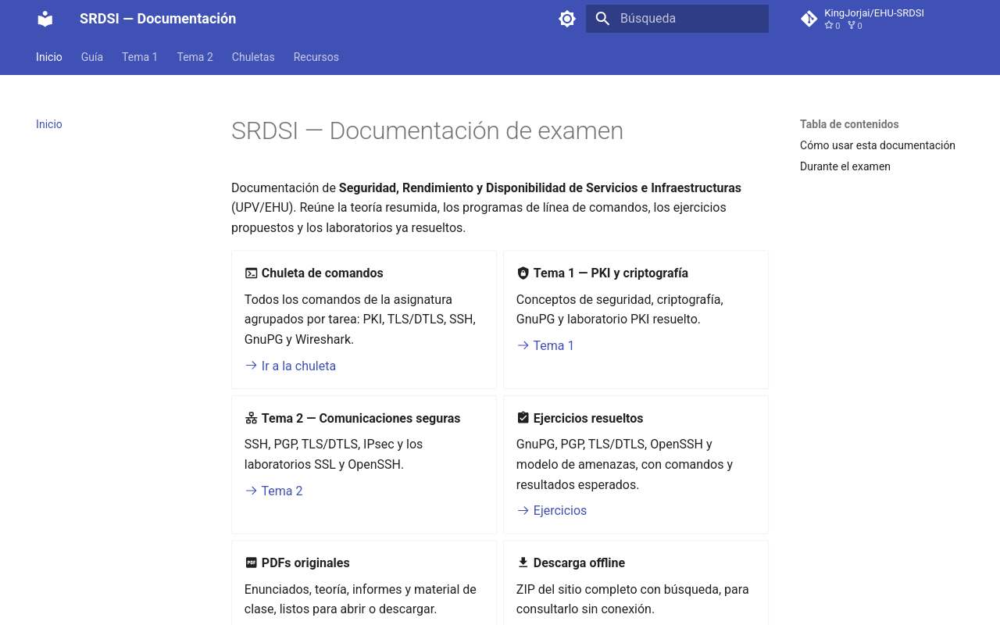

<p align="center">
  
</p>

<p align="center">
  <a href="https://kingjorjai.github.io/EHU-SRDSI/"></a>
  <a href="https://github.com/KingJorjai/EHU-SRDSI/actions/workflows/docs.yml"></a>
  <a href="https://squidfunk.github.io/mkdocs-material/"></a>
  <a href="https://www.ehu.eus/"></a>
  <a href="LICENSE"></a>
</p>

<h1 align="center">SRDSI</h1>

<p align="center">
  Apuntes, comandos y laboratorios resueltos de
  <strong>Seguridad, Rendimiento y Disponibilidad de Servicios e Infraestructuras</strong>
  (UPV/EHU).
</p>

## Acceso rápido

- **[Documentación online](https://kingjorjai.github.io/EHU-SRDSI/)**: teoría, comandos y laboratorios con búsqueda.
- **[Bundle offline](https://kingjorjai.github.io/EHU-SRDSI/recursos/EHU-SRDSI-docs-offline.zip)**: ZIP con el sitio y los PDFs para consultar sin internet.
- **[Chuleta de comandos](https://kingjorjai.github.io/EHU-SRDSI/chuletas/comandos/)**: OpenSSL, SSH, TLS/DTLS, GnuPG y Wireshark.
- **[PDFs originales](https://kingjorjai.github.io/EHU-SRDSI/recursos/pdfs/)**: enunciados, teoría e informes.

## Qué hay dentro

- Teoría resumida de los temas 1 y 2.
- Comandos de OpenSSL, GnuPG, SSH, TLS/DTLS, Wireshark y GDB.
- Ejercicios resueltos de GnuPG, PGP, TLS/DTLS, OpenSSH y modelo de amenazas.
- Laboratorios de PKI, SSL, OpenSSH y **MACsec**, con informes y capturas.
- Teoría de nivel de enlace: PPP, EAP, 802.1X, MACsec y WLAN.
- Ataques de enlace y retos Wireshark: ARP spoofing, MAC flooding, ICV alterado y replay.
- PDFs, chuletas y checklist para el examen.

## Cómo usarlo

- Pulsa `/` o usa la lupa para buscar cualquier comando o concepto.
- Navega con las pestañas: **Guía**, **Tema 1**, **Tema 2**, **Chuletas** y **Recursos**.
- Para el examen, descarga el ZIP offline y descomprímelo en el USB. Si el navegador bloquea la búsqueda con `file://`, sirve la carpeta con `python3 -m http.server`.

<details>
<summary><strong>Captura del sitio</strong></summary>
<p align="center">
  
</p>
</details>

## Desarrollo local

```bash
python3 -m venv .venv
.venv/bin/pip install -r requirements.txt
bash scripts/prepare_docs_assets.sh
.venv/bin/mkdocs serve
```

Construcción y verificación:

```bash
.venv/bin/mkdocs build --strict
.venv/bin/mkdocs build -f mkdocs.offline.yml -d site-offline --strict
```

El sitio se publica automáticamente en GitHub Pages al hacer push a `main`.

<details>
<summary><strong>Estructura del repositorio</strong></summary>

- `General/` — programa, anexo de laboratorios, entorno y bibliografía.
- `Tema 1: Introducción a la seguridad informática/` — teoría, actividad de criptografía, estudio de CA y laboratorio PKI.
- `Tema 2: Seguridad en la comunicación/` — teoría, laboratorio SSL, laboratorio OpenSSH, ejercicios TLS/DTLS y actividad MACsec.
- `docs/` — fuente del sitio MkDocs publicado.
- `mkdocs.yml`, `mkdocs.offline.yml`, `requirements.txt` y `scripts/` — construcción y bundle offline.
- `.github/workflows/docs.yml` — construcción y despliegue en GitHub Pages.

</details>

## Licencia y aviso

El contenido original de este repositorio se distribuye bajo **CC BY-NC-SA 4.0**; consulta [LICENSE](LICENSE). Los PDFs, transparencias, enunciados y código de ejemplo de la asignatura son material docente y no están cubiertos por esa licencia.

Las claves y certificados del repositorio son **sintéticos** y solo se usan en la máquina virtual del laboratorio. Este material es de apoyo: revisa siempre el enunciado oficial de la asignatura.

Hecho por **Jorge Arévalo** y **Jon González**. Si encuentras un error, abre un *issue* o un *pull request*.
