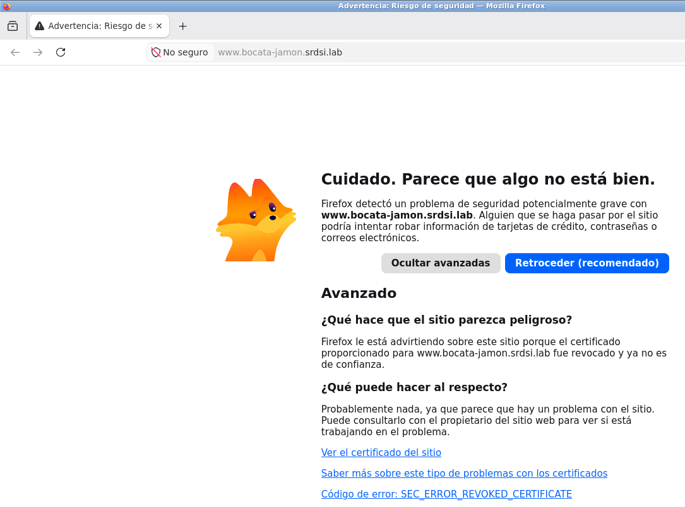
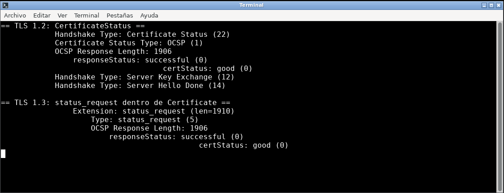
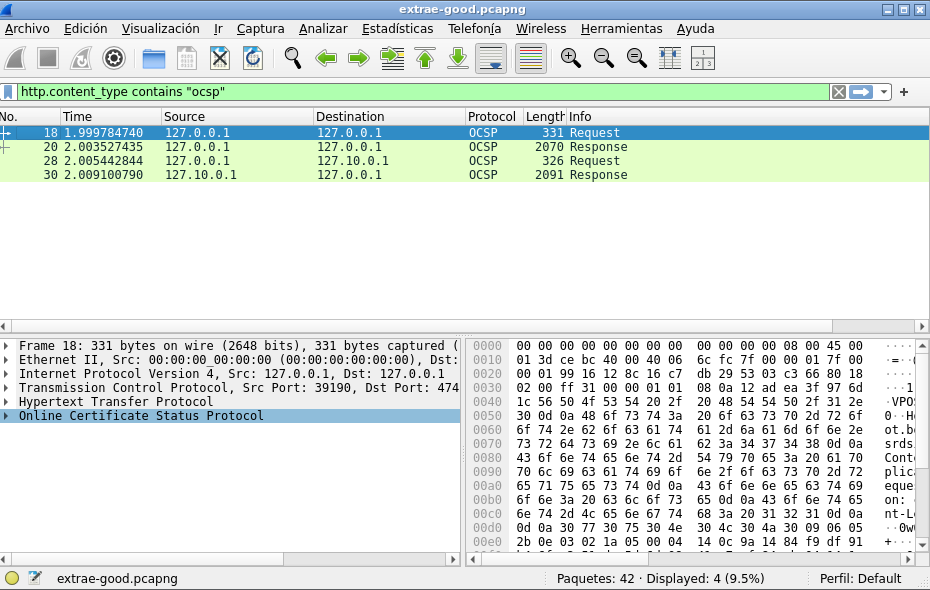
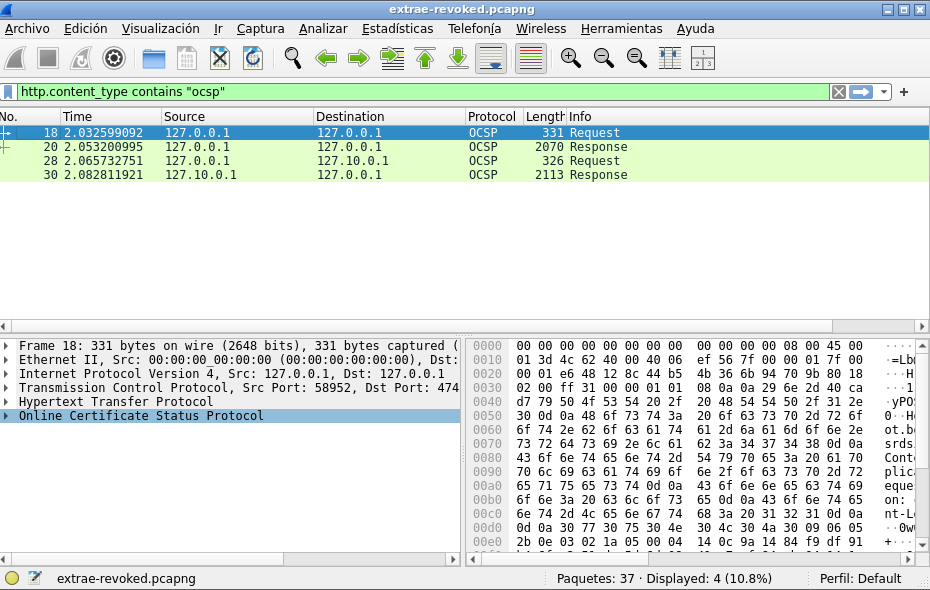
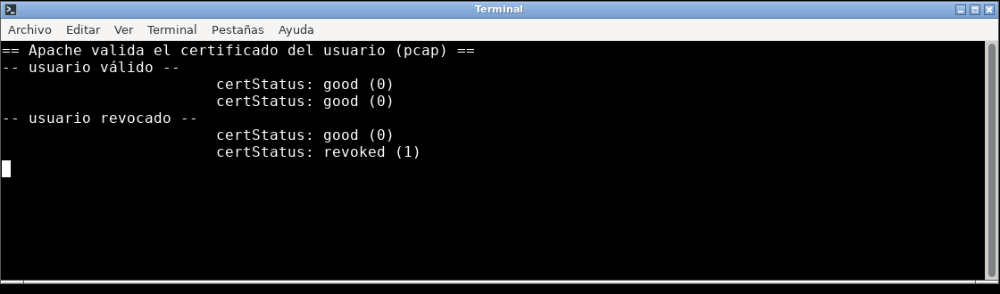

# Resumen

La práctica se ha completado y verificado sobre la PKI de la primera fase. Se
ha montado un sitio HTTPS con Apache, un respondedor OCSP para la subCA y otro
para la raíz, y se han analizado los tres modos de OCSP y la validación del
certificado de usuario. Todas las pruebas se han ejecutado en la VM Debian 13;
las capturas y los `.pcapng` acompañan al informe.

| Bloque | Resultado |
| --- | --- |
| **Ejercicio 1 — OCSP regular** | Soft-fail sin respondedor; consulta del navegador con `good`; bloqueo con `SEC_ERROR_REVOKED_CERTIFICATE` al revocar. |
| **Ejercicio 2 — Stapling** | Apache consulta el OCSP; `Cert Status: good` en TLS 1.2 y TLS 1.3; se documentan los mensajes de cada versión. |
| **Must-Staple** | Extensión `status_request`; sin *staple* el acceso se deniega, con *staple* funciona. |
| **Ejercicio E — Usuario** | `SSLOCSPEnable on` valida al usuario; revocado sin la directiva entra (200), con la directiva se rechaza. |

# 1. Introducción y objetivo

La primera fase de la práctica puso en marcha una PKI privada con una CA raíz y
una subCA, emitió certificados para usuarios y servicios y comprobó la
revocación con `openssl` actuando como cliente OCSP. En esta segunda fase se
configura un sitio web seguro que consulta el estado de los certificados y se
analizan los tres modos de operación de OCSP:

- **OCSP regular**: el navegador consulta directamente al respondedor.
- **OCSP stapling**: el servidor web consulta y envía la respuesta firmada en el
  *handshake* TLS.
- **OCSP Must-Staple** (RFC 7633): el certificado exige que haya *staple*.

Además se resuelve el apartado extra: la validación del certificado **del
usuario** por parte del servidor mediante OCSP.

# 2. Entorno y punto de partida

| Elemento | Valor |
| --- | --- |
| VM | Debian GNU/Linux 13 (trixie), `bocata-jamon.srdsi.lab` |
| Apache | 2.4.71 (Debian) |
| OpenSSL | 3.5.7 |
| PKI | `~/PKI_root` (raíz) y `~/PKI_root/PKI_sub` (subCA) de la fase 1 |
| Sitio web | `https://www.bocata-jamon.srdsi.lab` |
| Respondedor de la subCA | `http://ocsp.bocata-jamon.srdsi.lab:4747` |
| Respondedor de la raíz | `http://ocsp-root.bocata-jamon.srdsi.lab:4748` |

La PKI de la fase 1 conserva `index.txt`, los números de serie y los
certificados de la subCA y de firma OCSP. Para esta fase se han emitido
certificados nuevos para el sitio web y para un usuario, y se ha añadido un
respondedor para la CA raíz (apartado 8).

Resolución de nombres en la VM (`/etc/hosts`):

```text
127.0.0.1   www.bocata-jamon.srdsi.lab
127.10.0.1  ocsp.bocata-jamon.srdsi.lab
127.0.0.1   ocsp-root.bocata-jamon.srdsi.lab
127.0.0.1   subCA.bocata-jamon.srdsi.lab rootCA.bocata-jamon.srdsi.lab
```

Las URL de AIA (`CA Issuers` y `OCSP`) deben resolver y servir los
certificados de las CAs; de lo contrario el navegador puede quedarse esperando
la cadena. En la VM se publican con un *virtual host* HTTP en `/var/www/pki/`
(`configs/pki-aia.conf`).

El certificado de la subCA lleva AIA de tipo OCSP. Cuando Apache valida una
cadena completa (`SSLOCSPEnable`), pregunta también por la subCA; el
respondedor de la subCA no puede responder por el certificado que la propia
subCA recibió de la raíz. Por eso se ejecuta un segundo respondedor en el
4748 con el índice de la raíz, y la subCA se volvió a firmar con AIA a ese
puerto (misma clave y mismo *subject*; los certificados ya emitidos siguen
siendo válidos). Los comandos están en `configs/root-ocsp.txt`.

# 3. Respondedor OCSP

La clave del respondedor se generó cifrada con `gen_solicitud.sh`, por lo que
se pasa con `-passin`. El respondedor lee `index.txt` al arrancar: **hay que
reiniciarlo después de emitir o revocar**.

```bash
cd ~/PKI_root/PKI_sub
export OCSP_PASS='user1Sub_CA_ocsp'

openssl ocsp -port 4747 \
  -index DB/index.txt \
  -CA certificado-subCA.crt \
  -rsigner certs/certificado-ocsp.bocata-jamon.srdsi.lab.crt \
  -rkey private/clave-privada-ocsp.bocata-jamon.srdsi.lab.key \
  -passin env:OCSP_PASS \
  -text -out log-subCA.txt
```

Comprobación con el cliente de OpenSSL:

```console
$ openssl ocsp -issuer ~/PKI_root/PKI_sub/certificado-subCA.crt \
    -cert ~/PKI_root/PKI_sub/certs/certificado-www.bocata-jamon.srdsi.lab.crt \
    -CAfile ~/PKI_root/PKI_sub/certificado-subCA.crt \
    -url http://ocsp.bocata-jamon.srdsi.lab:4747 -resp_text
    OCSP Response Status: successful (0x0)
    Cert Status: good
    This Update: Nov 18 09:53:19 2026 GMT
```

# 4. Certificado del sitio web

Se emitió con la plantilla `server_ext`, que incluye SAN, AIA y los usos de
servidor:

```bash
KEY_PASS='pki2server' ./gen_solicitud.sh -t servicio \
  -n "www.bocata-jamon.srdsi.lab" \
  -d "www.bocata-jamon.srdsi.lab,bocata-jamon.srdsi.lab" \
  -e webadmin@bocata-jamon.srdsi.lab -C ES -S GP -L Donostia \
  -O "Bocata de Jamon" -U LABS -o ~/PKI_root/PKI_sub/pki2-server

CA_PASS='user1Sub_CA' ./emitir_cert.sh \
  ~/PKI_root/PKI_sub/pki2-server/solicitud-www.bocata-jamon.srdsi.lab.csr server_ext
```

```console
$ openssl x509 -in certs/servidor.crt \
    -noout -subject -ext subjectAltName,authorityInfoAccess
subject=C=ES, ST=GP, O=Bocata de Jamon, OU=LABS,
        CN=www.bocata-jamon.srdsi.lab, emailAddress=webadmin@bocata-jamon.srdsi.lab
X509v3 Subject Alternative Name:
    DNS:www.bocata-jamon.srdsi.lab, DNS:bocata-jamon.srdsi.lab
Authority Information Access:
    CA Issuers - URI:http://subCA.bocata-jamon.srdsi.lab/subCA.crt
    OCSP - URI:http://ocsp.bocata-jamon.srdsi.lab:4747
```

La clave se genera cifrada. Apache no puede arrancar con una clave cifrada sin
interacción (se queda esperando en `systemd-ask-password`), así que se descifra
antes de instalarla:

```bash
openssl pkey -in ~/PKI_root/PKI_sub/pki2-server/clave-privada-www.bocata-jamon.srdsi.lab.key \
  -passin pass:pki2server -out /tmp/servidor.key
sudo install -m 600 /tmp/servidor.key /etc/apache2/ssl/pki2/servidor.key
```

# 5. Ejercicio 1 — OCSP regular

## 5.1. Sin respondedor en marcha: soft-fail

Se detuvo el respondedor y se accedió al sitio con una captura de tráfico en
`lo`. El navegador intentó conectar al puerto 4747, recibió un `RST` y **mostró
la página igualmente**: es el comportamiento *soft-fail* actual.

{width=90%}

En la captura se ven los intentos de conexión al 4747 sin respuesta:

```console
$ tshark -r capturas/01-regular-sin-ocsp.pcapng -Y 'tcp.port==4747'
21  127.0.0.1 → 127.10.0.1  TCP 43630 → 4747 [SYN]
22  127.10.0.1 → 127.0.0.1  TCP 4747 → 43630 [RST, ACK]
```

Con el respondedor parado, un atacante podría bloquear el OCSP y hacer que se
acepte un certificado revocado. Es la motivación de *stapling* y Must-Staple.

## 5.2. Con el respondedor en marcha

Al arrancar el respondedor y recargar, **es el navegador** quien consulta al
OCSP. La captura muestra dos peticiones `POST` con contenido
`application/ocsp-request` y respuestas `200` con `application/ocsp-response`.

{width=90%}

```console
$ tshark -r capturas/02-regular-con-ocsp.pcapng \
    -d tcp.port==4747,http -Y 'http.request or http.response' \
    -T fields -e http.request.method -e http.response.code -e http.content_type
POST        application/ocsp-request
    200     application/ocsp-response
POST        application/ocsp-request
    200     application/ocsp-response
```

Las dos peticiones corresponden a las conexiones que abrió el navegador en esa
carga; cada una pide el estado del certificado del servidor.

{width=90%}

## 5.3. Certificado del servidor revocado

Se revocó el certificado con `revocar_cert.sh`, se reinició el respondedor y se
volvió a acceder. El respondedor devuelve `revoked` y el navegador bloquea la
conexión:

```console
$ openssl ocsp -issuer certs/subCA.crt \
    -cert certs/servidor-revocado.crt \
    -CAfile certs/subCA.crt \
    -url http://ocsp.bocata-jamon.srdsi.lab:4747 -resp_text
    OCSP Response Status: successful (0x0)
    Cert Status: revoked
    Revocation Time: Nov 18 09:53:38 2026 GMT
```

{width=90%}

La captura de ese acceso contiene la respuesta OCSP que recibe el navegador;
el estado es `revoked`, no solo en la consulta manual:

```console
$ tshark -r capturas/03-servidor-revocado.pcapng -d tcp.port==4747,http \
    -Y 'ocsp' -V | grep certStatus
    certStatus: revoked (1)
```

> **Nota.** El navegador guarda respuestas OCSP. Para repetir los escenarios se
> usó una ventana privada o un perfil nuevo, y se reinició el respondedor tras
> cada revocación.

# 6. Ejercicio 2 — OCSP stapling

Se activó `SSLUseStapling` y una caché `shmcb`:

```apache
SSLStaplingCache "shmcb:/var/run/apache2/ssl_stapling(32768)"

<VirtualHost *:443>
    ...
    SSLCACertificateFile /etc/apache2/ssl/pki2/cadena-cas.pem
    SSLUseStapling On
</VirtualHost>
```

Ahora **es Apache** quien consulta al respondedor; el navegador recibe la
respuesta firmada en el *handshake*. Se emitió un certificado nuevo para el
sitio (tras revocar el de la prueba anterior) y se comprobó sin navegador con
`openssl s_client -status`, tanto en TLS 1.2 como en TLS 1.3:

{width=90%}

La diferencia entre versiones está en **dónde viaja** la respuesta:

| TLS 1.2 | TLS 1.3 |
| --- | --- |
| `ClientHello` con la extensión `status_request`. | `ClientHello` con la extensión `status_request`. |
| `ServerHello`, `Certificate`, **`CertificateStatus` (respuesta OCSP)**, `ServerKeyExchange`, `ServerHelloDone`. | `ServerHello`, `EncryptedExtensions`, **`Certificate` con `status_request` dentro de la entrada de certificado**, `CertificateVerify`, `Finished`. |
| `CertificateStatus` es un mensaje propio y viaja **antes** del `ChangeCipherSpec` (en claro en la captura). | Todo el handshake posterior al `ServerHello` va cifrado; hace falta el *keylog* para verlo en Wireshark. |

{width=90%}

{width=90%}

| Pregunta | Respuesta observada |
| --- | --- |
| ¿Quién contacta con el OCSP? | Apache, no el navegador. |
| ¿Cuándo? | Al arrancar o en la primera conexión; después según la caché. La primera petición puede quedarse sin *staple*. |
| TLS 1.2 frente a TLS 1.3 | TLS 1.2 usa el mensaje `CertificateStatus`; TLS 1.3 incluye `status_request` en la entrada de certificado. En TLS 1.2 la respuesta es visible sin descifrar; en TLS 1.3 requiere el *keylog*. |

En la captura `04-stapling.pcapng` no hay ninguna conexión del navegador al
puerto 4747: las consultas las hace Apache antes de enviar el *staple*.

Al revocar el certificado del servidor y reiniciar el respondedor, el *staple*
acaba conteniendo `revoked` y el navegador rechaza la conexión con
`SEC_ERROR_REVOKED_CERTIFICATE`. Para verlo sin esperar a la caché se reinició
Apache y se usó `SSLStaplingResponseMaxAge 90`.

{width=90%}

La captura `09-stapling-revocado.pcapng` contiene la respuesta que Apache
recibe del respondedor:

```console
$ tshark -r capturas/09-stapling-revocado.pcapng -d tcp.port==4747,http \
    -Y 'ocsp' -V | grep certStatus
    certStatus: revoked (1)
```

# 7. Must-Staple (RFC 7633)

Se añadió la extensión al certificado del servidor:

```ini
[server_ext]
...
tlsfeature = status_request
```

```console
$ openssl x509 -in certs/servidor-must-staple.crt -noout -text
            TLS Feature:
                status_request
```

Con el respondedor detenido, Apache no puede obtener el *staple* y el navegador
**deniega** el acceso (ya no hay *soft-fail*):

{width=90%}

Con el respondedor en marcha y el *staple* disponible, el acceso funciona:

{width=90%}

# 8. Ejercicio E — validación del certificado de usuario

Apache valida por defecto la firma y la cadena del certificado de cliente, pero
**no consulta la revocación**. Para que lo haga se activa `SSLOCSPEnable on`.

Se emitió un certificado de usuario con `user_ext` (incluye AIA y
`clientAuth`) y se importó su `.p12` en Firefox. El sitio pide certificado solo
en la zona privada (`SSLVerifyClient optional` + `Require ssl-verify-client`).

En esta PKI, el certificado de la subCA también tiene AIA y Apache valida
**toda la cadena**, incluido el intermedio. Por eso se puso en marcha un segundo
respondedor para la raíz, que responde por la subCA:

```bash
cd ~/PKI_root
openssl ocsp -port 4748 -index DB/index.txt -CA certificado-rootCA.crt \
  -rsigner certs/certificado-ocsp-root.bocata-jamon.srdsi.lab.crt \
  -rkey ocsp-root/clave-privada-ocsp-root.bocata-jamon.srdsi.lab.key \
  -passin pass:rootocsp -text -out log-root.txt
```

```console
$ openssl ocsp -issuer certificado-rootCA.crt -cert certificado-subCA.crt \
    -CAfile certificado-rootCA.crt \
    -url http://ocsp-root.bocata-jamon.srdsi.lab:4748
    OCSP Response Status: successful (0x0)
    Cert Status: good
```

Para que Apache pueda verificar la firma de la respuesta OCSP (y no haga falta
`SSLOCSPNoVerify`), la CA raíz se añadió al almacén del sistema:

```bash
sudo cp ~/PKI_root/certificado-rootCA.crt \
  /usr/local/share/ca-certificates/pki2-root.crt
sudo update-ca-certificates
```

Con el usuario válido, el acceso es correcto:

{width=90%}

Tras revocar el certificado del usuario y reiniciar el respondedor:

| Configuración | Resultado | Evidencia |
| --- | --- | --- |
| Sin `SSLOCSPEnable` | **200 OK**: Apache no consulta la revocación | Figura del usuario revocado sin `SSLOCSPEnable` |
| Con `SSLOCSPEnable on` | **Denegado**: alerta TLS `certificate revoked` | Figura del usuario revocado con `SSLOCSPEnable` y log |

{width=90%}

{width=90%}

Log de Apache:

```text
AH03239: OCSP validation completed, certificate status: good
  [subject: CN=bocata_jamon_subCA ...]
AH03239: OCSP validation completed, certificate status: good
  [subject: CN=Usuario-PKI2b ...]
AH03239: OCSP validation completed, certificate status: revoked (1, 5)
  [subject: CN=Usuario-PKI2b ...]
AH02276: Certificate Verification: Error (23): certificate revoked
```

La captura de tráfico de una validación completa muestra **dos consultas de
Apache**: una al respondedor de la raíz (4748) por la subCA y otra al de la
subCA (4747) por el usuario. Se repitió con un usuario nuevo (`Usuario-PKI2c`)
para capturar el intercambio con el *sniffer*:

```console
$ tshark -r capturas/07-extrae-good.pcapng \
    -d tcp.port==4748,http -d tcp.port==4747,http \
    -Y 'http.request or http.response' \
    -T fields -e tcp.dstport -e http.request.method -e http.response.code
4748  POST
39190       200
4747  POST
55226       200
```

{width=90%}

Tras revocar el usuario, la segunda respuesta cambia a `revoked` y Apache
deniega la conexión:

{width=90%}

{width=85%}

Para aislar la validación del servidor se desactivó la comprobación OCSP del
navegador (`security.OCSP.enabled = 0`) en el perfil de esta prueba. Así el
navegador no bloquea por su cuenta la cadena del servidor y se observa
exactamente la decisión de Apache. Las capturas corresponden a la
configuración final, **sin** `SSLOCSPNoVerify`: Apache verifica la firma de la
respuesta OCSP. La figura del caso sin `SSLOCSPEnable` muestra la comprobación
por consola (HTTP 200) y la del caso con `SSLOCSPEnable` el rechazo en el
navegador con `SSL_ERROR_REVOKED_CERT_ALERT`.

# 9. Conclusiones

- **OCSP regular** delega la comprobación en el navegador, pero el *soft-fail*
  permite aceptar un certificado revocado si se bloquea el acceso al
  respondedor.
- **Stapling** mueve la consulta al servidor y evita esa dependencia del
  cliente, además de mejorar la privacidad y la latencia. La primera conexión
  puede no llevar *staple*.
- **Must-Staple** cierra el *soft-fail*: sin *staple* no hay conexión. Es la
  opción adecuada cuando se quiere garantizar la comprobación.
- La validación del certificado de usuario requiere `SSLOCSPEnable on`; sin esa
  directiva Apache no consulta la revocación y un usuario revocado entra.
- En una jerarquía con subCA hay que poder responder por **todos** los
  certificados de la cadena. Si el intermedio tiene AIA, se necesita un
  respondedor para la CA que lo emitió.

# 10. Anexo A — Configuraciones

Los ficheros completos están en `configs/`:

| Fichero | Uso |
| --- | --- |
| `pki2-ocsp-regular.conf` | OCSP regular. |
| `pki2-ocsp-stapling.conf` | Stapling. |
| `pki2-ocsp-must-staple.conf` | Must-Staple. |
| `pki2-usuario-ocsp.conf` | Validación OCSP del usuario (`SSLOCSPEnable on`). |
| `pki-aia.conf` | Publica los certificados de las CAs en las URL de AIA. |
| `root-ocsp.txt` | Comandos del respondedor OCSP de la CA raíz (4748). |
| `server-ext-must-staple.txt` | Sección `[server_ext]` con `tlsfeature`. |

# 11. Anexo B — Certificados

En `certs/` se incluyen los certificados públicos del sitio (normal y
Must-Staple), el de firma OCSP de la subCA, el de firma OCSP de la raíz, la
subCA, la raíz y el certificado de usuario. Las claves privadas no se adjuntan.

| Fichero | CN | Emisor | Serial | Validez |
| --- | --- | --- | --- | --- |
| `rootCA.crt` | `bocata_jamon_rootCA` | él mismo | `852A…A3` | 2026-10-10 → 2036-10-07 |
| `subCA.crt` | `bocata_jamon_subCA` | rootCA | `852A…A7` | 2026-11-18 → 2036-11-15 |
| `servidor.crt` | `www.bocata-jamon.srdsi.lab` | subCA | `C9FB…317E` | 2026-11-18 → 2036-11-15 |
| `servidor-revocado.crt` | `www.bocata-jamon.srdsi.lab` | subCA | `C9FB…317D` | 2026-11-18 → 2036-11-15 |
| `servidor-must-staple.crt` | `www.bocata-jamon.srdsi.lab` | subCA | `C9FB…317F` | 2026-11-18 → 2036-11-15 |
| `ocsp-subCA.crt` | `ocsp.bocata-jamon.srdsi.lab` | subCA | `C9FB…317C` | 2026-10-10 → 2036-10-07 |
| `ocsp-root.crt` | `ocsp-root.bocata-jamon.srdsi.lab` | rootCA | `852A…A6` | 2026-11-18 → 2036-11-15 |
| `usuario.crt` | `Usuario-PKI2b` | subCA | `C9FB…3181` | 2026-11-18 → 2036-11-15 |
| `usuario-pcap.crt` | `Usuario-PKI2c` | subCA | `C9FB…3182` | 2026-11-18 → 2036-11-15 |

El certificado del sitio lleva `subjectAltName = www.bocata-jamon.srdsi.lab,
bocata-jamon.srdsi.lab`; el de Must-Staple añade
`TLS Feature: status_request`. Los certificados de firma OCSP tienen
`extendedKeyUsage = OCSP Signing` y el de usuario, `clientAuth`.

Estados en el momento de la entrega: `servidor-revocado.crt` (serial `…317D`) y
`servidor.crt` (serial `…317E`) están revocados por los ejercicios 1 y 2;
`usuario.crt` (`…3181`) y `usuario-pcap.crt` (`…3182`) por el ejercicio E. La
raíz, la subCA, los dos certificados OCSP y el de Must-Staple son válidos.

# 12. Anexo C — Capturas y evidencias

- `img/`: capturas del navegador, de Wireshark y de las comprobaciones con
  `openssl`/`tshark`.
- `capturas/`: ficheros `.pcapng` de los escenarios y salidas de texto
  (`evidencias.txt`, `stapling-sclient.txt`).

| Captura | Contenido |
| --- | --- |
| `01-regular-sin-ocsp.pcapng` | Intentos al 4747 con el respondedor parado (`SYN`/`RST`). |
| `02-regular-con-ocsp.pcapng` | Peticiones y respuestas OCSP del navegador. |
| `03-servidor-revocado.pcapng` | Respuesta `revoked` al navegador. |
| `04-stapling.pcapng` | Acceso con *stapling* (sin consulta del navegador). |
| `05-tls12-stapling.pcapng` | `CertificateStatus` de TLS 1.2 en claro. |
| `06-tls13-stapling.pcapng` | `status_request` en TLS 1.3 (requiere *keylog*). |
| `07-extrae-good.pcapng` | Consultas de Apache por subCA (4748) y usuario (4747), `good`. |
| `08-extrae-revoked.pcapng` | Igual, con el usuario `revoked`. |
| `09-stapling-revocado.pcapng` | Respuesta `revoked` que recibe Apache con stapling. |

Comandos de reproducción:

```bash
# Respondedor de la subCA
openssl ocsp -port 4747 -index DB/index.txt -CA certificado-subCA.crt \
  -rsigner certs/certificado-ocsp.bocata-jamon.srdsi.lab.crt \
  -rkey private/clave-privada-ocsp.bocata-jamon.srdsi.lab.key \
  -passin env:OCSP_PASS -text -out log-subCA.txt

# Consulta manual
openssl ocsp -issuer certificado-subCA.crt -cert servidor.crt \
  -CAfile certificado-subCA.crt -url http://ocsp.bocata-jamon.srdsi.lab:4747 -resp_text

# Staple en el handshake
echo | openssl s_client -connect www.bocata-jamon.srdsi.lab:443 \
  -servername www.bocata-jamon.srdsi.lab -status \
  -CAfile /etc/apache2/ssl/pki2/cadena-cas.pem -tls1_2

# TLS 1.3: el keylog permite ver status_request en Wireshark
echo | openssl s_client -connect www.bocata-jamon.srdsi.lab:443 \
  -servername www.bocata-jamon.srdsi.lab -status -tls1_3 \
  -keylogfile tls13.keys -CAfile /etc/apache2/ssl/pki2/cadena-cas.pem
tshark -r capturas/06-tls13-stapling.pcapng -o tls.keylog_file:tls13.keys \
  -Y 'tls.handshake.type==11' -V | grep -E 'status_request|certStatus'
```

\newpage

# 13. Dedicación de horas

| Persona | Tarea | Horas |
| --- | --- | --- |
| Jon | Puesta en marcha del respondedor OCSP de la subCA y comprobación `good`/`revoked` | 0,5 h |
| Jorge | Emisión de los certificados del sitio y del usuario; configuración de Apache, AIA y respondedor de la raíz | 1,5 h |
| Jorge + Jon | Ejercicio 1: OCSP regular, escenarios soft-fail/con OCSP/revocado y capturas | 1,5 h |
| Jorge | Ejercicio 2: *stapling*, comparación TLS 1.2/TLS 1.3 y revocación | 1,5 h |
| Jorge | Must-Staple: extensión, reemisión y pruebas con y sin respondedor | 1 h |
| Jorge + Jon | Ejercicio E: `SSLOCSPEnable`, usuarios válido y revocado, capturas | 1,5 h |
| Jorge | Redacción del informe, figuras, anexos y ZIP de entrega | 2,5 h |
| Jorge + Jon | Revisión final y auditoría de la práctica | 1 h |
| **Total** | | **11 h** |

# 14. Referencias

- RFC 6960, *Online Certificate Status Protocol* (OCSP).
- RFC 6066, *TLS Extensions*: extensión `status_request`.
- RFC 7633, *TLS Feature Extension*: OCSP Must-Staple.
- RFC 5280, *Internet X.509 Public Key Infrastructure Certificate and CRL Profile*.
- Apache HTTP Server 2.4, `mod_ssl`: `SSLUseStapling`, `SSLStaplingCache`,
  `SSLOCSPEnable`, `SSLOCSPNoVerify`.
- OpenSSL, `ocsp(1)` y `s_client(1)`.
- NIST SP 800-52 Rev. 2, *Guidelines for the Selection, Configuration, and Use
  of TLS Implementations*.
