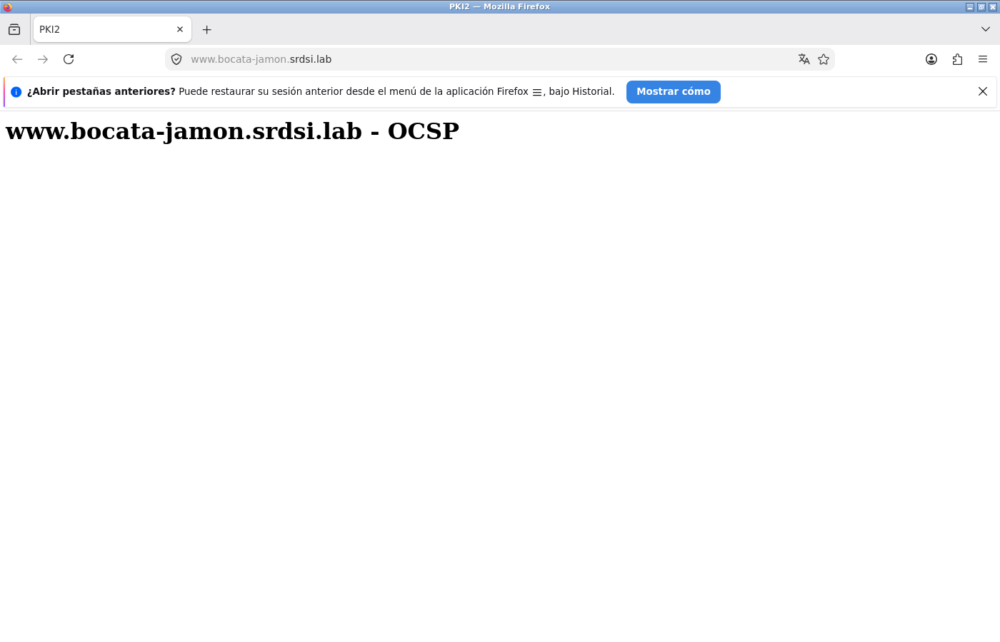
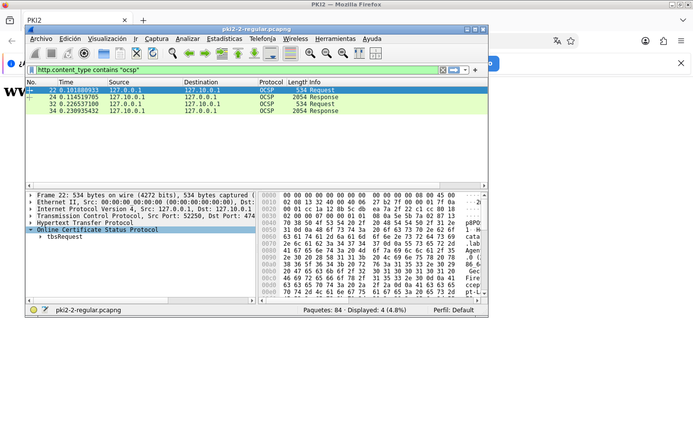
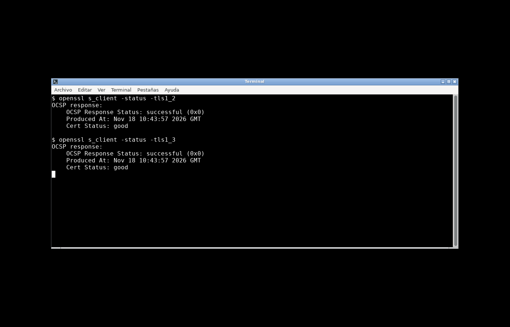
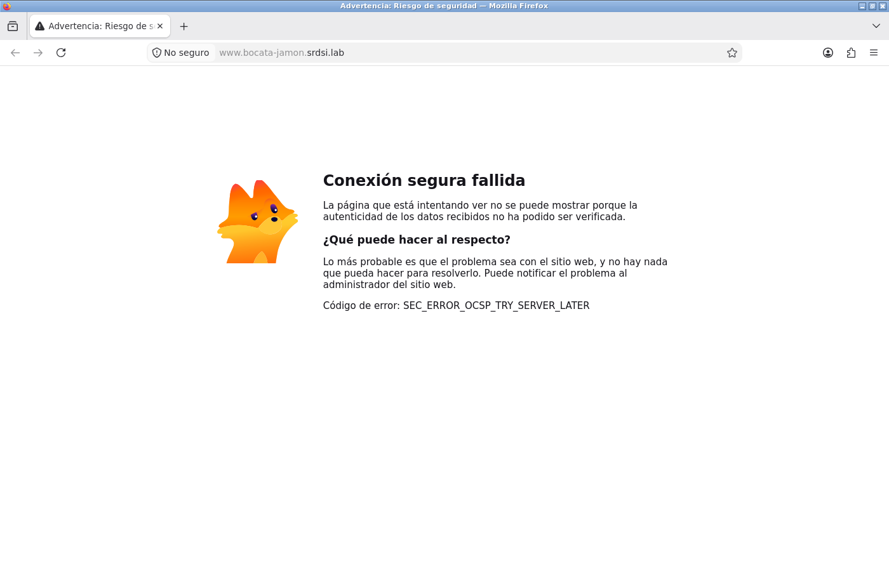
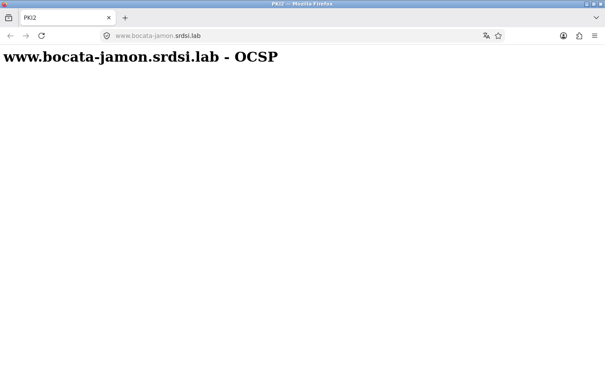
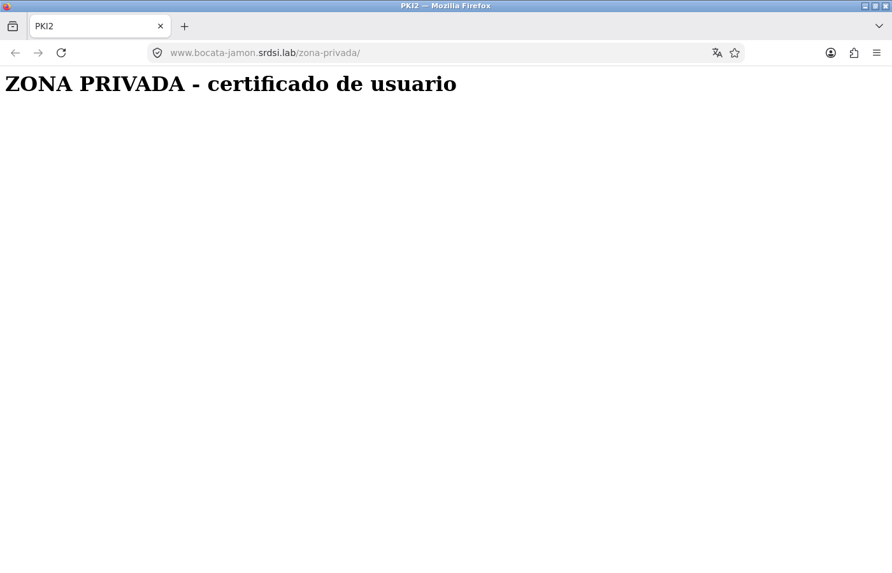
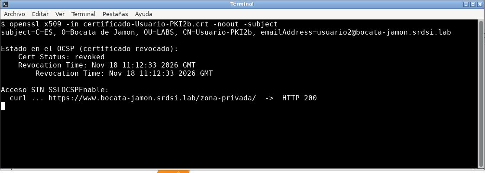
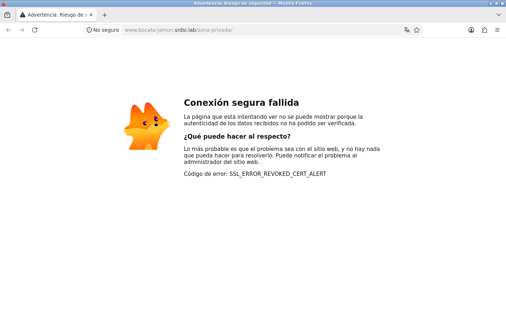

# 1. Introducción y objetivo

La primera fase de la práctica puso en marcha una PKI privada con una CA raíz y
una subCA, emitió certificados para usuarios y servicios y comprobó la
revocación con `openssl` actuando como cliente OCSP. En esta segunda fase se
configura un sitio web seguro que consulta el estado de los certificados y se
analizan los tres modos de operación de OCSP:

- **OCSP regular**: el navegador consulta directamente al respondedor.
- **OCSP stapling**: el servidor web consulta y envía la respuesta firmada en el
  *handshake* TLS.
- **OCSP Must-Staple** (RFC 7633): el certificado exige que haya *staple*.

Además se resuelve el apartado extra: la validación del certificado **del
usuario** por parte del servidor mediante OCSP.

# 2. Entorno y punto de partida

| Elemento | Valor |
| --- | --- |
| VM | Debian GNU/Linux 13 (trixie), `bocata-jamon.srdsi.lab` |
| Apache | 2.4.71 (Debian) |
| OpenSSL | 3.5.7 |
| PKI | `~/PKI_root` (raíz) y `~/PKI_root/PKI_sub` (subCA) de la fase 1 |
| Sitio web | `https://www.bocata-jamon.srdsi.lab` |
| Respondedor de la subCA | `http://ocsp.bocata-jamon.srdsi.lab:4747` |
| Respondedor de la raíz | `http://ocsp-root.bocata-jamon.srdsi.lab:4748` |

La PKI de la fase 1 conserva `index.txt`, los números de serie y los
certificados de la subCA y de firma OCSP. Para esta fase se han emitido
certificados nuevos para el sitio web y para un usuario, y se ha añadido un
respondedor para la CA raíz (apartado 7).

Resolución de nombres en la VM (`/etc/hosts`):

```text
127.0.0.1   www.bocata-jamon.srdsi.lab
127.10.0.1  ocsp.bocata-jamon.srdsi.lab
127.0.0.1   ocsp-root.bocata-jamon.srdsi.lab
127.0.0.1   subCA.bocata-jamon.srdsi.lab rootCA.bocata-jamon.srdsi.lab
```

Las URL de AIA (`CA Issuers` y `OCSP`) deben resolver y servir los
certificados de las CAs; de lo contrario el navegador puede quedarse esperando
la cadena. En la VM se publican con un *virtual host* HTTP en `/var/www/pki/`.

# 3. Respondedor OCSP

La clave del respondedor se generó cifrada con `gen_solicitud.sh`, por lo que
se pasa con `-passin`. El respondedor lee `index.txt` al arrancar: **hay que
reiniciarlo después de emitir o revocar**.

```bash
cd ~/PKI_root/PKI_sub
export OCSP_PASS='user1Sub_CA_ocsp'

openssl ocsp -port 4747 \
  -index DB/index.txt \
  -CA certificado-subCA.crt \
  -rsigner certs/certificado-ocsp.bocata-jamon.srdsi.lab.crt \
  -rkey private/clave-privada-ocsp.bocata-jamon.srdsi.lab.key \
  -passin env:OCSP_PASS \
  -text -out log-subCA.txt
```

Comprobación con el cliente de OpenSSL:

```console
$ openssl ocsp -issuer certificado-subCA.crt \
    -cert certs/certificado-www.bocata-jamon.srdsi.lab.crt \
    -CAfile certificado-subCA.crt \
    -url http://ocsp.bocata-jamon.srdsi.lab:4747 -resp_text
    OCSP Response Status: successful (0x0)
    Cert Status: good
    This Update: Nov 18 09:53:19 2026 GMT
```

# 4. Certificado del sitio web

Se emitió con la plantilla `server_ext`, que incluye SAN, AIA y los usos de
servidor:

```bash
KEY_PASS='pki2server' ./gen_solicitud.sh -t servicio \
  -n "www.bocata-jamon.srdsi.lab" \
  -d "www.bocata-jamon.srdsi.lab,bocata-jamon.srdsi.lab" \
  -e webadmin@bocata-jamon.srdsi.lab -C ES -S GP -L Donostia \
  -O "Bocata de Jamon" -U LABS -o ~/PKI_root/PKI_sub/pki2-server

CA_PASS='user1Sub_CA' ./emitir_cert.sh \
  ~/PKI_root/PKI_sub/pki2-server/solicitud-www.bocata-jamon.srdsi.lab.csr server_ext
```

```console
$ openssl x509 -in certs/certificado-www.bocata-jamon.srdsi.lab.crt \
    -noout -subject -ext subjectAltName,authorityInfoAccess
subject=C=ES, ST=GP, O=Bocata de Jamon, OU=LABS,
        CN=www.bocata-jamon.srdsi.lab, emailAddress=webadmin@bocata-jamon.srdsi.lab
X509v3 Subject Alternative Name:
    DNS:www.bocata-jamon.srdsi.lab, DNS:bocata-jamon.srdsi.lab
Authority Information Access:
    CA Issuers - URI:http://subCA.bocata-jamon.srdsi.lab/subCA.crt
    OCSP - URI:http://ocsp.bocata-jamon.srdsi.lab:4747
```

La clave se genera cifrada. Apache no puede arrancar con una clave cifrada sin
interacción (se queda esperando en `systemd-ask-password`), así que se descifra
antes de instalarla:

```bash
openssl pkey -in ~/PKI_root/PKI_sub/pki2-server/clave-privada-www.bocata-jamon.srdsi.lab.key \
  -passin pass:pki2server -out /tmp/servidor.key
sudo install -m 600 /tmp/servidor.key /etc/apache2/ssl/pki2/servidor.key
```

# 5. Ejercicio 1 — OCSP regular

## 5.1. Sin respondedor en marcha: soft-fail

Se detuvo el respondedor y se accedió al sitio con una captura de tráfico en
`lo`. El navegador intentó conectar al puerto 4747, recibió un `RST` y **mostró
la página igualmente**: es el comportamiento *soft-fail* actual.

{width=90%}

En la captura se ven los intentos de conexión al 4747 sin respuesta:

```console
$ tshark -r capturas/01-regular-sin-ocsp.pcapng -Y 'tcp.port==4747'
21  127.0.0.1 → 127.10.0.1  TCP 43630 → 4747 [SYN]
22  127.10.0.1 → 127.0.0.1  TCP 4747 → 43630 [RST, ACK]
```

Con el respondedor parado, un atacante podría bloquear el OCSP y hacer que se
acepte un certificado revocado. Es la motivación de *stapling* y Must-Staple.

## 5.2. Con el respondedor en marcha

Al arrancar el respondedor y recargar, **es el navegador** quien consulta al
OCSP. La captura muestra dos peticiones `POST` con contenido
`application/ocsp-request` y respuestas `200` con `application/ocsp-response`.

{width=90%}

```console
$ tshark -r capturas/02-regular-con-ocsp.pcapng \
    -d tcp.port==4747,http -Y 'http.request or http.response' \
    -T fields -e http.request.method -e http.response.code -e http.content_type
POST        application/ocsp-request
    200     application/ocsp-response
POST        application/ocsp-request
    200     application/ocsp-response
```

{width=90%}

## 5.3. Certificado del servidor revocado

Se revocó el certificado con `revocar_cert.sh`, se reinició el respondedor y se
volvió a acceder. El respondedor devuelve `revoked` y el navegador bloquea la
conexión:

```console
$ openssl ocsp -issuer certificado-subCA.crt \
    -cert certs/certificado-www.bocata-jamon.srdsi.lab.crt \
    -CAfile certificado-subCA.crt \
    -url http://ocsp.bocata-jamon.srdsi.lab:4747 -resp_text
    OCSP Response Status: successful (0x0)
    Cert Status: revoked
    Revocation Time: Nov 18 09:53:38 2026 GMT
```

{width=90%}

!!! nota
    El navegador guarda respuestas OCSP. Para repetir los escenarios se usó una
    ventana privada o un perfil nuevo, y se reinició el respondedor tras cada
    revocación.

# 6. Ejercicio 2 — OCSP stapling

Se activó `SSLUseStapling` y una caché `shmcb`:

```apache
SSLStaplingCache "shmcb:/var/run/apache2/ssl_stapling(32768)"

<VirtualHost *:443>
    ...
    SSLCACertificateFile /etc/apache2/ssl/pki2/cadena-cas.pem
    SSLUseStapling On
</VirtualHost>
```

Ahora **es Apache** quien consulta al respondedor; el navegador recibe la
respuesta firmada en el *handshake*. Se comprobó sin navegador con
`openssl s_client -status`, tanto en TLS 1.2 como en TLS 1.3:

{width=90%}

{width=90%}

| Pregunta | Respuesta observada |
| --- | --- |
| ¿Quién contacta con el OCSP? | Apache, no el navegador. |
| ¿Cuándo? | Al arrancar o en la primera conexión; después según la caché. La primera petición puede quedarse sin *staple*. |
| TLS 1.2 frente a TLS 1.3 | En TLS 1.2 la respuesta va en el mensaje `CertificateStatus`, tras `Certificate`. En TLS 1.3 va como extensión `status_request` dentro de la entrada de certificado del mensaje `Certificate`. En ambos casos queda cifrada. |

Al revocar el certificado del servidor y reiniciar el respondedor, el *staple*
acaba conteniendo `revoked` y el navegador rechaza la conexión. Para verlo sin
esperar a la caché se reinició Apache y se usó
`SSLStaplingResponseMaxAge 90`.

# 7. Must-Staple (RFC 7633)

Se añadió la extensión al certificado del servidor:

```ini
[server_ext]
...
tlsfeature = status_request
```

```console
$ openssl x509 -in certs-ms/certificado-www.bocata-jamon.srdsi.lab.crt -noout -text
            TLS Feature:
                status_request
```

Con el respondedor detenido, Apache no puede obtener el *staple* y el navegador
**deniega** el acceso (ya no hay *soft-fail*):

{width=90%}

Con el respondedor en marcha y el *staple* disponible, el acceso funciona:

{width=90%}

# 8. Extra E — validación del certificado de usuario

Apache valida por defecto la firma y la cadena del certificado de cliente, pero
**no consulta la revocación**. Para que lo haga se activa `SSLOCSPEnable on`.

Se emitió un certificado de usuario con `user_ext` (incluye AIA y
`clientAuth`) y se importó su `.p12` en Firefox. El sitio pide certificado solo
en la zona privada (`SSLVerifyClient optional` + `Require ssl-verify-client`).

En esta PKI, el certificado de la subCA también tiene AIA y Apache valida
**toda la cadena**, incluido el intermedio. Por eso se puso en marcha un segundo
respondedor para la raíz, que responde por la subCA:

```bash
cd ~/PKI_root
openssl ocsp -port 4748 -index DB/index.txt -CA certificado-rootCA.crt \
  -rsigner certs/certificado-ocsp-root.bocata-jamon.srdsi.lab.crt \
  -rkey ocsp-root/clave-privada-ocsp-root.bocata-jamon.srdsi.lab.key \
  -passin pass:rootocsp -text -out log-root.txt
```

```console
$ openssl ocsp -issuer certificado-rootCA.crt -cert certificado-subCA.crt \
    -CAfile certificado-rootCA.crt \
    -url http://ocsp-root.bocata-jamon.srdsi.lab:4748
    OCSP Response Status: successful (0x0)
    Cert Status: good
```

Con el usuario válido, el acceso es correcto:

{width=90%}

Tras revocar el certificado del usuario y reiniciar el respondedor:

| Configuración | Resultado | Evidencia |
| --- | --- | --- |
| Sin `SSLOCSPEnable` | **200 OK**: Apache no consulta la revocación | Captura 10 |
| Con `SSLOCSPEnable on` | **Denegado**: alerta TLS `certificate revoked` | Captura 11 y log |

{width=90%}

{width=90%}

Log de Apache:

```text
AH03239: OCSP validation completed, certificate status: good
  [subject: CN=bocata_jamon_subCA ...]
AH03239: OCSP validation completed, certificate status: good
  [subject: CN=Usuario-PKI2b ...]
AH03239: OCSP validation completed, certificate status: revoked (1, 5)
  [subject: CN=Usuario-PKI2b ...]
AH02276: Certificate Verification: Error (23): certificate revoked
```

Para aislar la validación del servidor se desactivó la comprobación OCSP del
navegador (`security.OCSP.enabled = 0`) en el perfil de esta prueba. Así el
navegador no bloquea por su cuenta la cadena del servidor y se observa
exactamente la decisión de Apache. Las capturas corresponden a la
configuración final, **sin** `SSLOCSPNoVerify`: Apache verifica la firma de la
respuesta OCSP. La captura 10 muestra la comprobación por consola del caso sin
`SSLOCSPEnable` (HTTP 200) y la 11 el rechazo en el navegador con
`SSL_ERROR_REVOKED_CERT_ALERT`.

# 9. Conclusiones

- **OCSP regular** delega la comprobación en el navegador, pero el *soft-fail*
  permite aceptar un certificado revocado si se bloquea el acceso al
  respondedor.
- **Stapling** mueve la consulta al servidor y evita esa dependencia del
  cliente, además de mejorar la privacidad y la latencia. La primera conexión
  puede no llevar *staple*.
- **Must-Staple** cierra el *soft-fail*: sin *staple* no hay conexión. Es la
  opción adecuada cuando se quiere garantizar la comprobación.
- La validación del certificado de usuario requiere `SSLOCSPEnable on`; sin esa
  directiva Apache no consulta la revocación y un usuario revocado entra.
- En una jerarquía con subCA hay que poder responder por **todos** los
  certificados de la cadena. Si el intermedio tiene AIA, se necesita un
  respondedor para la CA que lo emitió.

# 10. Anexo A — Configuraciones

Los ficheros completos están en `configs/`:

| Fichero | Uso |
| --- | --- |
| `pki2-ocsp-regular.conf` | OCSP regular. |
| `pki2-ocsp-stapling.conf` | Stapling. |
| `pki2-ocsp-must-staple.conf` | Must-Staple. |
| `pki2-usuario-ocsp.conf` | Validación OCSP del usuario (`SSLOCSPEnable on`). |
| `server-ext-must-staple.txt` | Sección `[server_ext]` con `tlsfeature`. |

# 11. Anexo B — Certificados

En `certs/` se incluyen los certificados públicos del sitio (normal y
Must-Staple), el de firma OCSP de la subCA, el de firma OCSP de la raíz, la
subCA, la raíz y el certificado de usuario. Las claves privadas no se adjuntan.

# 12. Anexo C — Capturas y evidencias

- `img/`: capturas del navegador, de Wireshark y de las comprobaciones con
  `openssl`.
- `capturas/`: ficheros `.pcapng` de los escenarios y salidas de texto
  (`evidencias.txt`, `stapling-sclient.txt`).

Comandos de reproducción:

```bash
# Respondedor de la subCA
openssl ocsp -port 4747 -index DB/index.txt -CA certificado-subCA.crt \
  -rsigner certs/certificado-ocsp.bocata-jamon.srdsi.lab.crt \
  -rkey private/clave-privada-ocsp.bocata-jamon.srdsi.lab.key \
  -passin env:OCSP_PASS -text -out log-subCA.txt

# Consulta manual
openssl ocsp -issuer certificado-subCA.crt -cert servidor.crt \
  -CAfile certificado-subCA.crt -url http://ocsp.bocata-jamon.srdsi.lab:4747 -resp_text

# Staple en el handshake
echo | openssl s_client -connect www.bocata-jamon.srdsi.lab:443 \
  -servername www.bocata-jamon.srdsi.lab -status \
  -CAfile /etc/apache2/ssl/pki2/cadena-cas.pem -tls1_2
```
