# 1. Introducción y objetivo

En esta actividad se pone en práctica **MACsec** (IEEE 802.1AE), la seguridad de la capa de enlace. El objetivo es establecer un enlace Ethernet protegido entre dos máquinas virtuales, verificar que el tráfico IP circula por él y comprobar qué ocurre cuando se activa y se desactiva el cifrado.

Tareas realizadas:

1. Preparar dos VM Debian 13 conectadas por una red L2 de VirtualBox.
2. Cargar el módulo `macsec` y crear las interfaces MACsec.
3. Configurar las asociaciones de seguridad (SA), las claves y los números de paquete.
4. Verificar la conectividad con `ping` y `ip macsec show`.
5. Capturar el tráfico con `dumpcap` y analizarlo con Wireshark/`tshark`.
6. Comparar `encrypt on` con `encrypt off`.
7. Documentar problemas, tiempos y conclusiones.

# 2. Fundamento: MACsec

**MACsec** (IEEE 802.1AE-2018) protege las tramas Ethernet entre dos extremos directamente conectados en la capa de enlace. No sustituye a TLS ni a IPsec: protege el salto local y es transparente para IP.

- **SAK** (*Secure Association Key*): clave simétrica compartida por la asociación de seguridad.
- **SCI** (*Secure Channel Identifier*): identifica el canal seguro; se construye con la MAC del sistema y el número de puerto.
- **SA** (*Secure Association*): cada dirección tiene su asociación, con un índice (0–3) y una clave.
- **PN** (*Packet Number*): contador por SA; permite detectar repeticiones y reordenaciones.
- **ICV** (*Integrity Check Value*): etiqueta de integridad calculada con AES-GCM.
- **Secure Channel**: combina una o más SAs y el SCI.

MACsec puede **autenticar** (proteger la integridad) y **cifrar** el payload. En este laboratorio se usan claves manuales; en producción lo habitual es negociarlas con **MKA** (*MACsec Key Agreement*, 802.1X/EAPOL) y una CA. Las tramas MACsec usan el EtherType **0x88e5**.

# 3. Entorno y topología

Se usaron dos VM Debian 13 sobre VirtualBox 7.2.22:

| VM | Hostname | Rol | `enp0s3` (NAT) | `enp0s8` (host-only) | `enp0s9` (NAT Network) |
|---|---|---|---|---|---|
| MV1 | `bocata-jamon` | extremo A | 10.0.2.15/24 | 192.168.56.110/24 | 10.0.3.11/24 |
| MV2 | `bocata-jamon2` | extremo B | 10.0.2.15/24 | 192.168.56.111/24 | 10.0.3.12/24 |

La red **NAT Network `macsecnet`** (10.0.3.0/24) conecta las dos VM y transporta las tramas MACsec. La red **host-only** (192.168.56.0/24) se usa para administración desde el anfitrión. La VM2 se creó como clon de la VM1; hubo que regenerar sus MAC y cambiar su IP host-only para que no chocaran.

| VM | Interfaz MACsec | MAC de `enp0s9` | IP MACsec | Clave TX | Clave RX |
|---|---|---|---|---|---|
| MV1 | `macsec0` | `08:00:27:17:ce:47` | 1.1.1.1/24 | 01 | 02 |
| MV2 | `macsec1` | `08:00:27:d1:03:ae` | 1.1.1.2/24 | 02 | 01 |

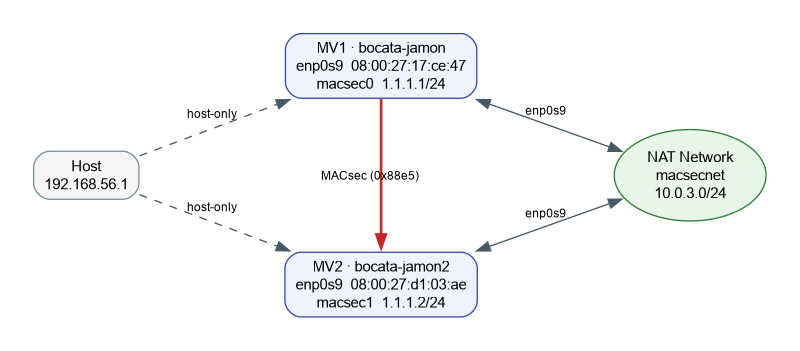{ width=95% }

# 4. Procedimiento

## 4.1. Preparar las interfaces

En ambas VM se levantó la interfaz de la NAT Network y se le asignó una IP para comprobar la conectividad antes de MACsec:

```bash
sudo ip link set enp0s9 up
sudo ip addr add 10.0.3.11/24 dev enp0s9   # MV1
sudo ip addr add 10.0.3.12/24 dev enp0s9   # MV2
ping -c 3 10.0.3.12                       # desde MV1
```

La conectividad IP funcionó en ambos sentidos.

## 4.2. Cargar el módulo MACsec

```bash
sudo modprobe macsec
lsmod | grep macsec
ip macsec help
```

El módulo `macsec` quedó cargado y `iproute2` reconoció los comandos `ip macsec`.

## 4.3. Configurar MV1

```bash
sudo ip link add link enp0s9 macsec0 type macsec encrypt on
sudo ip macsec add macsec0 tx sa 0 pn 100 on key 01 11111111111111111111111111111111
sudo ip macsec add macsec0 rx address 08:00:27:d1:03:ae port 1
sudo ip macsec add macsec0 rx address 08:00:27:d1:03:ae port 1 \
  sa 0 pn 100 on key 02 22222222222222222222222222222222
sudo ip link set dev macsec0 up
sudo ip addr add 1.1.1.1/24 dev macsec0
```

## 4.4. Configurar MV2

```bash
sudo ip link add link enp0s9 macsec1 type macsec encrypt on
sudo ip macsec add macsec1 tx sa 0 pn 100 on key 02 22222222222222222222222222222222
sudo ip macsec add macsec1 rx address 08:00:27:17:ce:47 port 1
sudo ip macsec add macsec1 rx address 08:00:27:17:ce:47 port 1 \
  sa 0 pn 100 on key 01 11111111111111111111111111111111
sudo ip link set dev macsec1 up
sudo ip addr add 1.1.1.2/24 dev macsec1
```

## 4.5. Verificar

```bash
ip macsec show
ping -c 4 1.1.1.2       # desde MV1
ping -c 4 1.1.1.1       # desde MV2
```

## 4.6. Capturar el tráfico

En MV1 se capturó la interfaz inferior `enp0s9` mientras se hacía `ping` por `macsec0`:

```bash
sudo dumpcap -i enp0s9 -w macsec-on.pcapng -a duration:6
```

La captura se analizó en el anfitrión con `tshark`/Wireshark. Para el caso sin cifrado se cambió `encrypt` a `off` en ambas VM y se repitió la captura.

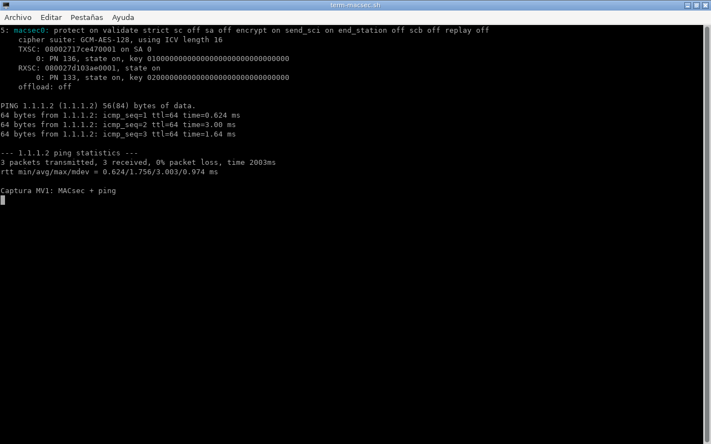{ width=92% }

# 5. Resultados

## 5.1. Estado de las interfaces

MV1:

```console
5: macsec0: protect on validate strict sc off sa off encrypt on send_sci on ...
    cipher suite: GCM-AES-128, using ICV length 16
    TXSC: 08002717ce470001 on SA 0
        0: PN 124, state on, key 01000000000000000000000000000000
    RXSC: 080027d103ae0001, state on
        0: PN 124, state on, key 02000000000000000000000000000000
    offload: off
```

MV2:

```console
5: macsec1: protect on validate strict sc off sa off encrypt on send_sci on ...
    cipher suite: GCM-AES-128, using ICV length 16
    TXSC: 080027d103ae0001 on SA 0
        0: PN 124, state on, key 02000000000000000000000000000000
    RXSC: 08002717ce470001, state on
        0: PN 124, state on, key 01000000000000000000000000000000
    offload: off
```

`ip macsec show` muestra el identificador de clave (`01`/`02`) seguido de ceros; **no imprime la clave completa**. El cifrado es `GCM-AES-128`, el ICV ocupa 16 bytes y el modo `offload: off` indica que el cifrado lo hace el software del kernel, no la NIC virtual.

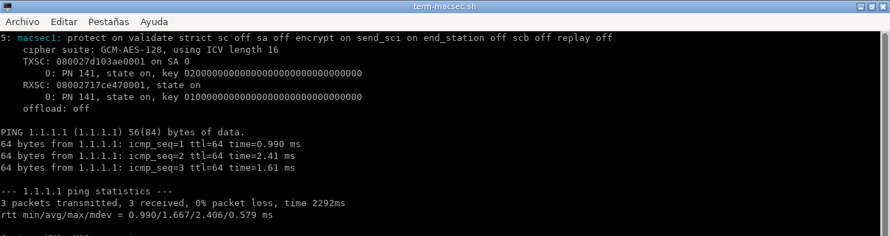{ width=92% }

## 5.2. Conectividad

```console
$ ping -c 4 1.1.1.2
PING 1.1.1.2 (1.1.1.2) 56(84) bytes of data.
64 bytes from 1.1.1.2: icmp_seq=1 ttl=64 time=0.383 ms
64 bytes from 1.1.1.2: icmp_seq=2 ttl=64 time=0.893 ms
64 bytes from 1.1.1.2: icmp_seq=3 ttl=64 time=0.593 ms
64 bytes from 1.1.1.2: icmp_seq=4 ttl=64 time=0.735 ms

--- 1.1.1.2 ping statistics ---
4 packets transmitted, 4 received, 0% packet loss, time 3076ms
rtt min/avg/max/mdev = 0.383/0.651/0.893/0.187 ms
```

## 5.3. Captura con `encrypt on`

`tshark` identifica las tramas como **MACSEC**, con EtherType `0x88e5`:

```console
1  08:00:27:17:ce:47  08:00:27:d1:03:ae  0x88e5  MACSEC  MACsec frame [UNVERIFIED]
2  08:00:27:d1:03:ae  08:00:27:17:ce:47  0x88e5  MACSEC  MACsec frame [UNVERIFIED]
...
```

En el detalle aparece la cabecera **802.1AE Security tag** y un **ICV** de 16 bytes. El payload se muestra como `Data`: está cifrado.

```console
Frame 1: 130 bytes on wire ...
Ethernet II, Src: 08:00:27:17:ce:47, Dst: 08:00:27:d1:03:ae
    Type: 802.1AE (MACsec) (0x88e5)
802.1AE Security tag
Data (86 bytes)
    ICV: 41d299da836f0e9cc3e69b161c8bb628
```

Wireshark marca las tramas como `[UNVERIFIED]` porque no le hemos proporcionado la SAK. La cabecera MACsec y el ICV se ven, pero la integridad y el contenido no se pueden verificar/descifrar sin la clave.

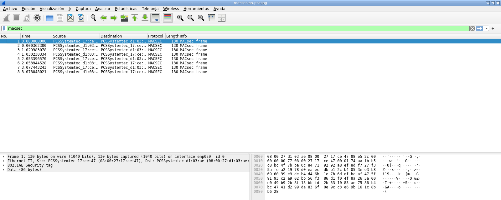{ width=100% }

## 5.4. Captura con `encrypt off`

Al desactivar el cifrado en ambos extremos, MACsec sigue autenticando, pero el payload viaja en claro. `tshark` ya puede interpretar el paquete interior:

```console
1  08:00:27:d1:03:ae  33:33:00:00:00:16  0x88e5  ICMPv6  Multicast Listener Report ...
2  08:00:27:17:ce:47  08:00:27:d1:03:ae  0x88e5  ICMP    Echo (ping) request ...
3  08:00:27:d1:03:ae  08:00:27:17:ce:47  0x88e5  ICMP    Echo (ping) reply ...
```

El detalle muestra la secuencia `eth:ethertype:macsec:ethertype:ipv6:icmpv6`: MACsec sigue presente, pero el contenido es visible.

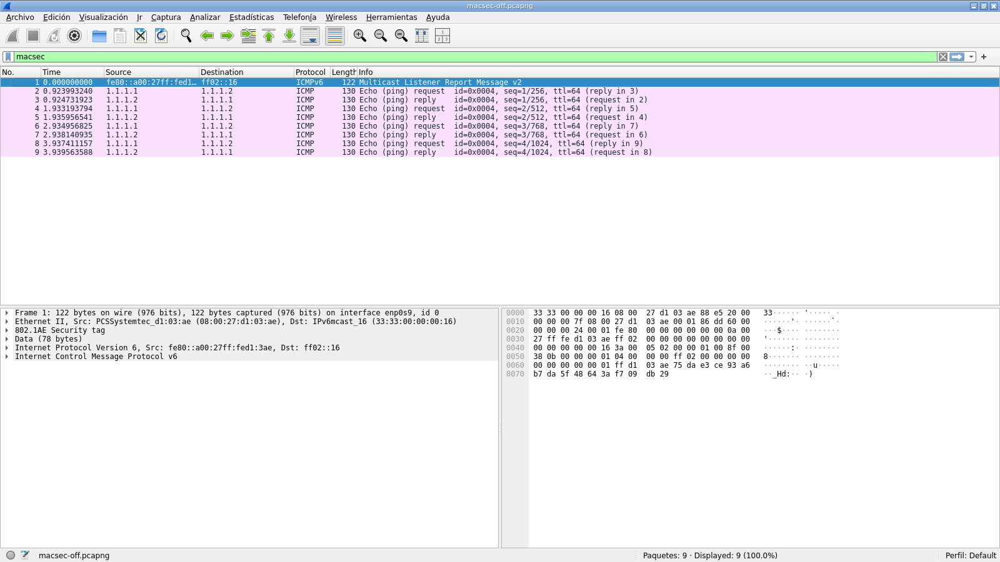{ width=100% }

## 5.5. Comparación

| Prueba | `encrypt on` | `encrypt off` |
|---|---|---|
| EtherType | `0x88e5` | `0x88e5` |
| Cabecera MACsec | Sí | Sí |
| ICV | Sí | Sí |
| Payload visible en Wireshark | No (`Data`) | Sí (ICMP/ICMPv6) |
| Ping | Correcto | Correcto |
| Confidencialidad | Sí | **No** |
| Integridad/autenticación | Sí | Sí |

# 6. Ataques de enlace y Wireshark

## 6.1. Montaje del atacante

Para las pruebas de ataque se añadió a MV1 una segunda interfaz (`enp0s10`) en la misma NAT Network `macsecnet`, con IP 10.0.3.99/24 y MAC `08:00:27:72:b5:6f`. El atacante **no tiene la SAK** de MACsec; para el ARP spoofing usa una MAC falsa (`02:00:00:00:00:01`) y actúa como *blackhole*.

Herramientas: Scapy 2.6.1 (`arp-spoof.py`, `mac-flood.py`, `replay.py`, `forge-icv.py`), `arping`, `dumpcap` y `tshark`. Todo se ejecutó en la red aislada; al terminar cada prueba se paró el atacante, se restauraron las cachés ARP y se dejó MACsec de nuevo operativo.

## 6.2. ARP spoofing contra la red no protegida

El atacante envió ARP replies a MV2 (10.0.3.12) diciendo que 10.0.3.11 (MV1) estaba en la MAC falsa `02:00:00:00:00:01`.

```console
# MV2 antes
10.0.3.11 dev enp0s9 lladdr 08:00:27:17:ce:47 REACHABLE

# MV2 después
10.0.3.11 dev enp0s9 lladdr 02:00:00:00:00:01 REACHABLE
```

El efecto fue inmediato: el ping a 10.0.3.11 perdió el 100% de los paquetes, mientras que el ping por MACsec a 1.1.1.1 siguió funcionando.

```console
$ ping -c 3 10.0.3.11
3 packets transmitted, 0 received, 100% packet loss

$ ping -c 3 1.1.1.1
3 packets transmitted, 3 received, 0% packet loss
```

La captura `arp-spoof-victim.pcapng` muestra las tramas ARP (`0x0806`) del atacante intercaladas con las tramas MACsec (`0x88e5`) legítimas. Es un ejemplo claro de que **MACsec protege el tráfico de 1.1.1.x, pero no la red de gestión 10.0.3.x**.

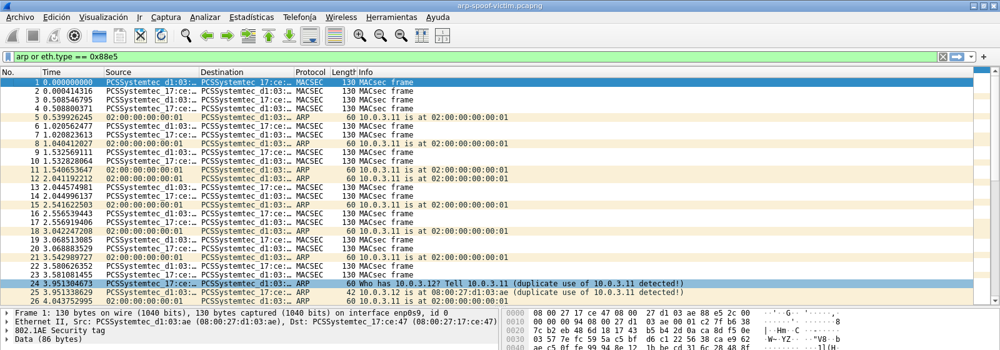{ width=100% }

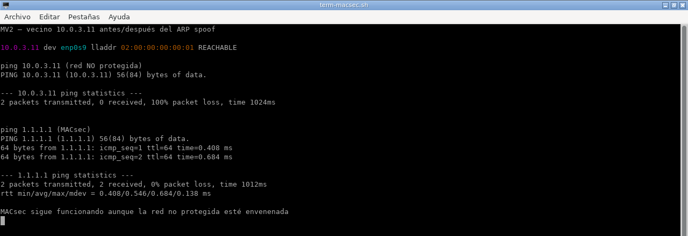{ width=95% }

> La puerta de enlace 10.0.3.1 tenía una entrada ARP **PERMANENTE**; por eso el ataque se dirigió a la entrada dinámica de 10.0.3.11. Es un detalle importante: una entrada estática o permanente no se puede envenenar con ARP.

## 6.3. ARP spoofing contra la IP protegida por MACsec

Se repitió el ataque contra 1.1.1.2, enviando ARP replies a MV1 con `psrc=1.1.1.2` y MAC falsa `02:00:00:00:00:02`. Las tramas llegaron a `enp0s9` (se ven en `arp-spoof-macsec.pcapng`), pero la entrada de vecino de MV1 siguió apuntando a `macsec0` y a la MAC real de MV2:

```console
$ ip neigh show 1.1.1.2
1.1.1.2 dev macsec0 lladdr 08:00:27:d1:03:ae REACHABLE

$ ping -c 3 1.1.1.2
3 packets transmitted, 3 received, 0% packet loss
```

El ARP legítimo de 1.1.1.x viaja **dentro** de MACsec. El atacante no tiene la SAK y no puede fabricar una trama MACsec válida; un ARP plano en `enp0s9` no modifica la entrada de `macsec0`.

## 6.4. MAC flooding

Se enviaron 800 tramas con MAC de origen aleatoria desde `enp0s10`. En MV2 se capturaron 272 tramas: 233 MAC de origen distintas, 230 UDP, 34 MACsec y 8 ARP. El ping por MACsec siguió funcionando (16/16).

```console
$ ping -c 16 -i 0.5 1.1.1.1
16 packets transmitted, 16 received, 0% packet loss
```

La NAT Network de VirtualBox no mostró una caída visible del servicio; su comportamiento no equivale al de un switch físico con tabla CAM. El valor de la prueba está en identificar el patrón de flooding y en la defensa: **port security**, VLANs y MACsec. La captura `mac-flood.pcapng` permite ver las MAC aleatorias y la convivencia con el tráfico MACsec.

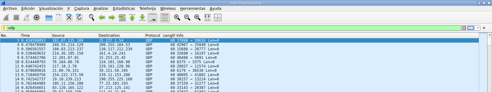{ width=100% }

## 6.5. Trama MACsec con ICV alterado

Se capturó una trama MACsec válida (PN 184), se modificó un byte antes del ICV y se reenviaron tres copias. En MV2 se capturaron las tres tramas (`forged-icv4.pcapng`) y **no hubo respuesta**; además, las estadísticas de `macsec1` pasaron de 3 a 6 errores RX.

| Prueba | RX errors | Respuestas |
| --- | ---: | ---: |
| Antes de las tramas alteradas | 3 | — |
| Después de 3 tramas con ICV alterado | 6 | 0 |
| Control: trama válida PN 187 | — | 1 (reply PN 193) |

La trama de control sí obtuvo respuesta, lo que confirma que el fallo es de la trama alterada y no del entorno. MACsec detecta la modificación y descarta la trama: **la integridad y la autenticación funcionan**.

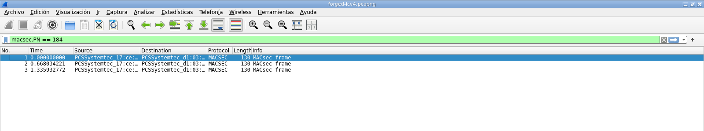{ width=100% }

## 6.6. Replay

Con `replay on window 0`, se capturó una trama válida (PN 105), se avanzó el PN con pings y se reenvió la trama antigua tres veces. En MV2 se vieron las tres copias (PN 105) y **ninguna respuesta**; las estadísticas pasaron de 0 a 3 descartes.

```console
# replay on
RX:  bytes packets errors dropped  missed   mcast
      1260      14      0       3       0       0
```

Con `replay off`, el mismo experimento (PN 104) sí obtuvo respuestas: las tramas reenviadas aparecen junto a replies con PN 117 y 118.

```console
# replay off
RX:  bytes packets errors dropped  missed   mcast
      1554      17      0       0       0       0
```

| Configuración | Replays enviados | Descartes RX | Respuestas |
| --- | ---: | ---: | ---: |
| `replay on window 0` | 3 | 3 | 0 |
| `replay off` | 3 | 0 | Sí (PN 117/118) |

La conclusión es importante: **la protección contra replay no está activa por defecto** en nuestra configuración manual; hay que activarla explícitamente. Con `replay on`, una trama antigua se descarta por PN repetido.

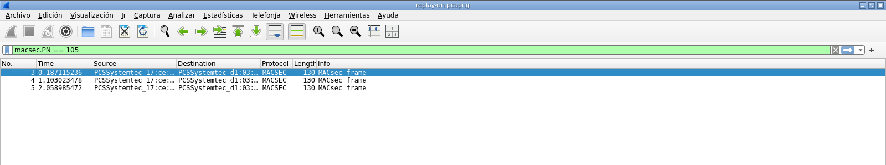{ width=95% }

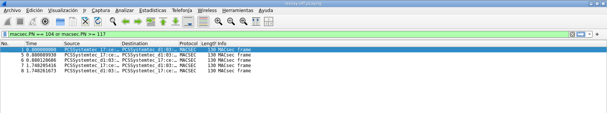{ width=95% }

## 6.7. Wireshark: qué buscar

| Concepto | Campo / filtro | Dónde se ve |
| --- | --- | --- |
| MACsec / 802.1AE | `eth.type == 0x88e5`, `macsec` | Columna Protocol y detalle Ethernet |
| SecTAG | `macsec.TCI`, `macsec.AN`, `macsec.SL` | Árbol 802.1AE Security Tag |
| Cifrado | `macsec.TCI.E` | Bit E del TCI |
| Texto cambiado | `macsec.TCI.C` | Bit C del TCI |
| SCI | `macsec.SCI` | SCI = MAC + puerto |
| PN | `macsec.PN` | Packet number |
| ICV | `macsec.ICV` | Últimos 16 bytes |
| EtherType interior | `macsec.etype` | Solo con `encrypt off` |
| Verificación | `macsec.verify_info.verified` | `False` sin SAK |
| ARP | `arp` | Tráfico de enlace no protegido o interior con `encrypt off` |
| MKA/EAPOL | `eapol` | Vacío con claves manuales |

Valores observados:

- TCI `0x0b` con `encrypt on` (`SC,E,C`); TCI `0x08` con `encrypt off` (`SC`).
- SCI MV1 `08002717ce470001`; SCI MV2 `080027d103ae0001`.
- PN 119–122 en la captura original; PN 184/187 en las pruebas de forja.
- ICV distinto en cada trama.

Preguntas y respuestas:

1. **¿Qué MAC y puerto forman el SCI de MV1?** `08:00:27:17:ce:47`, puerto 1.
2. **¿Qué bits del TCI cambian con `encrypt off`?** Se apagan `E` y `C`; queda `SC`. Pasa de `0x0b` a `0x08`.
3. **¿Dónde está el PN y cómo cambia?** En `macsec.PN`; aumenta por SCI y sirve para detectar repeticiones.
4. **¿Por qué Wireshark marca `[UNVERIFIED]`?** Porque no tiene la SAK; no significa que MACsec falle.
5. **¿Qué diferencia hay entre `Data` e `ICMP`?** `Data` es payload cifrado; `ICMP` aparece cuando `encrypt off` y el payload es visible.
6. **¿Por qué no se ve ARP con cifrado activo?** Porque el ARP de 1.1.1.x viaja dentro de MACsec; solo se ve el EtherType `0x88e5`.
7. **¿Qué pasa si cambias la clave RX?** El ICV no valida; el receptor descarta las tramas y el ping falla.
8. **¿Qué pasa con una trama de PN antiguo?** Con `replay on` se descarta; con `replay off` se acepta y puede generar respuesta.
9. **¿Qué metadatos siguen visibles?** MAC de origen/destino, SCI, PN, tamaños y tiempos; MACsec no da anonimato.
10. **¿Por qué no hay MKA/EAPOL?** Porque se usan claves manuales; en producción MKA/802.1X negociaría las SAK.

# 7. Problemas y soluciones

- **La VM clonada tenía las mismas MAC e IP que la original.** Si se arrancaban las dos, la red host-only entraba en conflicto. Se regeneraron las MAC de la VM2 y se le asignó `192.168.56.111`. Para el primer arranque se desconectó su host-only y se usó un *port forward* NAT `localhost:2222 -> 22`; después se reconectó la host-only.
- **El PDF de la actividad usa `enp0s3` y nombres como `ens33`.** En este entorno `enp0s3` es la NAT (10.0.2.15), que no conecta las dos VM. Se usó `enp0s9`, la interfaz de la NAT Network `macsecnet`. La NAT Network sí transportó el EtherType `0x88e5` en esta prueba; si no lo hiciera, la alternativa sería una **Internal Network**.
- **`tcpdump` no estaba instalado en las VM.** Se usó `dumpcap`, que ya venía con Wireshark, y el análisis se hizo con `tshark` en el anfitrión.
- **`ifconfig` no es necesario.** Se usó `ip addr add`, que es la herramienta actual de `iproute2`.
- **Wireshark muestra `[UNVERIFIED]`.** Es esperado: MACsec usa una SAK que no hemos configurado en Wireshark. Para verificarlo/descifrarlo habría que usar MKA o proporcionar la clave al disector.
- **`ip macsec show` no muestra la clave completa.** Muestra el ID de clave y ceros; la clave real no se imprime por seguridad.
- **El cifrado es software (`offload: off`).** La NIC virtual no ofrece offload MACsec; el kernel cifra y autentica las tramas.
- **La puerta de enlace 10.0.3.1 tenía ARP PERMANENTE.** El ARP spoofing no la modificó; la prueba se dirigió a la entrada dinámica de 10.0.3.11. Es una lección: las entradas estáticas/permanentes no se envenenan.
- **El atacante necesita una interfaz propia en la misma L2.** Se añadió `enp0s10` a MV1 en `macsecnet`; no se usó `enp0s9` para no interferir con MACsec. Una macvlan sobre `enp0s9` no se puede crear mientras existe `macsec0`.
- **El MAC flooding no tumbó la NAT Network.** Se enviaron 800 tramas y se capturaron 272 (233 MAC únicas); el switch virtual no equivale a un switch físico. MACsec siguió funcionando. Se documenta el resultado real, sin exagerarlo.
- **La trama forjada se detecta por ICV.** Las 3 copias alteradas no obtuvieron respuesta y `macsec1` pasó de 3 a 6 errores RX; una trama de control válida sí obtuvo reply.
- **El replay solo se detiene con `replay on`.** Con `replay on window 0` los 3 replays se descartaron (dropped 0 -> 3); con `replay off` se aceptaron y generaron replies.
- **Limpieza:** tras cada prueba se paró el atacante, se restauró la caché ARP (`ip neigh replace`/`del`) y se volvió a dejar MACsec operativo.

# 8. Tiempo dedicado

| Tarea | Tiempo |
|---|---|
| Preparación y clonado de las VM | 30 min |
| Configuración de red y MACsec | 25 min |
| Pruebas, capturas y análisis | 20 min |
| Ataques de enlace y análisis Wireshark | 90 min |
| Redacción del informe | 60 min |
| Documentación del sitio | 30 min |
| **Total** | **4 h 15 min** |

# 9. Conclusiones

MACsec permite proteger el enlace Ethernet sin cambiar las aplicaciones ni la configuración IP. En el laboratorio se comprobó que:

- Las dos VM se comunican por `macsec0`/`macsec1` con `ping`.
- Las tramas usan EtherType `0x88e5` y llevan cabecera 802.1AE e ICV.
- Con `encrypt on`, el payload está cifrado y Wireshark solo muestra `Data`.
- Con `encrypt off`, MACsec sigue autenticando pero el payload es visible.
- La clave, el SCI y el PN son los elementos que identifican y protegen cada asociación.
- El ARP spoofing funciona contra la red no protegida 10.0.3.x (caché envenenada y ping perdido), pero **no** contra la IP 1.1.1.x protegida por MACsec.
- El MAC flooding genera mucho tráfico con MAC aleatorias, pero no interrumpe el tráfico MACsec en esta red virtual.
- Una trama con ICV alterado se descarta (errores RX) y no obtiene respuesta.
- El replay se descarta solo si `replay on` está activo; con `replay off` la trama antigua se acepta.
- MACsec no oculta los metadatos (MAC, SCI, PN, tamaños, tiempos) ni sustituye a MKA/802.1X para la gestión de claves.

Como limitaciones, se usaron claves manuales y una red virtual de VirtualBox; en un despliegue real se usaría **MKA/802.1X** para negociar las claves y, si la NIC lo permite, *offload* hardware. También conviene recordar que MACsec protege el enlace, no el extremo a extremo: para eso siguen siendo necesarios TLS, IPsec u otras capas.

# 10. Referencias

1. IEEE 802.1AE-2018, *MAC Security*.
2. `man ip-macsec` y documentación de `iproute2`.
3. Documentación del módulo `macsec` del kernel Linux.
4. Wireshark: disección de MACsec y preferencia `macsec.mka`.
5. Enunciado `Lab_macsec_comandos.pdf` de la asignatura.
6. Transparencias `SRDSI_T2-5_parcial.pdf`, apartado 2.5 (Nivel de enlace).
7. Scapy: <https://scapy.readthedocs.io/>
8. `arping(8)`, `ip-neigh(8)` y `ip-macsec(8)`.
9. IEEE 802.1X-REV/MKA y 802.1AE para la gestión de asociaciones MACsec.
