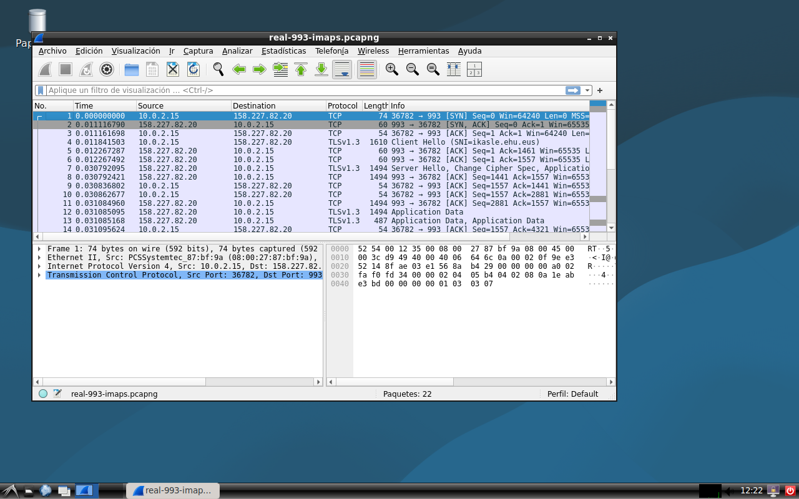
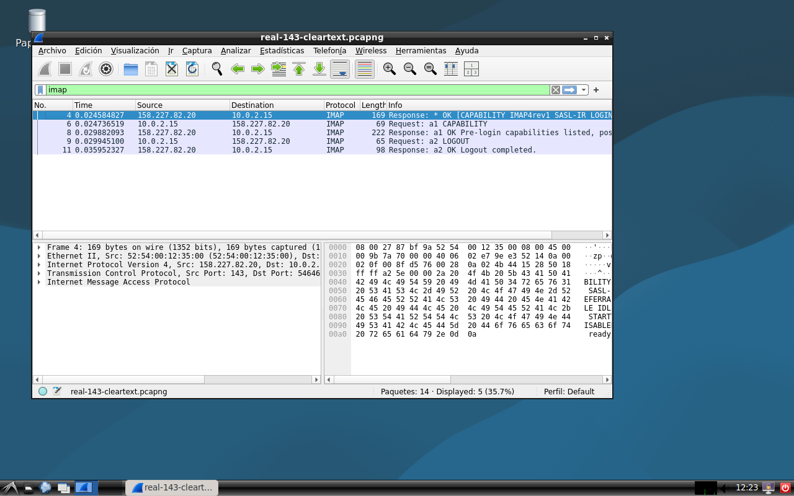
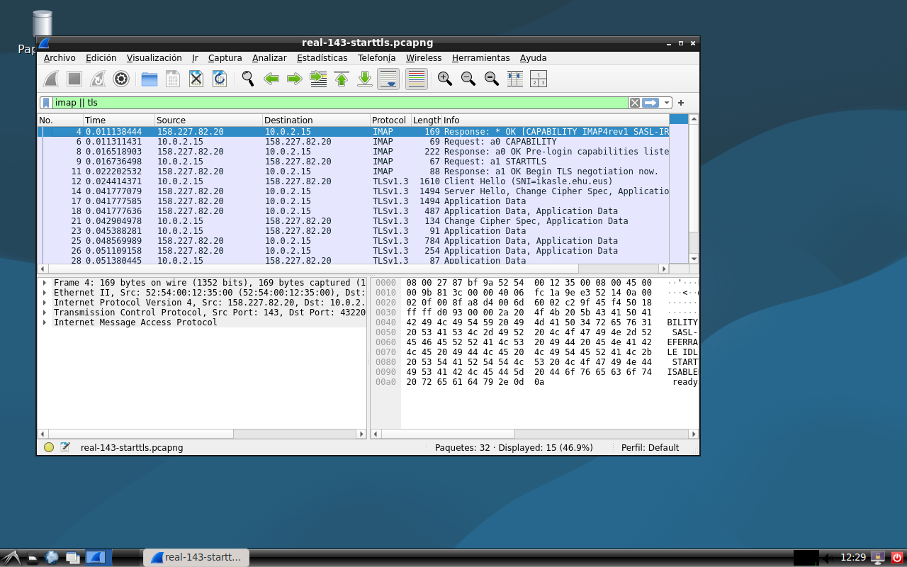

# 1. Objetivo

Estudiar las mejoras de seguridad de IMAPv4 (extensiones y autenticación), comprobar cómo se establecen conexiones seguras y analizar con Wireshark las diferencias entre los modos: texto claro, STARTTLS e IMAPS.

# 2. Seguridad en IMAPv4

IMAP4rev1 (RFC 3501) nació sin cifrado ni autenticación fuerte. Las mejoras posteriores se apoyan en **SASL** (RFC 4422) y **TLS**:

- **STARTTLS**: permite pasar de una conexión en claro a TLS en el mismo puerto 143.
- **LOGINDISABLED**: el servidor anuncia que no acepta `LOGIN` en claro; obliga a usar TLS antes de autenticarse.
- **SASL-IR** (RFC 4959): el cliente envía la respuesta inicial SASL en el mismo comando, sin un viaje extra.
- **AUTH=... / AUTHENTICATE**: mecanismos SASL. `PLAIN` y `LOGIN` solo son aceptables sobre TLS; `CRAM-MD5` (RFC 2195) evita enviar la contraseña, pero no cifra el canal; `SCRAM-SHA-256` (RFC 7677) añade sal, reto mutuo y *channel binding*; `OAUTHBEARER`/`XOAUTH2` usan tokens.
- **IMAP4rev2** (RFC 9051) recomienda TLS 1.2 o superior y penaliza la autenticación en claro.

Para la conexión segura hay dos modos:

| Modo | Puerto | Cuándo se cifra |
|---|---|---|
| **IMAPS** (TLS implícito) | 993 | Desde el primer byte de la conexión. |
| **IMAP + STARTTLS** | 143 | Tras el saludo y el comando `STARTTLS`. |

En ambos casos el cliente debe **validar el certificado** (cadena, fechas, nombre/SAN) y usar TLS 1.2/1.3 con cifrados fuertes. STARTTLS exige confiar en el `CAPABILITY` previo al cifrado y comprobar que no ha habido *downgrade*.

# 3. Metodología

Todas las capturas se han realizado en la VM `bocata-jamon` (Debian 13, IP 10.0.2.15) con **Wireshark** y `dumpcap`, contra el servidor IMAP real de la UPV/EHU:

- **Servidor**: `ikasle.ehu.eus` (158.227.82.20), puertos 143 y 993.
- No se han enviado credenciales reales: solo saludo, `CAPABILITY`, `STARTTLS` y un intento de `LOGIN` con credenciales ficticias.

Las capturas `.pcapng` se guardan junto al informe.

# 4. Capturas y análisis

## 4.1. IMAPS (TLS implícito, puerto 993)

{ width=95% }

La primera aplicación que aparece ya es `Client Hello` con **SNI=ikasle.ehu.eus**. El servidor responde `Server Hello` y todo lo demás es `Application Data`. No se ve ni el saludo IMAP ni el usuario: el canal está cifrado desde el inicio. El certificado es `CN=*.ehu.eus`, emitido por GEANT TLS RSA 1 y válido; la negociación es **TLS 1.3 / TLS_AES_256_GCM_SHA384**.

## 4.2. IMAP en claro (puerto 143): LOGINDISABLED

{ width=95% }

El saludo y `CAPABILITY` viajan en claro y son legibles: `IMAP4rev1 SASL-IR ... STARTTLS LOGINDISABLED`. El servidor **no permite autenticarse sin TLS**. Al intentar `LOGIN` en claro responde:

```text
* BAD [ALERT] Plaintext authentication not allowed without SSL/TLS,
  but your client did it anyway. If anyone was listening,
  the password was exposed.
a1 NO [PRIVACYREQUIRED] Plaintext authentication disallowed
  on non-secure (SSL/TLS) connections.
```

Es decir, el texto claro sigue existiendo, pero la autenticación está bloqueada.

## 4.3. IMAP + STARTTLS (puerto 143)

{ width=95% }

El cliente pide `CAPABILITY`, envía `STARTTLS`, el servidor responde `OK Begin TLS negotiation now` y a partir de ahí aparecen `Client Hello` (con **SNI=ikasle.ehu.eus**), `Server Hello` y `Application Data`. La transición es correcta y se negocia **TLS 1.3**. El tramo inicial (saludo y capacidades) sigue siendo manipulable: un atacante podría intentar eliminar `STARTTLS` de la lista de capacidades. Por eso el cliente debe **exigir** TLS y no aceptar un `CAPABILITY` sin `STARTTLS`.

# 5. Conclusiones

- **IMAPS (993)** es el modo más seguro: no hay ningún tramo en claro.
- **STARTTLS (143)** cifra tras el saludo, pero el tramo inicial es atacable; hay que forzar TLS y validar el certificado.
- Sin TLS, `LOGIN` viajaría en claro: el servidor lo evita con `LOGINDISABLED` y responde `NO [PRIVACYREQUIRED]`.
- **LOGINDISABLED** rechaza la autenticación insegura, pero no sustituye al cifrado del canal.
- La autenticación debe combinar **TLS + SASL** (preferiblemente `SCRAM-SHA-256` u OAuth) y no confiar nunca en el `CAPABILITY` previo a TLS.
