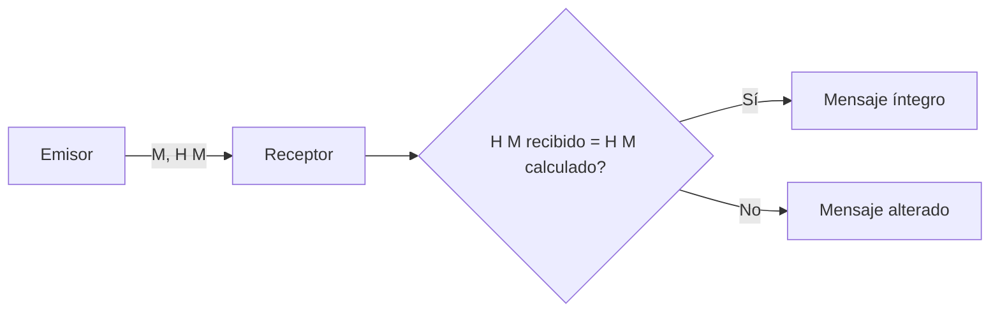
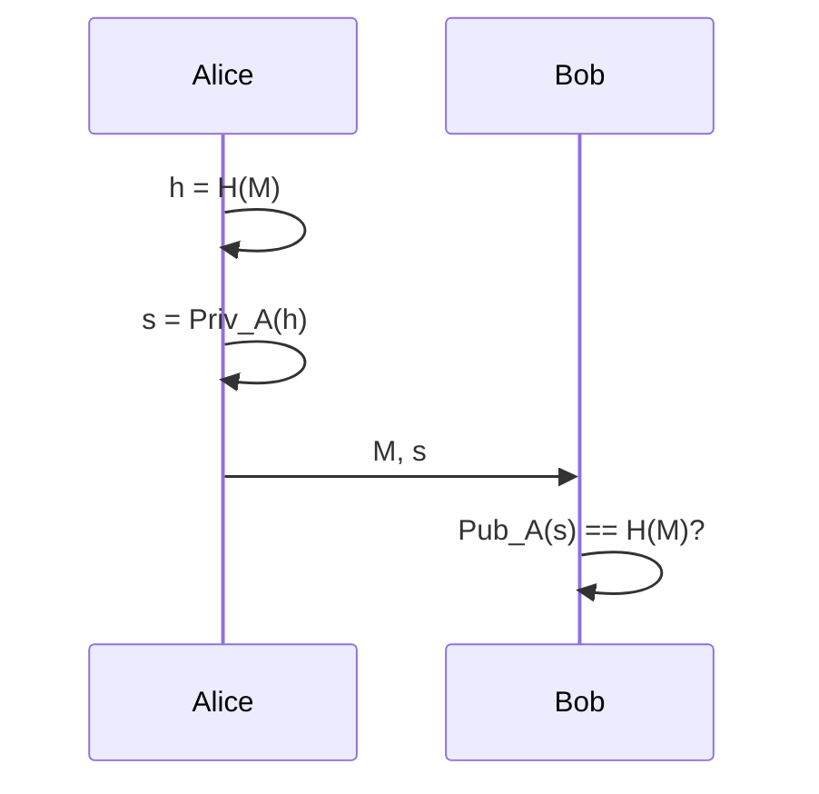
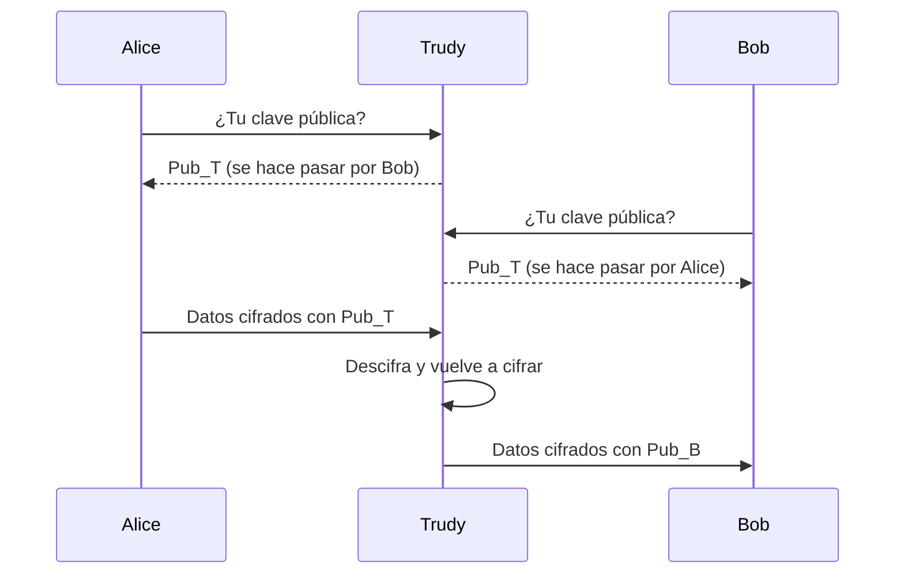

# Comunicación segura

Una comunicación segura combina primitivas criptográficas dentro de protocolos con un objetivo concreto: confidencialidad, integridad, autenticación y no repudio. No basta con usar un algoritmo fuerte si el protocolo que lo rodea es vulnerable.

[:material-file-pdf-box: Transparencias — Características de una comunicación segura (PDF)](../../assets/pdf/SRDSI_T1-3.pdf){ .md-button }

## Protocolos criptográficos ([p. 7](../../assets/pdf/SRDSI_T1-3.pdf#page=7))

Un **algoritmo criptográfico** transforma datos de entrada en datos de salida; por sí solo no basta si no se integra en un contexto semántico. Un **protocolo criptográfico** es un procedimiento con pasos de procesamiento e intercambios de mensajes entre entidades para alcanzar un objetivo de seguridad específico.

## Confidencialidad

Protocolo básico:

1. Generar u obtener la clave.
2. Cifrar el mensaje y obtener el criptograma.
3. Enviar o almacenar el criptograma.
4. Descifrar el criptograma.

Con criptografía simétrica, \(C = Sim_{K_{AB}}(M)\) y \(M = Sim_{K_{AB}}(C)\). Con asimétrica, \(C = Pub_B(M)\) y \(M = Priv_B(C)\).

## Integridad

El emisor calcula el resumen del mensaje y lo envía junto al mensaje; el receptor recalcula el resumen y lo compara:

El hash por sí solo no autentica el origen: un atacante podría modificar el mensaje y su resumen. Para autenticar hacen falta una clave compartida (MAC) o una firma digital.

## No repudio ([p. 15](../../assets/pdf/SRDSI_T1-3.pdf#page=15))

- **No repudio en origen**: el emisor no puede negar que envió el mensaje, porque el receptor tiene una prueba creada por el propio emisor.
- **No repudio en destino**: el receptor no puede negar que recibió el mensaje, porque el emisor tiene una prueba creada por el receptor (por ejemplo, un acuse de recibo firmado y datado).

Se garantiza mediante **firmas digitales**.

## Firma digital ([p. 16](../../assets/pdf/SRDSI_T1-3.pdf#page=16))

Permite al receptor validar la autenticidad del origen y la integridad del mensaje, y al emisor le impide negar la autoría. Tiene el mismo propósito que una firma manuscrita y **solo es posible con criptografía asimétrica**. Los protocolos de firma (DSS) comprenden siempre dos procesos: **generación** y **verificación**.

El protocolo básico puede firmar el mensaje directamente o, mejor, su resumen: \(C = [M, Priv_A(H(M))]\). Requisito imprescindible: **validar la clave pública** \(Pub_A\).

| Algoritmo | Notas |
| --- | --- |
| **RSA** (RFC 8017) | Firma con la clave privada y se verifica con la pública. |
| **DSA** | Definido en FIPS 186; FIPS 186-5 lo declara obsoleto y solo permite verificar firmas antiguas. |
| **ECDSA** (RFC 6979) | Firma sobre curvas elípticas. |
| **EdDSA** (RFC 8032) | Variante sobre curvas de Edwards. |

NIST advierte de que estos algoritmos no resisten a un ordenador cuántico a gran escala; los estándares post-cuánticos se publicarán aparte.

## Autenticación ([p. 29](../../assets/pdf/SRDSI_T1-3.pdf#page=29))

Verifica la identidad de una persona o entidad con uno o varios factores:

- **Lo que sabe**: contraseña, PIN.
- **Lo que tiene**: tarjeta, token, móvil.
- **Quién es o hace**: huella, voz, firma.
- **Dónde está**: dirección IP de origen.

En los protocolos **desafío-respuesta** (*challenge-response*) el password no viaja en claro: participa en un cálculo junto con el desafío. Un **nonce** es un número que el protocolo utiliza una sola vez. En la autenticación criptográfica, la entidad demuestra el conocimiento de su clave.

## Protocolos fallidos y ataque de intermediario ([p. 30](../../assets/pdf/SRDSI_T1-3.pdf#page=30))

Las transparencias muestran varios protocolos de autenticación fallidos: no basta con un intercambio simple de identificadores o con confiar en una clave pública sin autenticarla. Dos lecciones:

- Un desafío-respuesta mal construido puede reutilizarse o no vincularse a la sesión.
- La autenticación mutua basada en claves públicas exige validar que \(Pub_B\) pertenece realmente a Bob.

En el **ataque de intermediario** (*Man in the Middle*, MiM), Trudy se coloca entre Alice y Bob, presenta su propia clave a cada uno y descifra y reenvía el tráfico. Alice cree hablar con Bob y Bob con Alice, pero ambos hablan con Trudy.

La defensa pasa por **autenticar la clave pública**: certificados, firmas o un canal previo de confianza. Este problema se retoma en la gestión de claves.

## Ideas clave para el examen

- Algoritmo y protocolo no son lo mismo: el protocolo define pasos y mensajes.
- Integridad sin clave no autentica el origen; para eso se usa MAC o firma.
- El no repudio se apoya en la firma digital, no en un hash ni en un MAC.
- La firma se genera con la clave privada y se verifica con la pública.
- DSA está obsoleto en FIPS 186-5; RSA, ECDSA y EdDSA siguen siendo los referentes clásicos.
- La autenticación puede combinar factores; el nonce evita reutilización.
- Sin validar la clave pública, el protocolo cae ante un MiM.

## Actividades relacionadas

- [GnuPG: confidencialidad, integridad y firma](../actividades/gnupg.md)
- [Comandos de GnuPG](../comandos/gpg.md)
- [Gestión de claves y PKI](gestion-claves.md)
- [Transparencias completas del bloque](../../assets/pdf/SRDSI_T1-3.pdf)
