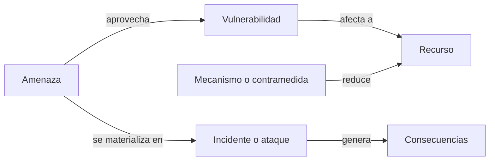

# Conceptos y amenazas

La seguridad informática no consiste en eliminar todo riesgo, sino en conocer qué protegemos, frente a quién y con qué garantías. Este bloque fija el vocabulario que se reutiliza en el resto del tema: servicios de seguridad, amenazas, vulnerabilidades, riesgos y los modelos de defensa habituales.

[:material-file-pdf-box: Transparencias — Conceptos básicos de seguridad (PDF)](../../assets/pdf/SRDSI_T1-1.pdf){ .md-button }

## Seguridad informática y seguridad de la información

| Término | Alcance |
| --- | --- |
| **Seguridad informática** (*computer security*) | Protección de un sistema de información automatizado para preservar integridad, disponibilidad y confidencialidad de sus recursos: hardware, software, firmware, datos y telecomunicaciones (NIST). |
| **Seguridad de la información** (*InfoSec*) | Herramientas y procesos para prevenir, detectar y remediar ataques a información sensible, digital y no digital, esté donde esté. Es multidisciplinar: técnica, organizativa, humana y legal. |

Las transparencias sitúan la **seguridad de la información** en el nivel estratégico (dirección) y la **seguridad informática** en el táctico/operacional. La gestión de la seguridad parte de tres piezas: análisis de riesgos, política de seguridad y mecanismos que implantan esa política.

## Servicios de seguridad ([p. 38](../../assets/pdf/SRDSI_T1-1.pdf#page=38))

- **Confidencialidad**: evitar que información almacenada o en tránsito se revele a entidades no autorizadas.
- **Integridad**: garantizar que la información no ha sido alterada, duplicada ni destruida de forma no autorizada o por error.
- **Autenticación**: verificar la identidad de las entidades y el origen de la información.
- **No repudio**: impedir que una entidad que participó en una comunicación niegue haberlo hecho.
- **Control de acceso**: prevenir el acceso y uso no autorizado de un recurso.
- **Disponibilidad**: garantizar el acceso y uso por entidades autorizadas cuando lo soliciten.
- **Anonimato y privacidad**: ocultar, respectivamente, la identidad y la actividad de las entidades en una comunicación.

## Amenaza, vulnerabilidad, riesgo e incidente

| Concepto | Definición |
| --- | --- |
| **Amenaza** | Potencial violación de la seguridad que aprovecha una vulnerabilidad. |
| **Vulnerabilidad** | Debilidad en el diseño, la implementación o la gestión del sistema. |
| **Riesgo** | Probabilidad de que una amenaza se materialice, junto con sus consecuencias negativas (pérdidas o daños). |
| **Incidente o ataque** | Realización efectiva de una amenaza. |
| **Mecanismo** | Medida diseñada para prevenir, detectar o recuperarse de un ataque o daño. |
| **Servicio** | Servicio de seguridad que usa uno o varios mecanismos para mejorar la protección. |
| **Protocolo** | Normas que rigen la comunicación entre entidades del mismo nivel para prestar servicios a las capas superiores. |

## Elementos a proteger

- **Hardware**: procesamiento, almacenamiento y dispositivos de comunicación.
- **Software**: sistema operativo, utilidades y aplicaciones.
- **Datos**: ficheros, bases de datos, contraseñas e información en tránsito.
- **Otros**: reputación, fungibles e infraestructuras.

## Amenazas según su procedencia

| Origen | Ejemplos |
| --- | --- |
| **Personas** | Internas (personal propio, intencionado o no) y externas (*hacker*, *cracker*, *lammer*). |
| **Lógicas** | Malware y spyware, herramientas administrativas, errores de configuración o programación (bugs explotados). |
| **Físicas y ambientales** | Robos, sabotajes, cortes de suministro, catástrofes, interferencias electromagnéticas y fallos de hardware. |

## Amenazas según sus consecuencias ([p. 41](../../assets/pdf/SRDSI_T1-1.pdf#page=41))

| Consecuencia | Ataques asociados |
| --- | --- |
| **Divulgación no autorizada** | *Exposure* (errores humanos, software o hardware), *interception* (pinchar una línea), *inference* (análisis de tráfico) e *intrusion* (ingeniería inversa, criptoanálisis). |
| **Interrupción** | *Incapacitation* (destrucción de hardware, malware, desastre), *corruption* (errores) y *obstruction* (cortar una línea, DoS, *flooding*). |
| **Engaño** | *Masquerade* (troyano), *falsification* (modificar ficheros o mensajes en tránsito) y *repudiation* (negar el envío o la recepción). |
| **Usurpación** | *Misappropriation* (usar el sistema para un DDoS o botnet) y *misuse* (escalado de privilegios). |

Estas categorías aparecen en RFC 4949 y se relacionan con la tríada clásica: pérdida de confidencialidad, integridad o disponibilidad, además de uso ilegítimo.

## Mecanismos y modelos de seguridad ([p. 55](../../assets/pdf/SRDSI_T1-1.pdf#page=55))

- **Según el recurso**: seguridad **física** (ubicación, control de acceso físico, UPS) y seguridad **lógica** (backups, ACL, cifrado, antimalware, actualizaciones, filtrado y monitorización).
- **Según su puesta en marcha**: seguridad **activa o proactiva** (previene antes del incidente) y **pasiva o reactiva** (detecta, corrige y minimiza el impacto: logs, checksums, IDS, redundancia, análisis forense).
- **Defensa en profundidad** (*Defense in Depth* o modelo de perímetro): capas de seguridad (física, perímetro, red interna, aplicación, políticas, procedimientos y concienciación) para aumentar la fiabilidad.
- **Zero Trust**: “nunca confiar, siempre verificar”. Control de acceso continuo y granular, autenticación y autorización dinámicas, mínimo privilegio y monitorización constante, con independencia de la ubicación. Referencia: NIST SP 1800-35.

## Contexto actual: cuántica e IA ([p. 23](../../assets/pdf/SRDSI_T1-1.pdf#page=23))

- **Computación cuántica**: el algoritmo de Shor amenaza la criptografía de clave pública (RSA, ECC, Diffie-Hellman). La criptografía simétrica y las funciones hash resisten mejor, aunque conviene aumentar tamaños de clave.
- **Q-Day**: momento en que un ordenador cuántico pueda romper la criptografía de clave pública. Las estimaciones hablan de la década de 2030 o más, pero el riesgo llega antes por **“harvest now, decrypt later”**: capturar tráfico hoy y descifrarlo cuando haya capacidad cuántica ([p. 29](../../assets/pdf/SRDSI_T1-1.pdf#page=29)).
- **QKD e internet cuántico**: la distribución cuántica de claves usa un canal cuántico para detectar interceptación. Es una tecnología complementaria, no una sustitución automática de toda la criptografía.
- **Criptografía post-cuántica (PQC)**: NIST publicó en agosto de 2024 los primeros estándares finales (FIPS 203 ML-KEM, FIPS 204 ML-DSA y FIPS 205 SLH-DSA). RFC 9958 resume la migración para ingenieros ([p. 31](../../assets/pdf/SRDSI_T1-1.pdf#page=31)).
- **Inteligencia artificial**: ayuda a detectar ataques en tiempo real, automatizar parches y clasificar alertas; pero también abarata el phishing creíble, los *deepfakes* y la búsqueda automatizada de vulnerabilidades ([p. 32](../../assets/pdf/SRDSI_T1-1.pdf#page=32)).
- **Informes de amenazas**: IBM X-Force y SANS publican informes periódicos con tendencias y vectores de ataque ([p. 47](../../assets/pdf/SRDSI_T1-1.pdf#page=47)).

## Ideas clave para el examen

- La seguridad es un proceso y un problema de gestión de riesgo, no un producto.
- No confundir **amenaza** (potencial), **vulnerabilidad** (debilidad), **riesgo** (probabilidad + impacto) e **incidente** (materialización).
- Los servicios básicos son confidencialidad, integridad, autenticación, no repudio, control de acceso y disponibilidad.
- Las cuatro consecuencias de RFC 4949 son divulgación, interrupción, engaño y usurpación.
- Un mecanismo puede implantar varios servicios y un servicio puede requerir varios mecanismos.
- La defensa en profundidad usa capas; Zero Trust elimina la confianza implícita en la red.
- **Q-Day** y *harvest now, decrypt later* justifican migrar ya a **PQC** (ML-KEM, ML-DSA, SLH-DSA).
- La **IA** mejora la defensa, pero también amplifica phishing, deepfakes y automatización de ataques.

## Actividades relacionadas

- [Modelo de amenazas con CAPEC](../actividades/amenazas.md)
- [Transparencias completas del bloque](../../assets/pdf/SRDSI_T1-1.pdf)
- [Introducción a la criptografía](criptografia.md)
