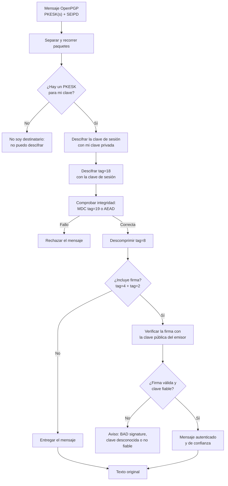
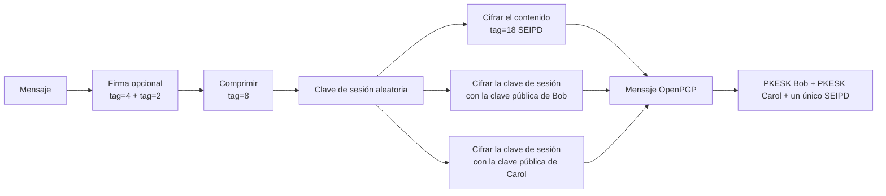
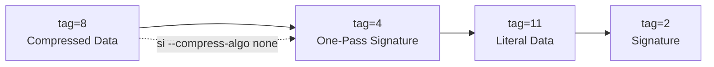

# Ejercicios PGP

[:material-file-pdf-box: Transparencias — PGP: ejercicios (PDF)](../../assets/pdf/SRDSI_T2-2.pdf#page=34){ .md-button }
[:material-file-pdf-box: Transparencias — Firmas y paquetes (PDF)](../../assets/pdf/SRDSI_T2-2.pdf#page=40){ .md-button }

Esta página resuelve los ejercicios de PGP de las transparencias **SRDSI_T2-2**, páginas **34** (receptor y varios destinatarios) y **40** (mensaje firmado y paquetes `tag=9`, `tag=18` y `tag=19`). Las pruebas están hechas con **GnuPG 2.4.9** y `libgcrypt 1.12.4` en llaveros temporales.

!!! info "Lo básico, en el Tema 1"
    Para crear claves, cifrado simétrico, llaveros, revocación y confianza, consulta [GnuPG (Tema 1)](../../tema1/comandos/gpg.md) y las [actividades de GnuPG (Tema 1)](../../tema1/actividades/gnupg.md). En el Tema 2 tienes la [teoría de PGP y S/MIME](../teoria/pgp-smime.md) y la [chuleta de comandos GnuPG](../comandos/pgp.md).

!!! note "Valores de las salidas"
    Las huellas, *key IDs*, fechas y tamaños que aparecen aquí son de una ejecución concreta. Sirven para interpretar la estructura, no como valores fijos: si repites los comandos obtendrás otros.

## 1. Recordatorio del modelo PGP

PGP/OpenPGP es un sistema **híbrido**:

1. El emisor genera una **clave de sesión** aleatoria (por ejemplo, AES-256).
2. Cifra el mensaje con esa clave simétrica.
3. Cifra la clave de sesión con la **clave pública** de cada destinatario.
4. El receptor descifra la clave de sesión con su **clave privada** y con ella descifra el mensaje.

La clave asimétrica no cifra el mensaje completo: solo protege la clave de sesión y las firmas. Esto es lo que permite cifrar un mensaje grande para varios destinatarios sin repetir el criptograma.

| Elemento | Función |
| --- | --- |
| **Clave de sesión** | Clave simétrica efímera que cifra el mensaje. |
| **PKESK** (`tag=1`) | Clave de sesión cifrada con la clave pública de un destinatario. Hay uno por destinatario. |
| **SKESK** (`tag=3`) | Clave de sesión cifrada con una contraseña (cifrado simétrico). |
| **SEIPD** (`tag=18`) | Datos cifrados con integridad (MDC o AEAD). |
| **Llavero público** | Claves públicas, *user IDs*, firmas, caducidad y revocación. |
| **Llavero privado** | Claves privadas, normalmente protegidas con una passphrase. |
| **Confianza** | Valoración local de si una clave pertenece realmente a su identidad. |
| **Validez** | Resultado de combinar firmas de terceros y niveles de confianza. |

El orden de las operaciones es **firmar → comprimir → cifrar**. Al recibir se invierte: **descifrar → comprobar integridad → descomprimir → verificar firma**.

## 2. Ejercicios de las transparencias

### 2.1 Receptor de un mensaje PGP (p. 34)

El receptor recibe un mensaje OpenPGP con uno o varios PKESK y un bloque SEIPD. Debe localizar el PKESK dirigido a su clave, recuperar la clave de sesión y descifrar el contenido. Si el mensaje está firmado, después verifica la firma y decide si la clave del emisor es fiable.



| Paso | Qué ocurre | Paquete o dato | Señal en GnuPG |
| --- | --- | --- | --- |
| 1 | Se recibe el mensaje | PKESK + SEIPD | `gpg --list-packets` |
| 2 | Se busca el PKESK propio | `tag=1`, `keyid` de la subclave de cifrado | `keyid` en la salida |
| 3 | Se descifra la clave de sesión | Clave privada del receptor | `encrypted with ... key, ID ...` |
| 4 | Se descifra el contenido | `tag=18` | `gpg --decrypt` |
| 5 | Se comprueba la integridad | MDC `tag=19` o AEAD | `mdc_method: 2` |
| 6 | Se descomprime | `tag=8` | `compressed packet: algo=...` |
| 7 | Se verifica la firma | `tag=4` + `tag=2` | `gpg --verify` |
| 8 | Se comprueba la confianza | Llavero local | `[ultimate]`, `[full]`, `[unknown]` |

!!! important "Firma válida no significa identidad fiable"
    `Good signature` demuestra que los datos coinciden con la firma y que la clave usada es la que dice el paquete. Que esa clave pertenezca a la persona correcta depende de las firmas de terceros y de la confianza configurada en **tu** llavero. Si la clave no es de confianza, GnuPG puede mostrar la firma como válida pero advertir de que no hay garantía sobre la identidad.

### 2.2 Envío a varios receptores (p. 34)

Todos los destinatarios comparten **una sola clave de sesión** y, por tanto, **un solo bloque SEIPD**. Lo que se repite es la clave de sesión cifrada: un PKESK por destinatario.



| Se repite por receptor | Se comparte |
| --- | --- |
| PKESK (`tag=1`) con la clave de sesión cifrada | Clave de sesión |
| Entrada en el sobre para ese destinatario | Contenido cifrado (`tag=18`) |
| — | Firma, compresión y mensaje original |

Un receptor ignora los PKESK que no puede abrir y usa el suyo. Esto también permite usar destinatarios ocultos (`--hidden-recipient`) o quitar los *key IDs* (`--throw-keyids`), a costa de que el receptor tenga que probar sus claves.

### 2.3 Mensaje firmado: estructura esperada y diferencias (p. 40)

Al firmar con `gpg --sign`, GnuPG no genera únicamente un paquete de firma. La estructura real de un mensaje firmado es una secuencia dentro de un contenedor:

```text
tag=8  Compressed Data
├── tag=4  One-Pass Signature
├── tag=11 Literal Data
└── tag=2  Signature
```

La diferencia con el esquema de las transparencias es que GnuPG **comprime por defecto**. Por eso aparece un `tag=8` envolviendo la firma y los datos. Además, la firma va precedida por un paquete **One-Pass Signature** (`tag=4`), que permite verificar mientras se procesa el mensaje y no solo al final. Si se desactiva la compresión, la estructura se queda en la secuencia mínima:

```text
tag=4  One-Pass Signature
tag=11 Literal Data
tag=2  Signature
```



| Paquete | Papel |
| --- | --- |
| `tag=4` One-Pass Signature | Anuncia que hay una firma y permite verificarla en streaming. Incluye el *key ID* del firmante, la clase de firma, el hash y el algoritmo de clave. |
| `tag=11` Literal Data | Mensaje original con nombre, modo y fecha. |
| `tag=2` Signature | Firma criptográfica sobre los datos. Incluye el *digest* y el emisor. |
| `tag=8` Compressed Data | Envoltorio de compresión que GnuPG añade por defecto al firmar. |

La prueba real con `--list-packets` está en [§3.4](#34-firmar-verificar-e-inspeccionar-paquetes). Allí se ve la diferencia entre la salida por defecto y `--compress-algo none`.

### 2.4 `tag=9`, `tag=18` y `tag=19` (p. 40)

Estos tres *tags* están relacionados con el cifrado simétrico, pero no son equivalentes:

| Tag | Paquete | Qué es | Integridad | Cuándo aparece |
| --- | --- | --- | --- | --- |
| **9** | Symmetrically Encrypted Data (SED) | Cifrado simétrico del contenido, formato antiguo. | **No** | Mensajes legacy o generados con `--rfc2440`. GnuPG moderno no lo usa por defecto. |
| **18** | SEIPD (*Symmetrically Encrypted Integrity Protected Data*) | Envoltorio de datos cifrados con protección de integridad. | **Sí** | Cifrado normal con GnuPG 2.x, tanto para clave pública como simétrica. |
| **19** | MDC (*Modification Detection Code*) | Código de detección de modificaciones: un SHA-1 de 20 bytes. | Es el mecanismo de integridad | Dentro de un SEIPD versión 1, al final del contenido cifrado. |

Esquema de los tres casos:

```text
tag=9  SED legacy:      PKESK + tag=9( ciphertext( tag=8 → tag=11 ) )
                        └── sin MDC: no hay detección de modificaciones

tag=18 SEIPD v1:        PKESK + tag=18( ciphertext( tag=8 → tag=11 ) + tag=19(MDC) )
                        └── el MDC viaja cifrado dentro del tag=18

tag=18 SEIPD v2:        PKESK + tag=18( AEAD( tag=8 → tag=11 ) )
                        └── integridad mediante AEAD; no usa tag=19
```

Puntos clave:

- **`tag=9` es el formato antiguo sin integridad.** Un atacante puede modificar el criptograma sin que el receptor lo detecte de forma fiable. GnuPG 2.4 puede generarlo con `--rfc2440` solo para pruebas, avisa con `message was not integrity protected` y no lo considera seguro.
- **`tag=18` es el sobre moderno.** En su versión 1 usa CFB y añade un MDC; en su versión 2 usa AEAD (RFC 9580). GnuPG 2.4 muestra `mdc_method: 2` cuando el SEIPD lleva MDC.
- **`tag=19` no suele aparecer como una línea independiente en `--list-packets`.** Viaja cifrado dentro del `tag=18`; la pista es precisamente `mdc_method: 2`. Si ves `tag=9`, no busques un MDC: no lo hay.
- El **MDC no es una firma**: detecta modificaciones, pero no autentica al emisor. Para autenticación hace falta una firma (`tag=2`).

Ejemplo real de un mensaje legacy generado solo para observar el `tag=9`:

```bash
gpg --rfc2440 --encrypt --recipient bob@srdsi.lab \
    --output legacy.gpg mensaje.txt
gpg --list-packets legacy.gpg
```

```console
# off=0 ctb=84 tag=1 hlen=2 plen=94
:pubkey enc packet: version 3, algo 18, keyid F3C23D80DB7BB1CA
	data: [263 bits]
	data: [392 bits]
# off=96 ctb=c9 tag=9 hlen=2 plen=79 new-ctb
:encrypted data packet:
	length: 79
# off=116 ctb=a3 tag=8 hlen=1 plen=0 indeterminate
:compressed packet: algo=2
# off=118 ctb=ac tag=11 hlen=2 plen=53
:literal data packet:
	mode b (62), created 1793189352, name="mensaje.txt",
	raw data: 36 bytes
```

Observa que en el `tag=9` **no** aparece `mdc_method`. En el cifrado normal de [§3.2](#32-cifrar-para-bob-y-carol) sí aparece `mdc_method: 2` dentro del `tag=18`. GnuPG 2.4 añade además un aviso (`message was not integrity protected`) y se niega a tratar el mensaje como seguro; `--list-packets` sigue mostrando la estructura para poder analizarla.

## 3. Solución práctica reproducible

Todo se ejecuta en un llavero temporal. No se toca `~/.gnupg` y no se deja nada en el repositorio.

### 3.1 Preparar el llavero y las claves

```bash
export GNUPGHOME=$(mktemp -d)
chmod 700 "$GNUPGHOME"
gpg --version | head -2
printf 'Mensaje de prueba para Bob y Carol.\n' > mensaje.txt
```

```console
gpg (GnuPG) 2.4.9
libgcrypt 1.12.4
```

Crear Alice, Bob y Carol **sin passphrase** (solo para el laboratorio):

```bash
for u in alice bob carol; do
  gpg --batch --passphrase '' --quick-gen-key \
    "$u <$u@srdsi.lab>" default default never
done
```

`default default` crea una clave primaria Ed25519 para firma/certificación y una subclave Curve25519 para cifrado. La subclave `[E]` es la que se usa al cifrar; su *key ID* es el que aparece en los PKESK.

```bash
gpg --list-keys --keyid-format long
```

Salida resumida de la ejecución de ejemplo:

```console
pub   ed25519/F6DA6F2D46AC956C 2026-10-28 [SC]
      18DA19CD2793D0046B8809CDF6DA6F2D46AC956C
uid                 [ultimate] Alice <alice@srdsi.lab>
sub   cv25519/3D5FACDA00260AD9 2026-10-28 [E]

pub   ed25519/35A0ACF5A2C25277 2026-10-28 [SC]
      D27FB5B5FC7840738480657F35A0ACF5A2C25277
uid                 [ultimate] Bob <bob@srdsi.lab>
sub   cv25519/F3C23D80DB7BB1CA 2026-10-28 [E]

pub   ed25519/DF603E379637AE77 2026-10-28 [SC]
      0C8900E9BD8F50B4D91FD10EDF603E379637AE77
uid                 [ultimate] Carol <carol@srdsi.lab>
sub   cv25519/4A264F5A020D5314 2026-10-28 [E]
```

En esta ejecución, las claves de cifrado son `F3C23D80DB7BB1CA` (Bob) y `4A264F5A020D5314` (Carol). Son distintas de las claves primarias: eso es normal, PGP usa la subclave `[E]`.

### 3.2 Cifrar para Bob y Carol

```bash
gpg --encrypt --recipient bob@srdsi.lab --recipient carol@srdsi.lab \
    --output mensaje-bc.gpg mensaje.txt

gpg --list-packets mensaje-bc.gpg
```

```console
# off=0 ctb=84 tag=1 hlen=2 plen=94
:pubkey enc packet: version 3, algo 18, keyid F3C23D80DB7BB1CA
	data: [263 bits]
	data: [392 bits]
# off=96 ctb=84 tag=1 hlen=2 plen=94
:pubkey enc packet: version 3, algo 18, keyid 4A264F5A020D5314
	data: [263 bits]
	data: [392 bits]
# off=192 ctb=d2 tag=18 hlen=2 plen=102 new-ctb
:encrypted data packet:
	length: 102
	mdc_method: 2
# off=213 ctb=a3 tag=8 hlen=1 plen=0 indeterminate
:compressed packet: algo=2
# off=215 ctb=ac tag=11 hlen=2 plen=53
:literal data packet:
	mode b (62), created 1793189352, name="mensaje.txt",
	raw data: 36 bytes
```

Interpretación:

1. **Dos paquetes `tag=1` (PKESK)**, uno por receptor. Los *key IDs* `F3C23D80DB7BB1CA` y `4A264F5A020D5314` son las subclaves de cifrado de Bob y Carol.
2. **Un único `tag=18` (SEIPD)** con `mdc_method: 2`: todo el contenido comparte una sola clave de sesión y lleva MDC.
3. **`tag=8` (Compressed Data)**: el contenido se comprimió antes de cifrar.
4. **`tag=11` (Literal Data)**: el mensaje original, con nombre, modo y fecha.

### 3.3 Descifrar con cada receptor

Con un solo llavero, GnuPG elegiría la primera clave privada que pueda abrir un PKESK. Para demostrar que **cada receptor descifra con la suya**, crea un llavero temporal por receptor:

```bash
for u in bob carol; do
  mkdir -p "$GNUPGHOME-$u"
  chmod 700 "$GNUPGHOME-$u"

  gpg --armor --export-secret-keys "$u@srdsi.lab" |
    GNUPGHOME="$GNUPGHOME-$u" gpg --batch --import

  echo "== Descifrado como $u =="
  GNUPGHOME="$GNUPGHOME-$u" gpg --batch --yes --decrypt mensaje-bc.gpg
done
```

Salida resumida:

```console
== Descifrado como bob ==
gpg: encrypted with ECDH key, ID 4A264F5A020D5314
gpg: encrypted with cv25519 key, ID F3C23D80DB7BB1CA, created 2026-10-28
      "Bob <bob@srdsi.lab>"
Mensaje de prueba para Bob y Carol.
== Descifrado como carol ==
gpg: encrypted with cv25519 key, ID 4A264F5A020D5314, created 2026-10-28
      "Carol <carol@srdsi.lab>"
gpg: encrypted with ECDH key, ID F3C23D80DB7BB1CA
Mensaje de prueba para Bob y Carol.
```

Cada llavero solo tiene la clave privada de su dueño. GnuPG recorre los PKESK, descarta el que no puede abrir y usa el propio. El mensaje descifrado es idéntico: la clave de sesión era la misma; solo cambiaba la copia cifrada de esa clave.

### 3.4 Firmar, verificar e inspeccionar paquetes

```bash
gpg --local-user alice@srdsi.lab --output mensaje-firmado.gpg --sign mensaje.txt
gpg --list-packets mensaje-firmado.gpg
gpg --verify mensaje-firmado.gpg
```

```console
# off=0 ctb=a3 tag=8 hlen=1 plen=0 indeterminate
:compressed packet: algo=1
# off=2 ctb=90 tag=4 hlen=2 plen=13
:onepass_sig packet: keyid F6DA6F2D46AC956C
	version 3, sigclass 0x00, digest 10, pubkey 22, last=1
# off=17 ctb=ac tag=11 hlen=2 plen=53
:literal data packet:
	mode b (62), created 1793189352, name="mensaje.txt",
	raw data: 36 bytes
# off=72 ctb=88 tag=2 hlen=2 plen=134
:signature packet: algo 22, keyid F6DA6F2D46AC956C
	version 4, created 1793189352, md5len 0, sigclass 0x00
	digest algo 10, begin of digest 99 ba
	hashed subpkt 33 len 21 (issuer fpr v4 18DA19CD2793D0046B8809CDF6DA6F2D46AC956C)
	hashed subpkt 2 len 4 (sig created 2026-10-28)
	hashed subpkt 28 len 15 (signer's user ID)
	subpkt 16 len 8 (issuer key ID F6DA6F2D46AC956C)
	data: [255 bits]
	data: [255 bits]
```

Verificación:

```console
gpg: Signature made Wed 28 Oct 2026 01:09:12 PM CET
gpg:                using EDDSA key 18DA19CD2793D0046B8809CDF6DA6F2D46AC956C
gpg:                issuer "alice@srdsi.lab"
gpg: Good signature from "Alice <alice@srdsi.lab>" [ultimate]
```

La estructura real es `tag=8` → (`tag=4`, `tag=11`, `tag=2`). Para ver la estructura sin la compresión que añade GnuPG por defecto:

```bash
gpg --compress-algo none --local-user alice@srdsi.lab \
    --output mensaje-firmado-nocomp.gpg --sign mensaje.txt
gpg --list-packets mensaje-firmado-nocomp.gpg
```

```console
# off=0 ctb=90 tag=4 hlen=2 plen=13
:onepass_sig packet: keyid F6DA6F2D46AC956C
	version 3, sigclass 0x00, digest 10, pubkey 22, last=1
# off=15 ctb=ac tag=11 hlen=2 plen=53
:literal data packet:
	mode b (62), created 1793189352, name="mensaje.txt",
	raw data: 36 bytes
# off=70 ctb=88 tag=2 hlen=2 plen=134
:signature packet: algo 22, keyid F6DA6F2D46AC956C
	version 4, created 1793189352, md5len 0, sigclass 0x00
	digest algo 10, begin of digest 99 ba
```

Comparación con el esquema de las transparencias:

- La transparencia muestra la firma como un paquete asociado al mensaje; GnuPG añade el **One-Pass Signature** (`tag=4`) delante del literal para poder verificar en streaming.
- GnuPG **comprime por defecto**, por eso el `tag=8` envuelve todo. Con `--compress-algo none` desaparece y queda exactamente `tag=4` → `tag=11` → `tag=2`.
- El `tag=2` final contiene la firma. `digest 10` es SHA-512 y `pubkey 22` es EdDSA; `sigclass 0x00` indica firma de un documento binario.
- `gpg --list-packets` **no verifica** la firma: solo describe paquetes. La comprobación real es `gpg --verify`.

### 3.5 Limpiar el entorno

```bash
gpgconf --kill gpg-agent
rm -rf "$GNUPGHOME" "$GNUPGHOME-bob" "$GNUPGHOME-carol"
unset GNUPGHOME
```

## 4. Interpretación de `--list-packets` y errores típicos

### 4.1 Tabla de paquetes

| Línea o campo | Significado |
| --- | --- |
| `# off=... ctb=... tag=... hlen=... plen=...` | Posición, *cipher type byte*, longitud de cabecera y longitud del cuerpo. Es información de diagnóstico. |
| `tag=1` / `:pubkey enc packet` | PKESK: clave de sesión cifrada para un destinatario. |
| `keyid` de un PKESK | *Key ID* de la **subclave de cifrado** del destinatario, no de la clave primaria. |
| `tag=3` / `:symkey enc packet` | SKESK: clave de sesión protegida con contraseña. |
| `tag=4` / `:onepass_sig packet` | One-Pass Signature: anuncia la firma y permite verificarla en streaming. |
| `tag=2` / `:signature packet` | Firma de datos, clave o identidad. |
| `tag=8` / `:compressed packet` | Datos comprimidos (`algo=1` ZIP, `2` ZLIB, `3` BZIP2). |
| `tag=9` / `:encrypted data packet` | SED legacy: cifrado sin integridad. |
| `tag=11` / `:literal data packet` | Datos originales con nombre, modo y fecha. |
| `tag=18` / `:encrypted data packet` | SEIPD: datos cifrados con integridad. |
| `mdc_method: 2` | El SEIPD lleva MDC; `2` es SHA-1. |
| `tag=19` / MDC | Código de integridad dentro del SEIPD v1. Normalmente no se muestra como línea independiente. |
| `sigclass` | Tipo de firma: `0x00` documento binario, `0x01` texto canónico, etc. |
| `digest` / `digest algo` | Algoritmo de *hash* de la firma; `10` es SHA-512. |

### 4.2 Errores típicos

| Mensaje de GnuPG | Causa habitual | Qué hacer |
| --- | --- | --- |
| `decryption failed: No secret key` | Ningún PKESK corresponde a una clave privada del llavero. | Importar la clave privada correcta o comprobar que eres destinatario. |
| `Unusable public key` | La clave del destinatario no tiene subclave de cifrado, está caducada/revocada, o se forzó la primaria con `!`. | Usar la subclave `[E]` o quitar el `!` del *fingerprint*. |
| `WARNING: message was not integrity protected` | Mensaje legacy con `tag=9`, sin MDC. | No confiar en él; pedir que se reenvíe con formato moderno. |
| `BAD signature` | Los datos han cambiado o la firma no corresponde. | Rechazar el mensaje. |
| `Can't check signature: No public key` | Falta la clave pública del emisor. | Importar su clave pública y verificar la huella por un canal independiente. |
| `decryption failed: Bad session key` | Clave privada incorrecta, fichero truncado/corrupto o problema con la passphrase. | Revisar el fichero y la clave usada. |
| `There is no assurance this key belongs to the named user` | La clave no está certificada o no tiene confianza asignada. | Verificar la huella, firmar la clave y asignar confianza; no usar `--trust-model always` fuera del laboratorio. |
| `no valid OpenPGP data found` | Fichero equivocado, formato binario/ASCII confundido o mensaje truncado. | Comprobar el fichero y si es `.gpg` o `.asc`. |
| `gpg: Note: ...` al listar paquetes | Aviso informativo; no impide seguir. | Leerlo antes de interpretar la estructura. |

!!! tip "Regla práctica"
    `--list-packets` responde a **qué estructura tiene** el mensaje. Para responder a **si es auténtico**, usa `gpg --verify`; para **si es confidencial**, comprueba que solo tus claves privadas abren algún PKESK. Ninguna de las dos cosas se deduce solo de los *tags*.

## 5. Enlaces

- [Transparencias SRDSI_T2-2 — ejercicios, p. 34](../../assets/pdf/SRDSI_T2-2.pdf#page=34)
- [Transparencias SRDSI_T2-2 — firmas y paquetes, p. 40](../../assets/pdf/SRDSI_T2-2.pdf#page=40)
- [Teoría: PGP, OpenPGP y S/MIME](../teoria/pgp-smime.md)
- [Comandos: PGP con GnuPG](../comandos/pgp.md)
- [GnuPG — manual oficial](https://www.gnupg.org/documentation/manuals/gnupg/)
- [GnuPG — guía de usuario](https://www.gnupg.org/gph/en/manual.html)
- [RFC 4880 — OpenPGP Message Format](https://www.rfc-editor.org/rfc/rfc4880)
- [RFC 9580 — OpenPGP](https://www.rfc-editor.org/rfc/rfc9580)
