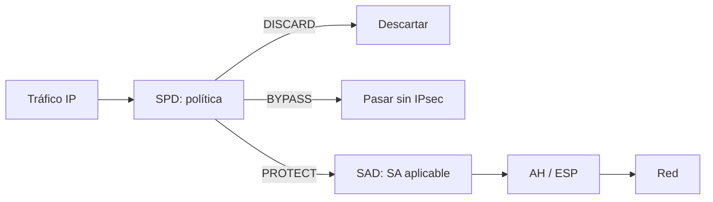
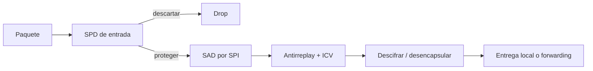

# IPsec

IPsec protege las comunicaciones en la **capa de red**, de forma transparente a las aplicaciones. Es la base de muchas VPN y permite autenticar hosts, cifrar datagramas y aplicar políticas de tráfico sin modificar los programas finales.

[:material-file-pdf-box: Transparencias — IPsec (PDF)](../../assets/pdf/SRDSI_T2-4.pdf#page=6){ .md-button }

## Qué es IPsec

- Extensión de IP que proporciona **confidencialidad**, **autenticación del emisor**, **integridad** y **control de acceso**.
- Nació para IPv6 (recomendado) y se portó a IPv4 (opcional). El estándar actual es IPsec v3 (RFC 4301, RFC 6071).
- Usos: VPN de sitio a sitio y de acceso remoto, protección nodo a nodo (por ejemplo, protocolos de routing) y refuerzo del comercio electrónico.
- No protege la aplicación: si el tráfico sale en claro antes de IPsec, IPsec no lo arregla.

## Modos de funcionamiento

| Modo | Qué protege | Extremos | Uso típico |
| --- | --- | --- | --- |
| **Transporte** | Payload de la capa superior (TCP/UDP) y, si se usa, parte de la cabecera IP. | Host a host. | Comunicaciones extremo a extremo entre hosts con software IPsec. |
| **Túnel** | Datagrama IP completo, incluida la cabecera original. | Gateways o host-gateway. | VPN; el tráfico interno es transparente para la red. |

```text
Transporte:  IP original | AH/ESP | TCP/UDP | datos
Túnel:      IP nueva    | AH/ESP | IP original | TCP/UDP | datos
```

En modo túnel el gateway añade una nueva cabecera IP y el paquete original queda encapsulado; en transporte se conserva la cabecera IP original y solo se protege el payload.

## Componentes

| Componente | Función |
| --- | --- |
| **AH** (RFC 4302) | Autenticación e integridad; opcionalmente antirreplay. No cifra. |
| **ESP** (RFC 4303) | Confidencialidad y, opcionalmente, autenticación, integridad y antirreplay. |
| **IKEv2** (RFC 7296) | Autenticación mutua, negociación y mantenimiento de SAs. |
| **SPD** | Política de seguridad: qué tráfico se descarta, se deja pasar o se protege. |
| **SAD** | Base de datos de asociaciones de seguridad activas. |
| **PAD** | Relación entre cada peer y su método de autenticación. |
| **IPcomp** (RFC 3173) | Compresión del payload antes del cifrado ESP. |
| **Algoritmos** (RFC 8221) | Cifrado, autenticación e integridad recomendados. |



## AH (Authentication Header)

- Protocolo IP **51**. Autentica el emisor y garantiza integridad; puede añadir **antirreplay**.
- El **ICV** cubre los campos inmutables de la cabecera IP, la cabecera AH y el payload. Los campos mutables (TTL, checksum, opciones de fragmentación) se ponen a cero para el cálculo.
- Se calcula con HMAC o un algoritmo AEAD; no proporciona confidencialidad.
- Puede funcionar en modo transporte o túnel. Al cubrir direcciones IP, **no es compatible con NAT** sin mecanismos adicionales.

## ESP (Encapsulating Security Payload)

- Protocolo IP **50**. Proporciona confidencialidad y, opcionalmente, autenticación, integridad y antirreplay.
- Estructura: **SPI**, número de secuencia, datos cifrados, relleno, longitud del relleno, next header e **ICV**.
- El cifrado cubre el payload y el relleno; el ICV puede cubrir también la cabecera ESP. La cabecera IP externa no queda protegida.
- En modo transporte protege el payload; en modo túnel protege el datagrama original completo.
- Para atravesar NAT se encapsula ESP en UDP (puerto 4500, NAT-T).

## Asociación de seguridad (SA)

Una **SA** es un canal unidireccional entre emisor y receptor. Para una comunicación bidireccional hacen falta **dos SAs**.

- Se identifica por **SPI** (32 bits) + **protocolo** (AH o ESP) + **dirección de destino**.
- Contiene modo, algoritmos, claves, ventana antirreplay, lifetime y MTU.
- La **SAD** guarda las SAs de salida y de entrada. Cada entrada incluye SPI, secuencia, flags, modo, protocolo, algoritmos y dirección.
- El **SPI** es el equivalente a un puerto TCP/UDP para localizar la SA.
- El *lifetime* puede ser por tiempo o por volumen; al expirar se renegocia (soft/hard lifetime).

## SPD y PAD

La **SPD** es una base de datos ordenada de políticas. Cada paquete se compara con los selectores (direcciones, puertos, protocolo, etc.) y recibe una acción:

| Acción | Efecto |
| --- | --- |
| **DISCARD** | El paquete se descarta. |
| **BYPASS** | El paquete pasa sin IPsec. |
| **PROTECT** | Se aplica la SA indicada por IPsec. |

Hay SPD de entrada y de salida. La **PAD** asocia cada peer autorizado con su método de autenticación (certificados X.509, PSK, etc.) y con el identificador que se usará para consultar la SPD.

## Procesamiento del tráfico

**Salida**: se consulta la SPD, se elige la SA de la SAD, se aplica AH/ESP, se asigna el número de secuencia y se envía.

**Entrada**: se localiza la SA por SPI y destino, se comprueba la política, se valida la ventana antirreplay, se verifica el ICV, se descifra y se elimina la encapsulación. Después el paquete se entrega localmente o se reenvía.



## IKEv2

**IKEv2** (RFC 7296, STD 79) autentica a los peers, negocia algoritmos, crea y mantiene SAs y permite rekeying. Usa **UDP 500** (y 4500 con NAT-T).

| Intercambio | Contenido |
| --- | --- |
| `IKE_SA_INIT` | Negocia algoritmos, intercambia nonces y DH, crea la IKE-SA. |
| `IKE_AUTH` | Autenticación mutua y creación de la primera IPsec-SA (child SA). |
| `CREATE_CHILD_SA` | Nuevas SAs AH/ESP o rekeying. |
| `INFORMATIONAL` | Estado, errores, borrado de SAs y configuración. |

La autenticación puede ser con certificados X.509 o PSK. Las **cookies** del respondedor mitigan DoS. IKEv2 sustituye a IKEv1, ISAKMP y Oakley, y usa pares petición/respuesta con retransmisión.

## IPsec y criptografía post-cuántica

- **RFC 8784**: mezcla claves precompartidas (PPK) en IKEv2 para resistencia post-cuántica.
- **RFC 9242**: *Intermediate Exchange* para transportar grandes volúmenes de datos durante el establecimiento de la SA.
- **RFC 9370**: permite uno o varios intercambios de claves post-cuánticos junto con (EC)DH; la clave resultante es híbrida.
- **RFC 9867**: extiende la mezcla de PPK a `IKE_INTERMEDIATE` y `CREATE_CHILD_SA`.
- La amenaza es **Harvest Now, Decrypt Later**: almacenar tráfico hoy para descifrarlo cuando haya un ordenador cuántico.

## Combinaciones de SAs

Las SAs se pueden aplicar en serie para sumar servicios:

| Combinación | Efecto |
| --- | --- |
| **AH + ESP (transporte)** | Primero AH autentica y después ESP cifra (o al revés según la política). |
| **ESP + AH (túnel)** | Se encapsula y protege el datagrama; AH añade autenticación de la cabecera externa. |
| **Túnel + transporte** | Un gateway crea un túnel y dentro se aplica transporte extremo a extremo. |
| **Túneles anidados** | Varios gateways encapsulan sucesivamente; cada capa añade su propia SA. |

AH y ESP pueden convivir, pero AH no atraviesa NAT porque autentica direcciones IP. En una VPN con NAT se prefiere ESP (eventualmente en UDP 4500).

## Ideas clave para el examen

- IPsec opera en la **capa de red** y es transparente a las aplicaciones.
- **Transporte** protege el payload; **túnel** encapsula el datagrama completo.
- **AH** autentica e integra, pero no cifra; **ESP** cifra y puede autenticar.
- Una SA es **unidireccional** y se identifica por SPI + protocolo + destino.
- La **SPD** decide (DISCARD/BYPASS/PROTECT); la **SAD** contiene los parámetros; la **PAD** autoriza peers.
- IKEv2 usa `IKE_SA_INIT`, `IKE_AUTH`, `CREATE_CHILD_SA` e `INFORMATIONAL`.
- RFC 9370 permite intercambios de claves híbridos post-cuánticos en IKEv2.
- AH no es compatible con NAT; ESP en UDP 4500 es la solución habitual.

## Actividades relacionadas

- [Transparencias de IPsec](../../assets/pdf/SRDSI_T2-4.pdf#page=6)
- [Comandos y análisis con Wireshark](../comandos/wireshark.md)
- [Ejercicios TLS/DTLS](../actividades/tls-dtls.md): comparación de seguridad en transporte.
- No hay un laboratorio específico de IPsec en el repositorio; las transparencias incluyen los diagramas de cabeceras y de IKEv2.
