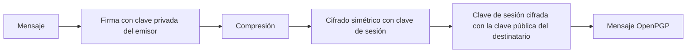

# PGP, OpenPGP y S/MIME

El correo electrónico es el caso de uso clásico de la criptografía de extremo a extremo: el mensaje viaja por servidores intermedios y debe seguir siendo confidencial e íntegro. PGP y S/MIME resuelven el problema con modelos de confianza distintos: la *web of trust* y la PKI X.509.

[:material-file-pdf-box: Transparencias — PGP y S/MIME (PDF)](../../assets/pdf/SRDSI_T2-2.pdf#page=26){ .md-button }

## PGP y OpenPGP

**PGP** (*Pretty Good Privacy*) fue creado por Phil Zimmermann a principios de los años 90. Combina criptografía simétrica y asimétrica para dar confidencialidad y autenticación a correo y almacenamiento.

- El estándar abierto es **OpenPGP**: RFC 4880, revisado por **RFC 9580**. Las transparencias citan además RFC 9980 para criptografía post-cuántica.
- Existe la variante **LibrePGP** (`draft-ietf-openpgp-rfc4880bis`), usada por GnuPG.
- PGP 2.6.3i (RFC 1991) es histórico: RSA, IDEA, ZIP, Base64 para SMTP y segmentación. Hoy los algoritmos son configurables (AES, ChaCha20, ECDH, EdDSA, etc.).
- La clave asimétrica **solo protege la clave de sesión** y las firmas; los datos se cifran en simétrico.

## Servicios y esquema híbrido

PGP proporciona **confidencialidad**, **integridad**, **autenticación del emisor** y **no repudio** (con firma). No ofrece forward secrecy: comprometer la clave privada permite descifrar mensajes antiguos.



Orden importante: **firmar → comprimir → cifrar**. Se firma el mensaje sin comprimir para que la verificación no dependa del algoritmo de compresión; después se comprime para reducir tamaño y, por último, se cifra. Al recibir se invierte: descifrar → descomprimir → verificar.

## Confidencialidad y múltiples destinatarios

1. El emisor genera una **clave de sesión** aleatoria.
2. Cifra el mensaje (comprimido) con esa clave.
3. Cifra la clave de sesión con la clave pública de cada destinatario y genera un paquete **PKESK** por destinatario.
4. El receptor usa su clave privada para recuperar la clave de sesión y descifrar el mensaje.

Todos los destinatarios comparten la misma clave de sesión, pero cada uno recibe su propio PKESK. Esto permite cifrar para varios receptores sin repetir el mensaje.

## Autenticación y firma

El emisor calcula un resumen del mensaje y lo firma con su clave privada. El receptor verifica con la clave pública y comprueba que el mensaje no ha cambiado y que procede de quien dice. La firma puede ser:

- **Adjunta** (*signed message*): el mensaje y la firma viajan juntos.
- **Separada** (*detached*): la firma es un fichero aparte; útil para software y documentos.
- **En claro** (*clearsigned*): el texto queda legible y la firma va delimitada por `BEGIN PGP SIGNATURE`.

## Paquetes OpenPGP

Un mensaje es una combinación secuencial o anidada de paquetes. Cada paquete tiene una cabecera genérica con **tag** y longitud, seguida de campos específicos y del cuerpo.

| Tag | Paquete | Función |
| --- | --- | --- |
| 1 | PKESK | Clave de sesión cifrada con clave pública. |
| 2 | Signature | Firma de datos, clave o identidad. |
| 5 / 6 | Secret Key / Public Key | Clave privada o pública. |
| 8 | Compressed Data | Datos comprimidos. |
| 9 | Symmetrically Encrypted Data | Cifrado simétrico sin integridad (legacy). |
| 11 | Literal Data | Datos originales con nombre y tipo. |
| 13 | User ID | Identidad asociada a la clave. |
| 18 | SEIPD | Cifrado simétrico con integridad (MDC/AEAD). |
| 19 | MDC | Código de detección de modificaciones. |

Estructuras habituales:

```text
Cifrado:            PKESK + SEIPD[ COMP[ LIT ] ]
Firmado:            One-Pass SIG + LIT + SIG
Firmado y cifrado:  PKESK + SEIPD[ COMP[ One-Pass SIG + LIT + SIG ] ]
Varios receptores:  PKESK₁ + PKESK₂ + ... + SEIPD[ ... ]
```

El paquete **One-Pass Signature** permite verificar mientras se procesa un mensaje grande. `tag=9` es el cifrado antiguo sin MDC; `tag=18` añade integridad y `tag=19` transporta el MDC.

## Llaveros y gestión de claves

- **Llavero público**: claves públicas, *user IDs*, firmas de terceros, fechas de caducidad y revocación.
- **Llavero privado**: claves privadas protegidas con una passphrase. La función **S2K** deriva una clave simétrica a partir de la passphrase.
- Cada clave tiene un **fingerprint** que se verifica por un canal independiente.
- Las claves se publican en servidores de claves; la confianza no se deduce de que la clave esté publicada.
- Una clave se revoca con un **certificado de revocación**; conviene generarlo y guardarlo al crear la clave.

## Web of trust

PGP no usa una autoridad central. Cada usuario firma las claves que considera auténticas y otorga niveles de confianza:

| Concepto | Significado |
| --- | --- |
| **Firma de clave** | Un usuario certifica que una clave pertenece a una identidad. |
| **Confianza** | Grado de credibilidad que deposita el usuario en otro para firmar claves. |
| **Validez** | Resultado de combinar firmas y confianza; una clave puede ser válida sin ser de confianza. |
| **Revocación** | Anula una clave o una certificación antes de su caducidad. |

La verificación es **local**: cada usuario decide en quién confía (*marginal* o *complete*). Es un modelo descentralizado y resistente a la desaparición de una CA, pero exige verificar huellas y mantener el llavero.

## S/MIME

**S/MIME** (*Secure/Multipurpose Internet Mail Extensions*) es el estándar IETF para correo seguro en entornos corporativos e institucionales: RFC 8550/8551 para la versión 4, sobre MIME (RFC 2045–2047, 2077, 4289, 6838) y **CMS** (RFC 5652).

- Usa **certificados X.509** emitidos por CAs; el cliente mantiene un almacén de CAs raíz.
- Ofrece autenticación, integridad, confidencialidad y no repudio.
- La versión 4 añade recibos firmados, etiquetas de seguridad, certificados de firma y listas de correo seguras.

| Tipo CMS | Protección |
| --- | --- |
| `signed-data` | Firma; el contenido puede ir incluido o separado. |
| `enveloped-data` | Cifrado para uno o varios destinatarios. |
| `compressed-data` | Compresión. |
| `digested-data`, `encrypted-data`, `authenticated-data` | Variantes de resumen, cifrado simétrico y autenticación. |

En MIME se traduce en `multipart/signed` con `application/pkcs7-signature` o en `application/pkcs7-mime` con `smime-type=enveloped-data`. Los tipos se pueden anidar: por ejemplo, firmar y luego cifrar (`Enveloped-Data[Signed-Data[MIME]]`).

## PGP frente a S/MIME

| Aspecto | PGP/OpenPGP | S/MIME |
| --- | --- | --- |
| Modelo de confianza | Web of trust, descentralizado | PKI jerárquica con CAs |
| Formato | Paquetes OpenPGP | CMS + MIME |
| Identidad | *User ID* y firmas de terceros | Certificado X.509 con DN y SAN |
| Descubrimiento | Servidores de claves, intercambio directo | Directorios y certificados corporativos |
| Uso típico | Correo personal, software, cifrado de ficheros | Correo corporativo, firma institucional |
| Revocación | Certificado de revocación distribuido | CRL/OCSP de la CA |
| Integración | Requiere cliente o plugin | Integrado en clientes de correo |

## Ideas clave para el examen

- PGP es **híbrido**: clave de sesión simétrica + clave pública para protegerla.
- El orden es firmar, comprimir y cifrar; al recibir, descifrar, descomprimir y verificar.
- La firma aporta integridad, autenticación y no repudio; el cifrado aporta confidencialidad.
- Un mensaje para varios destinatarios lleva un PKESK por destinatario y una sola clave de sesión.
- La web of trust sustituye a la CA por firmas y niveles de confianza locales.
- S/MIME usa X.509, CMS y MIME; es el estándar del correo corporativo.
- Ninguno de los dos proporciona forward secrecy por sí mismo.

## Actividades relacionadas

- [Ejercicios de PGP](../actividades/pgp.md)
- [Comandos GnuPG](../comandos/pgp.md)
- [Transparencias de PGP y S/MIME](../../assets/pdf/SRDSI_T2-2.pdf#page=26)
- [Transparencias de S/MIME](../../assets/pdf/SRDSI_T2-2.pdf#page=41)
