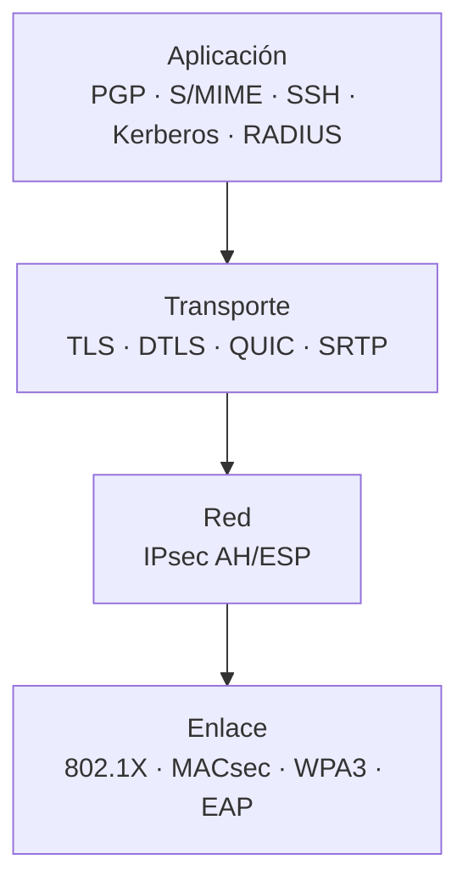

# Protocolos seguros por niveles

Las transparencias de T2-1 sitúan la seguridad en cada nivel de TCP/IP. No hay un único punto: la aplicación puede proteger extremo a extremo, el transporte puede cifrar sus PDUs, la red puede proteger datagramas y el enlace puede proteger tramas. La elección depende de **qué se quiere proteger** y **dónde se despliega**.

[:material-file-pdf-box: Transparencias — Protocolos seguros de comunicación (PDF)](../../assets/pdf/SRDSI_T2-1.pdf#page=4){ .md-button }

## Mapa por niveles

| Nivel | Alcance | Protocolos y mecanismos |
| --- | --- | --- |
| **Aplicación** | Seguridad **extremo a extremo**: los datos de la aplicación se autentican y/o cifran según sus necesidades. | Kerberos, RADIUS, PGP, S/MIME, SSH, SET, IKEv2, BGPSec |
| **Transporte** | Protege las **PDUs de transporte** (datos y cabecera); transparente para la aplicación. | SSL/TLS, DTLS, QUIC, SRTP |
| **Interred** | Protege **datagramas IP**. En modo transporte solo el payload; en modo túnel, el datagrama completo. | IPsec (AH, ESP) |
| **Enlace/Red** | Protege **tramas**: cifra y/o autentica el payload. | 802.1X, MACsec, MPPE, MS-CHAP, EAP, LEAP, PEAP, WEP, WPA, WPA2, WPA3, PPTP, L2TP |

## Aplicación

- La protección se diseña para una aplicación concreta: correo, terminal remota, autenticación, routing.
- Es la opción más **extremo a extremo**: el dato viaja protegido desde el emisor hasta el receptor, aunque haya saltos intermedios.
- Ejemplos: **PGP/S/MIME** para correo, **SSH** para terminal y túneles, **Kerberos/RADIUS** para autenticación, **IKEv2** para negociar IPsec y **BGPSec** para routing.

## Transporte

- Protege la conexión entre dos extremos sin que la aplicación tenga que cambiar su código: el sistema operativo o la librería hacen el trabajo.
- **SSL/TLS** protege TCP; **DTLS** protege UDP; **QUIC** integra TLS 1.3 sobre UDP; **SRTP** protege flujos RTP de voz y vídeo.
- Es transparente para la aplicación, pero no protege las cabeceras de red ni los metadatos de encaminamiento.

## Interred

- **IPsec** protege el tráfico IP a nivel de red. Puede autenticar (**AH**) y/o cifrar (**ESP**).
- En **modo transporte** se protege solo el payload del datagrama; en **modo túnel** se protege el datagrama completo y hace falta una pasarela que cifre y descifre.
- Es la opción habitual para **VPN de sitio a sitio** o para proteger todo el tráfico entre dos hosts.

## Enlace/Red

- Protege el salto local: Wi-Fi, Ethernet, enlaces punto a punto.
- **802.1X** autentica el acceso a la red; **MACsec** protege tramas Ethernet; **WPA2/WPA3** protege Wi-Fi; **EAP/LEAP/PEAP/MS-CHAP** son mecanismos de autenticación; **PPTP/L2TP** son túneles de enlace.
- WEP está roto y no debe usarse; WPA/TKIP también están obsoletos frente a WPA2/WPA3.

## Cómo elegir

- **Solo una aplicación**: TLS/DTLS, SSH, PGP o S/MIME.
- **Toda la red entre dos sedes**: IPsec en modo túnel.
- **Wi-Fi o acceso a la red**: WPA3, 802.1X y RADIUS/EAP.
- **Voz y vídeo en tiempo real**: SRTP; para señalización, TLS.
- **Routing**: BGPSec.

## Ideas clave para el examen

- La seguridad por capas no es excluyente: se pueden combinar varios niveles.
- Aplicación y transporte suelen dar protección **extremo a extremo**; red y enlace protegen **saltos**.
- TLS no protege las cabeceras IP; IPsec sí puede proteger el datagrama completo en modo túnel.
- 802.1X autentica el acceso; MACsec/WPA2/WPA3 protegen el enlace.
- WEP y WPA/TKIP están obsoletos.

## Páginas relacionadas

- [SSH](ssh.md)
- [PGP y S/MIME](pgp-smime.md)
- [TLS, DTLS y QUIC](tls-dtls.md)
- [IPsec](ipsec.md)
- [Transparencias T2-1 (PDF)](../../assets/pdf/SRDSI_T2-1.pdf)
