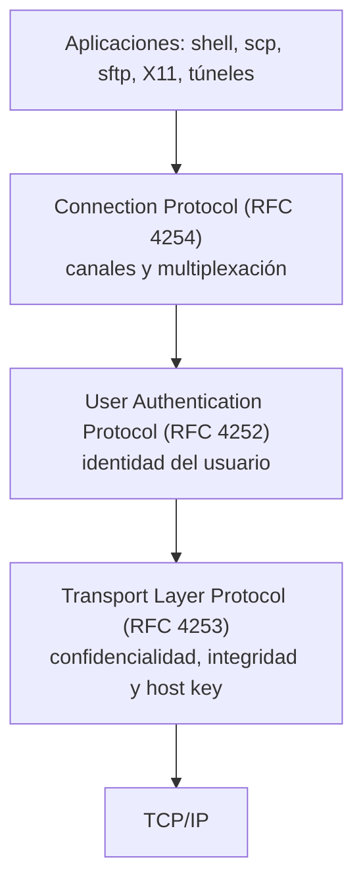
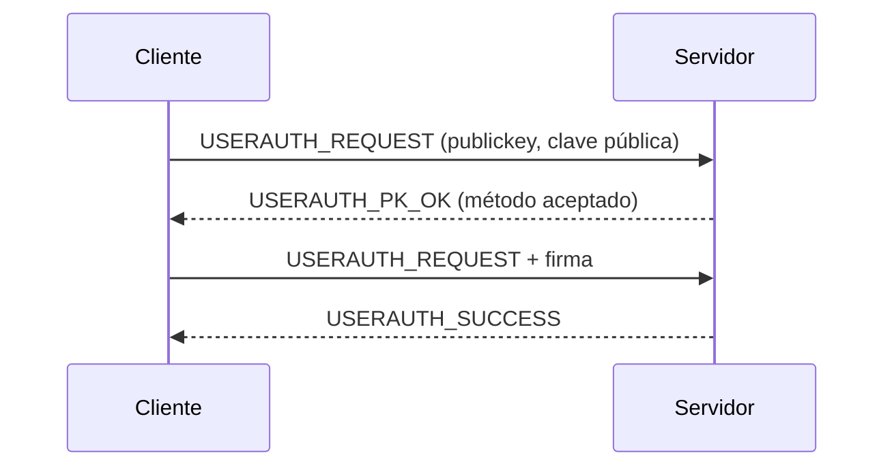
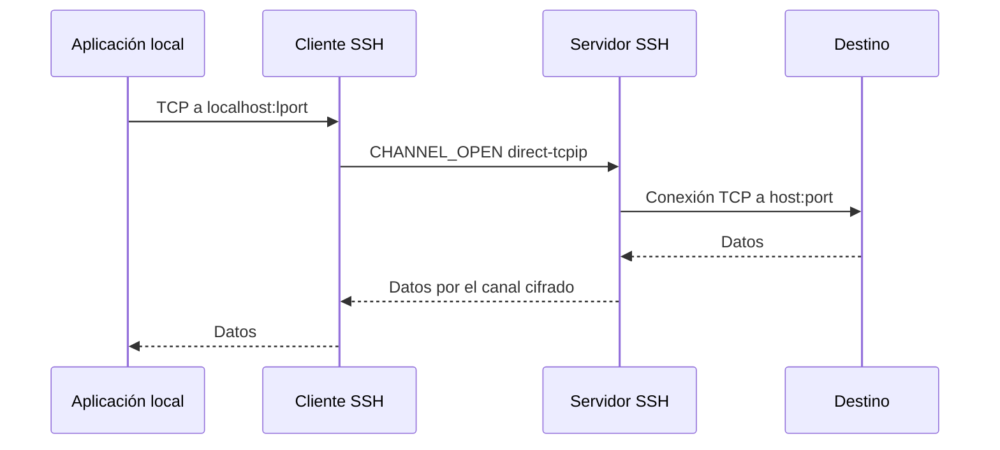

# SSH: Secure Shell

SSH es el protocolo de referencia para administrar sistemas y transportar tráfico de aplicación sobre una red no confiable. Este bloque repasa su arquitectura en capas, el formato de los paquetes, la autenticación y los túneles, que son la base del laboratorio OpenSSH.

[:material-file-pdf-box: Transparencias — SSH y PGP/S/MIME (PDF)](../../assets/pdf/SRDSI_T2-2.pdf#page=6){ .md-button }

## Qué es y dónde encaja

- Protocolo de **nivel de aplicación** (familia RFC 4250–4256, actualizada por RFC 9142) que crea conexiones seguras sobre redes no seguras.
- Modelo **cliente/servidor**: `ssh` y `sshd`. Sustituye a `telnet`, `rlogin` y `rsh`, que transmiten credenciales en claro.
- Es la base de `scp`, `sftp`, de la ejecución remota de comandos y de los túneles para otras aplicaciones.
- Autentica al servidor y, opcionalmente, al usuario; puede integrarse con Kerberos, PAM o certificados SSH.
- Implementaciones: **OpenSSH** (libre, sobre OpenSSL), Tectia (comercial), `libssh` y `wolfSSH`.

## Arquitectura en capas (RFC 4251)

SSH se organiza en tres protocolos que se apoyan en TCP:

La **capa de transporte** autentica al servidor y protege la conexión; la de **autenticación** identifica al usuario; la de **conexión** multiplexa canales lógicos. SSH-2 es la única versión recomendable: SSH-1 está obsoleto.

## Transporte (RFC 4253 y RFC 8308)

1. Intercambio de identificadores en claro: `SSH-2.0-OpenSSH_...`.
2. Negociación con `SSH_MSG_KEXINIT`: intercambio de claves, host key, cifrado, MAC y compresión.
3. Intercambio de claves (Diffie-Hellman clásico, ECDH o híbrido PQC como `sntrup761x25519-sha512`).
4. El servidor demuestra su identidad firmando el intercambio con la **host key**.
5. `NEWKEYS` activa las claves de sesión. RFC 8308 permite intercambiar extensiones con `SSH_MSG_EXT_INFO`.

El **rekeying** renueva claves tras cierto volumen de datos o tiempo. La secuencia de paquete es implícita (32 bits) y no viaja en el paquete.

| Campo | Función |
| --- | --- |
| `packet_length` | Longitud del paquete sin contar este campo ni el MAC. |
| `padding_length` | Relleno aleatorio; el total debe ser múltiplo del bloque (o de 8). |
| `payload` | Mensaje SSH (KEX, autenticación, canal, etc.). |
| `padding` | Relleno aleatorio (mínimo 4 bytes). |
| `MAC` | Integridad; cubre longitud, relleno y payload, salvo en AEAD o encrypt-then-MAC. |

## Host keys y confianza

La host key identifica al servidor. El cliente la guarda en `~/.ssh/known_hosts` y, la primera vez, aplica **trust on first use (TOFU)**: si la huella cambia, SSH avisa de un posible ataque de intermediario.

- Algoritmos habituales: `ssh-ed25519`, `ecdsa-sha2-nistp256` y `rsa-sha2-256/512`.
- Evitar `ssh-rsa` con SHA-1; verificar huellas por un canal independiente.
- Las claves de host se rotan y se mantienen varias en `HostKey` para no romper clientes.
- El KEX proporciona **forward secrecy**: comprometer la clave de host no descifra sesiones pasadas.

## Autenticación de usuario (RFC 4252)

El cliente abre el servicio `ssh-userauth` y envía `SSH_MSG_USERAUTH_REQUEST`. Ante un fallo, el servidor responde con la lista de métodos disponibles y el cliente elige otro.

| Método | Funcionamiento |
| --- | --- |
| `none` | Consulta qué métodos acepta el servidor; no autentica por sí solo. |
| `password` | Contraseña dentro del canal cifrado; cómoda, pero expuesta si el servidor se compromete. |
| `publickey` | El cliente firma el identificador de sesión y demuestra posesión de la clave privada; el servidor comprueba `authorized_keys`. |
| `hostbased` | Autentica el host cliente mediante su host key; útil en entornos de confianza. |
| GSSAPI / PAM / Kerberos | Delegación en un sistema externo de autenticación. |

Flujo típico con clave pública:

`MaxAuthTries` limita los intentos. El agente SSH (`ssh-agent`) mantiene las claves privadas desbloqueadas y evita copiarlas por la red.

## Conexión y canales (RFC 4254)

Una conexión SSH multiplexa **canales** independientes con control de flujo por ventana:

| Tipo de canal | Uso |
| --- | --- |
| `session` | Shell interactiva, ejecución de un comando, subsistema (`sftp`). |
| `direct-tcpip` | *Local port forwarding*: el cliente pide al servidor abrir una conexión. |
| `forwarded-tcpip` | *Remote port forwarding*: el servidor reenvía conexiones hacia el cliente. |
| `x11` | Reenvío de aplicaciones gráficas X11. |

Los mensajes principales son `CHANNEL_OPEN`, `CHANNEL_OPEN_CONFIRMATION`, `CHANNEL_DATA`, `CHANNEL_WINDOW_ADJUST`, `CHANNEL_EOF` y `CHANNEL_CLOSE`. Los *global requests* permiten peticiones que afectan a toda la conexión (por ejemplo, `tcpip-forward`).

## Port forwarding o túneles SSH

El túnel cifra de extremo a extremo el tráfico TCP de una aplicación y evita depender de que esta soporte TLS.

| Modo | Opción | Sentido |
| --- | --- | --- |
| **Local** | `ssh -L [bind:]lport:host:port usuario@servidor` | El cliente abre un puerto local y lo reenvía a `host:port` visto desde el servidor. |
| **Remoto** | `ssh -R [bind:]rport:host:port usuario@servidor` | El servidor abre un puerto y lo reenvía a `host:port` visto desde el cliente. |
| **Dinámico** | `ssh -D 1080 usuario@servidor` | El cliente actúa como proxy SOCKS; decide el destino cada aplicación. |

`-N` evita abrir shell y `-f` pasa a segundo plano. El reenvío remoto puede requerir `GatewayPorts`; por defecto escucha solo en loopback. Un túnel no autentica al destino final: la seguridad depende de no exponer puertos y de verificar la host key.

## Configuración y endurecimiento

**Servidor** (`/etc/ssh/sshd_config`): `Port`, `ListenAddress`, `HostKey`, `PermitRootLogin no`, `PermitEmptyPasswords no`, `PubkeyAuthentication yes`, `PasswordAuthentication no`, `MaxAuthTries`, `AuthorizedKeysFile`, `AllowUsers`/`DenyGroups` y `AllowTcpForwarding`.

**Cliente**: prioridad de opciones de línea de comandos, luego `~/.ssh/config` y por último `/etc/ssh/ssh_config`. Directivas útiles: `Host`, `HostName`, `User`, `Port`, `IdentityFile`, `ServerAliveInterval` y `StrictHostKeyChecking yes`.

Buenas prácticas: deshabilitar root y contraseñas, usar claves con passphrase, restringir usuarios y reenvíos, revisar `authorized_keys` y no reenviar el agente a hosts no confiables (`ForwardAgent no`).

## Ideas clave para el examen

- SSH separa **transporte**, **autenticación de usuario** y **conexión**; cada capa tiene su RFC.
- La host key autentica al servidor; el KEX aporta forward secrecy.
- La autenticación por clave pública demuestra posesión de la clave privada sin transmitirla.
- Los canales permiten multiplexar shell, `sftp`, X11 y túneles sobre una sola conexión.
- `-L` reenvía desde el cliente, `-R` desde el servidor y `-D` ofrece un proxy SOCKS dinámico.
- La primera conexión es TOFU: verificar la huella evita aceptar un servidor falso.
- `ssh-agent` mejora la usabilidad, pero el reenvío del agente es un riesgo.

## Actividades relacionadas

- [Laboratorio OpenSSH](../actividades/openssh.md)
- [Comandos SSH y túneles](../comandos/ssh.md)
- [Enunciado de port forwarding](../../assets/pdf/lab-openssh-port-forwarding.pdf)
- [Enunciado del laboratorio OpenSSH](../../assets/pdf/lab-openssh.pdf)
- [Transparencias de SSH](../../assets/pdf/SRDSI_T2-2.pdf#page=6)
