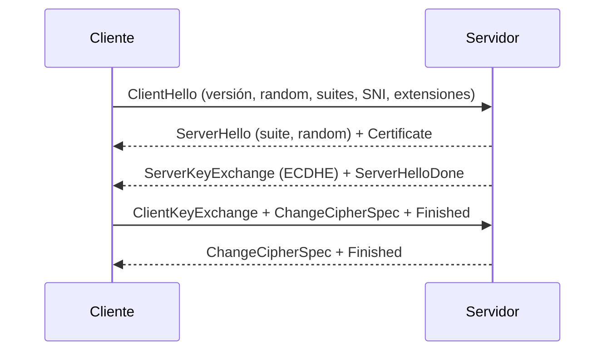

# TLS, DTLS y QUIC

TLS es la capa de seguridad que protege la mayor parte del tráfico de Internet. Este bloque cubre su arquitectura, la evolución de SSL a TLS 1.3, la variante para datagramas (DTLS) y el transporte seguro QUIC, incluyendo el impacto de la criptografía post-cuántica.

[:material-file-pdf-box: Transparencias — SSL, TLS, DTLS y QUIC (PDF)](../../assets/pdf/SRDSI_T2-3.pdf#page=6){ .md-button }

## SSL/TLS: ubicación y servicios

- **SSL** lo diseñó Netscape en 1994; SSLv3 está obsoleto (RFC 7568). **TLS** es su estandarización IETF: TLS 1.2 (RFC 5246) y TLS 1.3 (RFC 9846 en el material; originalmente RFC 8446).
- Se sitúa entre la aplicación y TCP, ofreciendo una API independiente del protocolo de aplicación: HTTPS, SMTP, POP3, IMAP, FTPS.
- Requiere una **PKI jerárquica** con CAs y certificados X.509 para autenticar al servidor (y opcionalmente al cliente).
- Servicios: confidencialidad, autenticación, integridad, fragmentación, entramado y compresión (obsoleta). Implementaciones: OpenSSL, GnuTLS, wolfSSL.

## Sesión frente a conexión

| Estado | Contenido | Alcance |
| --- | --- | --- |
| **Sesión** | Identificador, cipher suite, método de compresión, `master_secret`, certificado del par | Se comparte entre varias conexiones. |
| **Conexión** | `client_random` y `server_random`, claves MAC y de cifrado, IV y números de secuencia | Una conexión de transporte concreta. |

Reutilizar la sesión evita repetir el handshake completo; es la base de la *resumption*.

## Protocolos que componen TLS

| Protocolo | Función |
| --- | --- |
| **Handshake** | Negocia parámetros, autentica y establece claves. |
| **Change Cipher Spec** | Indica el paso de parámetros pendientes a activos; un solo byte `1`. |
| **Alert** | Notifica avisos o errores fatales (nivel 1/2 y código, p. ej. 20 MAC incorrecto, 44 certificado revocado). |
| **Record** | Fragmenta, protege y encapsula los mensajes de las capas superiores. |

El registro lleva tipo, versión, longitud y payload, más MAC o etiqueta AEAD. En TLS 1.3 el tipo real se oculta y se muestra como `application_data`.

## Cipher suites

En TLS 1.2 una *cipher suite* agrupa intercambio de claves, autenticación, cifrado y hash:

```text
TLS_ECDHE_RSA_WITH_AES_128_GCM_SHA256
     └ KEX   └ auth  └ cifrado   └ hash
```

En TLS 1.3 la negociación se separa: el **key exchange** y la **autenticación** van en extensiones, y la suite solo indica **AEAD + hash HKDF** (`TLS_AES_128_GCM_SHA256`, `TLS_CHACHA20_POLY1305_SHA256`). Se eliminan RSA estático, DH estático, CBC y RC4.

## Handshake TLS 1.2



1. **Fase 1**: se negocian versión, algoritmos y compresión.
2. **Fase 2**: el servidor se autentica y envía los parámetros de intercambio.
3. **Fase 3**: el cliente envía su clave (o su parte ECDHE) y se autentica si el servidor lo pide.
4. **Fase 4**: `Finished` verifica el handshake con el `verify_data` derivado de los secretos.

Derivación de claves en TLS 1.2:

```text
master_secret = PRF(pre_master_secret, "master secret",
                    ClientHello.random || ServerHello.random)
key_block     = PRF(master_secret, "key expansion",
                    ServerHello.random || ClientHello.random)
```

Del `key_block` salen las claves MAC, las claves de cifrado y los IV de cliente y servidor. La PRF se basa en HMAC (SHA-256 en TLS 1.2).

## Handshake TLS 1.3

- **1-RTT**: el cliente envía uno o varios `key_share` en `ClientHello`; el servidor puede derivar el secreto y responder en `ServerHello`.
- Si no acepta el grupo, envía `HelloRetryRequest`. Tras `ServerHello` todo el handshake va cifrado, y el servidor firma los mensajes.
- No hay renegociación: se sustituye por **KeyUpdate** y autenticación de cliente post-handshake.
- La derivación usa **HKDF** y solo AEAD. Las claves de aplicación se separan de las del handshake.
- Extensiones clave: **ALPN**, **SNI**, **ECH** (TLS Encrypted Client Hello, RFC 9849) y `supported_versions`.

```mermaid
sequenceDiagram
    participant C as Cliente
    participant S as Servidor
    C->>S: ClientHello + key_share
    S-->>C: ServerHello + key_share
    S-->>C: EncryptedExtensions + Certificate + CertVerify + Finished
    C->>S: Finished
    Note over C,S: 1-RTT; datos de aplicación
```

### Resumption, tickets y PSK

| Mecanismo | Idea |
| --- | --- |
| **Session ID** (TLS 1.2) | El servidor guarda el estado y lo referencia por ID; no escala bien. |
| **Session Ticket** (RFC 5077) | El servidor cifra el estado y lo entrega al cliente; el cliente lo presenta al reconectar. |
| **PSK** (TLS 1.3) | El ticket contiene una PSK derivada del handshake; la reanudación es un handshake parcial sin certificados. |

En TLS 1.3 el servidor envía `NewSessionTicket` cifrado después del handshake. Se pueden emitir varios tickets para conexiones paralelas (RFC 9149).

### 0-RTT y sus riesgos

El cliente reutiliza una PSK y cifra datos en el primer vuelo (`EarlyData`). Se ahorra un RTT, pero los datos **no tienen garantía de frescura**: un atacante puede reenviar el primer vuelo (*replay*). Por eso solo deben usarse operaciones idempotentes y el servidor debe aplicar antirreplay. El ataque *Selfie* explota la PSK de TLS 1.3 en escenarios de reflexión.

## Ataques y defensas

- **Downgrade**: forzar una versión o suite débil. TLS 1.3 incluye centinelas en `ServerHello` y rechaza versiones inferiores; la negociación debe validarse.
- **FREAK/LogJam**: suites EXPORT y DH débil. **POODLE**: CBC y relleno. **BEAST/Lucky13**: CBC. **Renegotiation attack** (CVE-2009-3555).
- **Bleichenbacher**: oracle de relleno RSA; TLS 1.3 elimina RSA estático.
- **Harvest Now, Decrypt Later**: almacenar tráfico para descifrarlo con un ordenador cuántico; se mitiga con intercambio híbrido.
- Buenas prácticas: RFC 9325, deshabilitar versiones y suites antiguas, validar certificados y usar AEAD.

## DTLS

**DTLS** lleva TLS a UDP manteniendo integridad, autenticación y confidencialidad. Añade lo que UDP no ofrece:

- **Pérdida de datagramas**: temporizadores y retransmisión.
- **Desorden y replay**: número de época (`epoch`) y secuencia, más ventana antirreplay.
- **DoS**: cookie en el saludo inicial.
- **Message flights**: cada vuelo agrupa mensajes y termina con la respuesta o ACK del otro extremo.

DTLS 1.2 (RFC 6347) se basa en TLS 1.2. DTLS 1.3 (RFC 9147) sigue TLS 1.3: número de secuencia cifrado, solo AEAD, `HelloRetryRequest`, HKDF, tickets PSK, 0-RTT, sin ChangeCipherSpec y soporte PQC. Se usa en VoIP, videoconferencia y juegos online; una alternativa es IPsec o rediseñar la aplicación sobre TCP.

## QUIC

**QUIC** (RFC 9000, 9001, 9002, 9369) es un transporte fiable y seguro sobre UDP, pensado para HTTP/3:

- Conexión identificada por un **Connection ID** de 64 bits, que sobrevive a cambios de IP/puerto.
- **Streams** independientes con control de flujo; la pérdida en un flujo no bloquea los demás.
- Handshake **TLS 1.3** integrado, con 1-RTT y 0-RTT; los mensajes TLS viajan en *CRYPTO frames*.
- No usa el Record de TLS: define sus propias tramas, protege payload y cabeceras y aplica control de congestión (RFC 9002).
- HTTP/3 sustituye la pila HTTP/2 + TCP + TLS por HTTP/3 + QUIC.

## Noise protocol framework

**Noise** no es un protocolo concreto: es un **framework** para construir protocolos criptográficos. Se elige un patrón de handshake en la fase de diseño y, durante el uso, no hay negociación: ambos extremos siguen el protocolo diseñado.

- Ofrece distintos **patrones de handshake** (por ejemplo, `N`, `K`, `X`, `XX`, `IK`), con propiedades diferentes de autenticación y confidencialidad.
- Cada intercambio DH deriva un nuevo conjunto de claves simétricas; la **chaining key** (`ck`) y el hash (`h`) encadenan el estado y autentican los mensajes siguientes.
- La autenticación es **continuada**: cada mensaje del handshake se autentica con el estado acumulado, y `h` se usa como *associated data* en AEAD.
- Lo usan, entre otros, **WhatsApp**, **WireGuard**, **I2P** y **Lightning**.
- Hay propuestas experimentales para incorporar mecanismos cuánticos, como **NoisePQC++**.

!!! note "Noise frente a TLS"
    TLS negocia algoritmos y versiones en el handshake. Noise fija el patrón y los algoritmos en el diseño: menos flexibilidad, pero menos superficie de negociación y un protocolo más pequeño y predecible.

## Criptografía post-cuántica

- **ML-KEM** se usa para el intercambio de claves y **ML-DSA** para firmas y certificados; el Record sigue usando criptografía simétrica, resistente a ataques cuánticos. El acuerdo híbrido (p. ej. `X25519MLKEM768`) combina un grupo clásico y uno post-cuántico: aporta *hybrid forward secrecy* y protege si uno de los dos falla.
- Referencias del material: RFC 9954 (Hybrid Key Exchange), RFC 9956 (PQC for Engineers), RFC 10024 (PQ/T hybrid key agreement).
- Coste: `ClientHello` y certificados crecen (ML-DSA-65 ronda 2,4–3,3 KB), lo que puede exigir fragmentación en QUIC y romper middleboxes.

## Ideas clave para el examen

- TLS protege la aplicación sobre TCP; DTLS hace lo propio sobre UDP; QUIC integra TLS 1.3 sobre UDP.
- La **sesión** se reutiliza; la **conexión** tiene claves y números de secuencia propios.
- TLS 1.2 usa PRF y CBC/GCM; TLS 1.3 usa HKDF, solo AEAD y claves separadas por nivel.
- En TLS 1.3 el key exchange va en `key_share` y el handshake se cifra tras `ServerHello`.
- Session IDs y tickets permiten reanudar; en TLS 1.3 la reanudación es PSK.
- 0-RTT ahorra latencia pero es vulnerable a replay: solo para datos idempotentes.
- DTLS añade temporizadores, época/secuencia, cookies y vuelos; DTLS 1.3 hereda TLS 1.3.
- Noise es un framework, no un protocolo: el patrón se fija en diseño y no hay negociación en tiempo de ejecución.
- PQC se aplica al handshake (ML-KEM/ML-DSA), no al cifrado simétrico de los datos.

## Actividades relacionadas

- [Laboratorio SSL](../lab-ssl/index.md)
- [Ejercicios TLS y DTLS](../actividades/tls-dtls.md)
- [Comandos OpenSSL: `s_server` y `s_client`](../comandos/openssl-tls.md)
- [Análisis con Wireshark](../comandos/wireshark.md)
- [Enunciado TLS/DTLS](../../assets/pdf/lab-tls-dtls.pdf)
- [Transparencias de TLS, DTLS y QUIC](../../assets/pdf/SRDSI_T2-3.pdf#page=6)
- [Noise protocol framework (pp. 76–77)](../../assets/pdf/SRDSI_T2-3.pdf#page=76)
