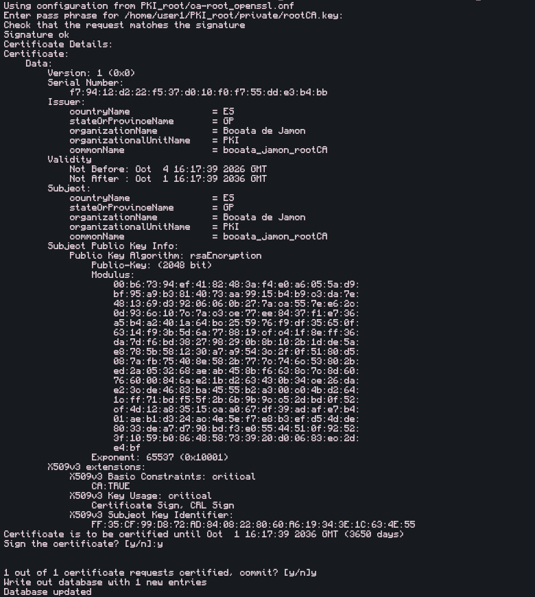
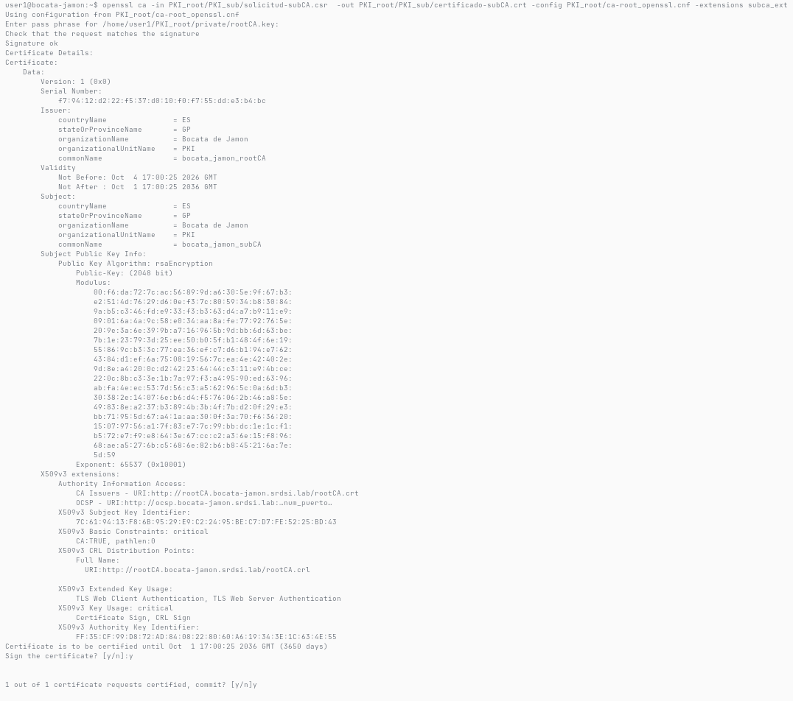
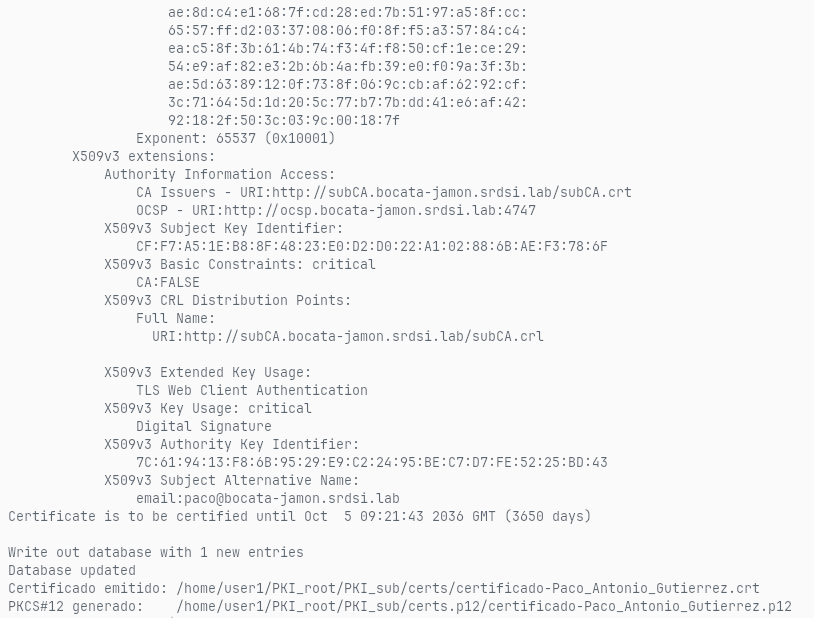
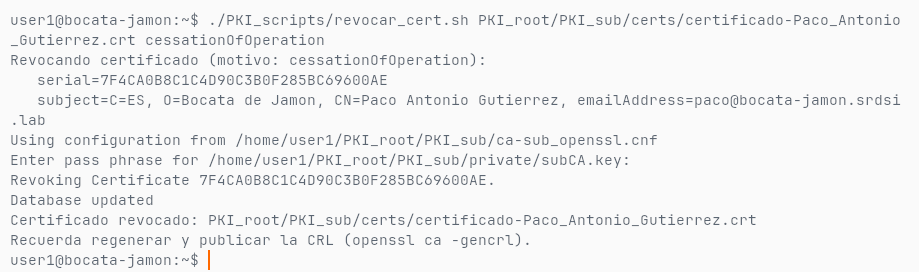
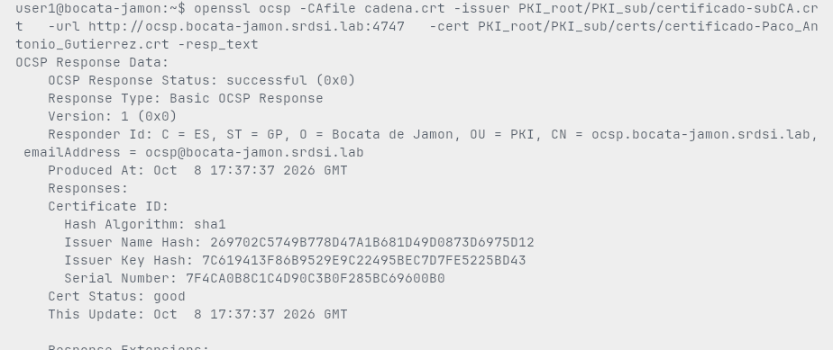
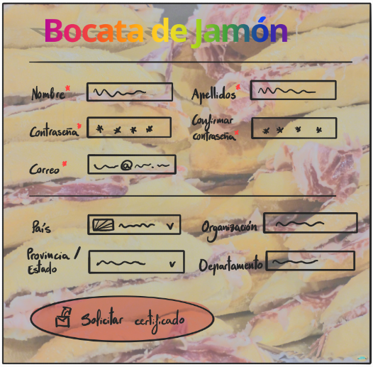

# 1. Introducción y objetivo

El objetivo de esta primera fase es poner en marcha una PKI privada compuesta
por una autoridad raíz (*rootCA*) y una autoridad subordinada (*subCA*) que
emite certificados para usuarios (personas) y servicios, además de diseñar
la interfaz web de la subCA.

Tareas realizadas:

1. Crear y configurar la CA raíz y la CA subordinada.
2. Generar, emitir, revocar y verificar certificados (usuarios y servicios).
3. Poner en marcha un respondedor OCSP y verificar el estado por CRL y OCSP.
4. Diseñar la aplicación web de la subCA (roles de usuario y administrador).
5. Contabilizar el tiempo invertido.

Los scripts `gen_solicitud.sh`, `emitir_cert.sh` y `revocar_cert.sh`
(en `PKI_scripts/`) automatizan la generación de solicitudes, la emisión
y la revocación. Se generaron con IA y se ajustaron manualmente para que
la entrada y la salida fueran las que necesitábamos. Este informe
documenta el guion completo con capturas de la ejecución.
Las capturas de los hitos principales van intercaladas; el resto se
conserva en `img/` como respaldo.

# 2. Paso 1 — CA raíz y CA subordinada

## 2.1. Estructura de directorios y permisos

```bash
mkdir -p ~/PKI_root/{private,DB,certs,solicitudes,certs.p12,PKI_sub/{private,DB,certs,certs.p12}}
chmod 700 ~/PKI_root/private ~/PKI_root/PKI_sub/private
touch ~/PKI_root/DB/index.txt ~/PKI_root/PKI_sub/DB/index.txt
```

Salida:

```console
/home/user1/PKI_root:
certs  certs.p12  DB  PKI_sub  private	solicitudes
/home/user1/PKI_root/PKI_sub:
certs  certs.p12  DB  private  solicitudes
drwx------ 2 user1 user1 4096 oct 10 14:51 /home/user1/PKI_root/PKI_sub/private
drwx------ 2 user1 user1 4096 oct 10 14:51 /home/user1/PKI_root/private
[... salida truncada: 29 líneas omitidas ...]
```

Las claves privadas quedan solo accesibles al propietario (`chmod 700` en
los directorios `private`; los scripts trabajan con `umask 077` y dejan
claves y `.p12` con modo 600).

## 2.2. Números de serie y CRL

```bash
openssl rand -hex 16 > ~/PKI_root/DB/serial
openssl rand -hex 16 > ~/PKI_root/DB/crlnumber
openssl rand -hex 16 > ~/PKI_root/PKI_sub/DB/serial
openssl rand -hex 16 > ~/PKI_root/PKI_sub/DB/crlnumber
```

Salida:

```console
total 8
-rw-rw-r-- 1 user1 user1  0 oct 10 14:52 index.txt
-rw-rw-r-- 1 user1 user1 33 oct 10 14:52 serie_emitidos.txt
-rw-rw-r-- 1 user1 user1 33 oct 10 14:52 serie_revocados.txt
852af8743232faa94d14b2a15c61afa3
28d562cfb6cacda9e0fdb6dba9aa7990
0 /home/user1/PKI_root/DB/index.txt
0 /home/user1/PKI_root/PKI_sub/DB/index.txt
[... salida truncada: 13 líneas omitidas ...]
```

Se generan cuatro series aleatorias (`serial` y `crlnumber` para cada nivel)
con `openssl rand -hex 16`.

## 2.3. Ficheros de configuración

Se copian `ca-root_openssl.cnf` y `ca-sub_openssl.cnf` a `~/PKI_root/` y
`~/PKI_root/PKI_sub/` respectivamente. Valores principales de la CA raíz:

| Parámetro | Valor |
|---|---|
| name | rootCA |
| domain | bocata-jamon.srdsi.lab |
| ocsp_url | puerto 4747 |
| C / ST / L | ES / GP / Donostia |
| O / OU | Bocata de Jamon / PKI |
| CN | bocata_jamon_rootCA |
| home | /home/user1/PKI_root |

La subCA usa los mismos valores con `name=subCA` y `home=.../PKI_sub`,
política `supplied` (C y O deben coincidir con los de la CA) y sin
`subjectAltName=email:copy` en `server_ext`.

## 2.4. Clave y certificado de la CA raíz (autofirmado)

```bash
openssl req -new -newkey rsa:3072 \
  -keyout ~/PKI_root/private/ca-root.key \
  -out ~/PKI_root/solicitudes/ca-root.csr \
  -config ~/PKI_root/ca-root_openssl.cnf
# contraseña: user1Root_CA

openssl ca -selfsign -batch -config ~/PKI_root/ca-root_openssl.cnf \
  -extensions ca_ext \
  -in ~/PKI_root/solicitudes/ca-root.csr \
  -out ~/PKI_root/certs/ca-root.crt
mv ~/PKI_root/certs/01.pem ~/PKI_root/certs/ca-root.crt 2>/dev/null || true
openssl ca -gencrl -config ~/PKI_root/ca-root_openssl.cnf \
  -out ~/PKI_root/certs/ca-root.crl
```

Salida:

```console
subject=C=ES, ST=GP, L=Donostia, O=Bocata de Jamon, OU=PKI, CN=bocata_jamon_rootCA
Certificate is to be certified until Oct  7 12:52:29 2036 GMT (3650 days)
Write out database with 1 new entries
Database updated
subject=C=ES, ST=GP, O=Bocata de Jamon, OU=PKI, CN=bocata_jamon_rootCA
issuer=C=ES, ST=GP, O=Bocata de Jamon, OU=PKI, CN=bocata_jamon_rootCA
serial=852AF8743232FAA94D14B2A15C61AFA3
Issuer: C=ES, ST=GP, O=Bocata de Jamon, OU=PKI, CN=bocata_jamon_rootCA
Last Update: Oct 10 12:52:47 2026 GMT
No Revoked Certificates.
[... salida truncada: 105 líneas omitidas ...]
```

{ width=90% }

## 2.5. Clave y certificado de la CA subordinada

```bash
openssl req -new -newkey rsa:3072 \
  -keyout ~/PKI_root/PKI_sub/private/ca-sub.key \
  -out ~/PKI_root/PKI_sub/solicitudes/ca-sub.csr \
  -config ~/PKI_root/PKI_sub/ca-sub_openssl.cnf
# contraseña: user1Sub_CA

openssl ca -batch -config ~/PKI_root/ca-root_openssl.cnf \
  -extensions subca_ext \
  -in ~/PKI_root/PKI_sub/solicitudes/ca-sub.csr \
  -out ~/PKI_root/PKI_sub/certs/ca-sub.crt
# contraseña de la CA raíz: user1Root_CA
```

Salida:

```console
subject=C=ES, ST=GP, L=Donostia, O=Bocata de Jamon, OU=PKI, CN=bocata_jamon_subCA
Certificate is to be certified until Oct  7 12:53:04 2036 GMT (3650 days)
Write out database with 1 new entries
Database updated
subject=C=ES, ST=GP, O=Bocata de Jamon, OU=PKI, CN=bocata_jamon_subCA
issuer=C=ES, ST=GP, O=Bocata de Jamon, OU=PKI, CN=bocata_jamon_rootCA
serial=852AF8743232FAA94D14B2A15C61AFA4
[... salida truncada: 78 líneas omitidas ...]
```

{ width=90% }

# 3. Paso 2 — Certificados de usuario: scripts y ejemplo

## 3.1. `gen_solicitud.sh` — genera clave privada cifrada + CSR

Uso:

```console
./gen_solicitud.sh -t {usuario|servicio} -n <nombre> {-p <password> | KEY_PASS} [opciones]
```

| Opción | Significado |
|---|---|
| `-t` | Tipo: `usuario` o `servicio` (obligatorio) |
| `-n` | Common Name, CN (obligatorio) |
| `-p` / `KEY_PASS` | Contraseña de la clave (obligatoria; preferible `KEY_PASS`) |
| `-e` | Correo (obligatorio para usuario y servicio) |
| `-d` | DNS separados por comas (obligatorio para servicio) |
| `-b` | Bits RSA, mínimo 2048 (por defecto 3072) |
| `-C` | País C, 2 letras (obligatorio para servicio) |
| `-S` / `-L` | Provincia ST / localidad L (opcionales) |
| `-O` | Organización O (obligatoria para servicio) |
| `-U` | Unidad organizativa OU (opcional) |
| `-o` | Directorio de salida |
| `-f` | Sobrescribir clave y CSR existentes |

Para tipo `servicio` son obligatorios `-d`, `-e`, `-C` y `-O`: la política
de la subCA exige `emailAddress`, y que C y O coincidan con los de la CA.
Para tipo `usuario` basta con `-e`. Los ficheros generados son
`clave-privada-<nombre>.key` (cifrada, modo 600) y
`solicitud-<nombre>.csr`; el nombre deriva del CN (espacios a `_`,
solo `[alnum]_.-`). Nunca sobrescribe salvo con `-f`.

## 3.2. `emitir_cert.sh` — firma una CSR con la subCA

Uso:

```console
./emitir_cert.sh <solicitud.csr> {server_ext|user_ext|ocsp_ext}
```

El script NO revisa la solicitud: se asume revisión manual previa (el
administrador actúa como autoridad de registro). Solo acepta extensiones
cuya sección exista en `ca-sub_openssl.cnf`. Con `user_ext` exige la clave
privada junto a la CSR (`clave-privada-<nombre>.key`) y genera además un
PKCS#12; con `server_ext`/`ocsp_ext` entrega solo el `.crt`.

| Variable | Efecto |
|---|---|
| `KEY_PASS` | Contraseña de la clave (obligatoria solo con `user_ext`) |
| `P12_PASS` | Contraseña del `.p12` (por defecto = `KEY_PASS`) |
| `PKI_DIR` | SubCA (por defecto `/home/user1/PKI_root/PKI_sub`) |
| `CONF_CA` | Config de la CA (por defecto `$PKI_DIR/ca-sub_openssl.cnf`) |
| `CERTS_DIR` / `P12_DIR` | Destinos de `.crt` / `.p12` |
| `CA_PASS` | Contraseña de la CA (si no, openssl la pide) |

Códigos de salida: 1 = solicitud/clave ilegible, 2 = extensión no válida,
3 = configuración o fichero existente, 4 = `.crt` emitido pero falló el `.p12`.
Nunca sobrescribe salidas existentes.

## 3.3. `revocar_cert.sh` — revoca un certificado

Uso:

```console
./revocar_cert.sh <certificado.crt> [motivo]
```

Motivos válidos: `unspecified` (por defecto), `keyCompromise`,
`CACompromise`, `affiliationChanged`, `superseded`,
`cessationOfOperation`, `certificateHold`. Comprueba antes el estado con
`openssl ca -status <serial>` (solo lectura) para no ensuciar `index.txt`
si el serial no existe o ya está revocado. Tras revocar hay que regenerar
y publicar la CRL con `openssl ca -gencrl`.

## 3.4. Ejemplo: usuario Paco

```bash
KEY_PASS='Contraseña segura1234_' ~/PKI_scripts/gen_solicitud.sh \
  -t usuario -n "Paco Antonio Gutierrez" \
  -e paco@bocata-jamon.srdsi.lab -C ES -O "Bocata de Jamon" \
  -o ~/PKI_root/PKI_sub/solicitudes -f
# genera clave-privada-Paco_Antonio_Gutierrez.key
#      + solicitud-Paco_Antonio_Gutierrez.csr
```

Salida:

```console
Generando solicitud para usuario: Paco Antonio Gutierrez
Solicitud generada correctamente:
   Clave privada: /home/user1/PKI_root/PKI_sub/solicitudes/clave-privada-Paco_Antonio_Gutierrez.key (cifrada, RSA 3072)
   CSR:           /home/user1/PKI_root/PKI_sub/solicitudes/solicitud-Paco_Antonio_Gutierrez.csr
   Subject:       /C=ES/O=Bocata de Jamon/CN=Paco Antonio Gutierrez/emailAddress=paco@bocata-jamon.srdsi.lab
[... salida truncada: 4 líneas omitidas ...]
```

```bash
CA_PASS='user1Sub_CA' ~/PKI_scripts/emitir_cert.sh \
  ~/PKI_root/PKI_sub/solicitudes/solicitud-Paco_Antonio_Gutierrez.csr user_ext
# genera .crt + .p12 (P12_PASS = KEY_PASS por defecto)
```

Salida:

```console
Check that the request matches the signature
Signature ok
Certificate is to be certified until Oct  7 12:54:39 2036 GMT (3650 days)
Write out database with 1 new entries
Database updated
Certificado emitido: /home/user1/PKI_root/PKI_sub/certs/certificado-Paco_Antonio_Gutierrez.crt
PKCS#12 generado:    /home/user1/PKI_root/PKI_sub/certs.p12/certificado-Paco_Antonio_Gutierrez.p12
[... salida truncada: 74 líneas omitidas ...]
```

{ width=90% }

```bash
~/PKI_scripts/revocar_cert.sh \
  ~/PKI_root/PKI_sub/certs/*Paco*.crt cessationOfOperation
openssl ca -gencrl -config ~/PKI_root/PKI_sub/ca-sub_openssl.cnf \
  -out ~/PKI_root/PKI_sub/certs/ca-sub.crl
```

Salida:

```console
Revocando certificado (motivo: cessationOfOperation):
   serial=C9FB6826580D25B8E21F03354DD2317B
   subject=C=ES, O=Bocata de Jamon, CN=Paco Antonio Gutierrez, emailAddress=paco@bocata-jamon.srdsi.lab
Revoking Certificate C9FB6826580D25B8E21F03354DD2317B.
Database updated
Certificado revocado: /home/user1/PKI_root/PKI_sub/certs/certificado-Paco_Antonio_Gutierrez.crt
Issuer: C=ES, ST=GP, O=Bocata de Jamon, OU=PKI, CN=bocata_jamon_subCA
    Serial Number: C9FB6826580D25B8E21F03354DD2317B
                Cessation Of Operation
[... salida truncada: 51 líneas omitidas ...]
```

{ width=90% }

# 4. Paso 3 — Servidor OCSP

```bash
echo "127.10.0.1  ocsp ocsp.bocata-jamon.srdsi.lab" | sudo tee -a /etc/hosts
mkdir -p ~/PKI_root/PKI_sub/ocsp
```

Salida:

```console
127.10.0.1      ocsp.bocata-jamon.srdsi.lab
127.10.0.1 ocsp.bocata-jamon.srdsi.lab
drwxrwxr-x 2 user1 user1 4096 oct 10 14:55 /home/user1/PKI_root/PKI_sub/ocsp
[... salida truncada: 21 líneas omitidas ...]
```

## 4.1. Solicitud y emisión del certificado OCSP

```bash
KEY_PASS='user1Sub_CA_ocsp' ~/PKI_scripts/gen_solicitud.sh \
  -t servicio -n "ocsp" -d ocsp.bocata-jamon.srdsi.lab \
  -e ocsp@bocata-jamon.srdsi.lab -C ES -S GP -L Donostia \
   -O "Bocata de Jamon" -U PKI -o ~/PKI_root/PKI_sub/ocsp
```

Salida:

```console
Generando solicitud para servicio: ocsp.bocata-jamon.srdsi.lab
Solicitud generada correctamente:
   Clave privada: /home/user1/PKI_root/PKI_sub/ocsp//clave-privada-ocsp.bocata-jamon.srdsi.lab.key (cifrada, RSA 3072)
   CSR:           /home/user1/PKI_root/PKI_sub/ocsp//solicitud-ocsp.bocata-jamon.srdsi.lab.csr
   Subject:       /C=ES/ST=GP/L=Donostia/O=Bocata de Jamon/OU=PKI/CN=ocsp.bocata-jamon.srdsi.lab/emailAddress=ocsp@bocata-jamon.srdsi.lab
[... salida truncada: 10 líneas omitidas ...]
```

```bash
CA_PASS='user1Sub_CA' ~/PKI_scripts/emitir_cert.sh \
  ~/PKI_root/PKI_sub/ocsp/solicitud-ocsp.csr ocsp_ext

mv ~/PKI_root/PKI_sub/ocsp/clave-privada-ocsp.key \
   ~/PKI_root/PKI_sub/private/
chmod 600 ~/PKI_root/PKI_sub/private/clave-privada-ocsp.key
```

Salida:

```console
Certificate is to be certified until Oct  7 12:55:12 2036 GMT (3650 days)
Write out database with 1 new entries
Database updated
Certificado emitido: /home/user1/PKI_root/PKI_sub/certs/certificado-ocsp.bocata-jamon.srdsi.lab.crt
Entregar al solicitante solo el certificado (no se genera PKCS#12 para ocsp_ext).
subject=C=ES, ST=GP, O=Bocata de Jamon, OU=PKI, CN=ocsp.bocata-jamon.srdsi.lab, emailAddress=ocsp@bocata-jamon.srdsi.lab
issuer=C=ES, ST=GP, O=Bocata de Jamon, OU=PKI, CN=bocata_jamon_subCA
    OCSP Signing
renamed '/home/user1/PKI_root/PKI_sub/ocsp/clave-privada-ocsp.bocata-jamon.srdsi.lab.key' -> '/home/user1/PKI_root/PKI_sub/private/clave-privada-ocsp.bocata-jamon.srdsi.lab.key'
[... salida truncada: 85 líneas omitidas ...]
```

## 4.2. Arranque del respondedor y consulta

```bash
openssl ocsp -port 4747 \
  -index ~/PKI_root/PKI_sub/DB/index.txt \
  -CA ~/PKI_root/PKI_sub/certs/ca-sub.crt \
  -rsigner ~/PKI_root/PKI_sub/certs/ocsp.crt \
   -ndays 7 &
```

Salida:

```console
ACCEPT 0.0.0.0:4747 PID=3004
ocsp: waiting for OCSP client connections...
-rw-rw-r-- 1 user1 user1 74 oct 10 14:55 /home/user1/PKI_root/PKI_sub/ocsp/responder.log
[... salida truncada: 12 líneas omitidas ...]
```

```bash
cat ~/PKI_root/PKI_sub/certs/ocsp.crt \
    ~/PKI_root/PKI_sub/certs/ca-sub.crt > /tmp/chain.crt
openssl ocsp -issuer ~/PKI_root/PKI_sub/certs/ca-sub.crt \
  -cert ~/PKI_root/PKI_sub/certs/ocsp.crt \
  -url http://ocsp.bocata-jamon.srdsi.lab:4747 \
  -CAfile /tmp/chain.crt -resp_text
# esperado: ocsp.crt: good
```

Salida:

```console
    OCSP Response Status: successful (0x0)
      Serial Number: C9FB6826580D25B8E21F03354DD2317B
    Cert Status: revoked
    Revocation Reason: cessationOfOperation (0x5)
/home/user1/PKI_root/PKI_sub/certs/certificado-Paco_Antonio_Gutierrez.crt: revoked
	Reason: cessationOfOperation
    Cert Status: good
      Serial Number: C9FB6826580D25B8E21F03354DD2317C
[... salida truncada: 223 líneas omitidas ...]
```

{ width=90% }

# 5. Verificación de certificados

## 5.1. Inspección del certificado (`x509`)

```bash
openssl x509 -in ~/PKI_root/PKI_sub/certs/certificado-Paco_Antonio_Gutierrez.crt \
  -noout -text | less
# muestra subject, issuer, serial, validez, subjectAltName,
# keyUsage y extendedKeyUsage
openssl x509 -in <cert>.crt -noout -serial -subject -issuer
```

Salida:

```console
subject=C=ES, O=Bocata de Jamon, CN=Paco Antonio Gutierrez, emailAddress=paco@bocata-jamon.srdsi.lab
issuer=C=ES, ST=GP, O=Bocata de Jamon, OU=PKI, CN=bocata_jamon_subCA
notBefore=Oct 10 12:54:39 2026 GMT
notAfter=Oct  7 12:54:39 2036 GMT
[... salida truncada: 11 líneas omitidas ...]
```

## 5.2. Cadena de certificación

```bash
cat ~/PKI_root/PKI_sub/certs/ca-sub.crt \
    ~/PKI_root/certs/ca-root.crt > ~/PKI_root/PKI_sub/certs/chain.crt
openssl verify -CAfile ~/PKI_root/certs/ca-root.crt \
  -untrusted ~/PKI_root/PKI_sub/certs/ca-sub.crt \
  ~/PKI_root/PKI_sub/certs/certificado-Paco_Antonio_Gutierrez.crt
```

Salida:

```console
== verify chain ==
/home/user1/PKI_root/PKI_sub/certificado-subCA.crt: OK
V	361007125229Z		852AF8743232FAA94D14B2A15C61AFA3	unknown	/C=ES/ST=GP/O=Bocata de Jamon/OU=PKI/CN=bocata_jamon_rootCA
V	361007125304Z		852AF8743232FAA94D14B2A15C61AFA4	unknown	/C=ES/ST=GP/O=Bocata de Jamon/OU=PKI/CN=bocata_jamon_subCA
[... salida truncada: 39 líneas omitidas ...]
```

La cadena `chain.crt` (subCA + raíz) permite a los clientes verificar
cualquier certificado final hasta la raíz de confianza.

## 5.3. Estado por CRL (PEM y DER)

```bash
# Regenerar y publicar tras cada revocación:
openssl ca -config ~/PKI_root/PKI_sub/ca-sub_openssl.cnf \
  -gencrl -out ~/PKI_root/PKI_sub/certs/ca-sub.crl

# Inspeccionar la CRL en texto:
openssl crl -in ~/PKI_root/PKI_sub/certs/ca-sub.crl -noout -text | less
# (muestra issuer, lastUpdate/nextUpdate y la lista de revocados
#  con su serial, fecha y motivo, p. ej. cessationOfOperation)

# Convertir a DER para clientes que lo exijan:
openssl crl -in ~/PKI_root/PKI_sub/certs/ca-sub.crl -inform PEM \
  -outform DER -out ~/PKI_root/PKI_sub/certs/ca-sub.crl.der
openssl crl -in ~/PKI_root/PKI_sub/certs/ca-sub.crl.der -inform DER \
   -noout -text | head -20
```

Salida:

```console
Certificate Revocation List (CRL):
        Version 2 (0x1)
        Issuer: C=ES, ST=GP, O=Bocata de Jamon, OU=PKI, CN=bocata_jamon_subCA
        Last Update: Oct 10 12:55:03 2026 GMT
    Serial Number: C9FB6826580D25B8E21F03354DD2317B
        Revocation Date: Oct 10 12:54:58 2026 GMT
                Cessation Of Operation
-rw-rw-r-- 1 user1 user1 743 oct 10 14:55 /home/user1/PKI_root/PKI_sub/DB/crl-sub.pem
[... salida truncada: 52 líneas omitidas ...]
```

## 5.4. PKCS#12: exportar, inspeccionar y extraer

`emitir_cert.sh` ya genera el `.p12` para `user_ext`. Operaciones manuales:

```bash
# Inspeccionar el contenido (sin extraer):
openssl pkcs12 -in ~/PKI_root/PKI_sub/certs.p12/certificado-Paco_Antonio_Gutierrez.p12 \
  -info -noout
# Extraer solo el certificado (sin clave):
openssl pkcs12 \
  -in ~/PKI_root/PKI_sub/certs.p12/certificado-Paco_Antonio_Gutierrez.p12 \
  -nokeys -out /tmp/paco-cert.pem
# Extraer solo la clave privada (sin certificado):
openssl pkcs12 \
  -in ~/PKI_root/PKI_sub/certs.p12/certificado-Paco_Antonio_Gutierrez.p12 \
   -nocerts -out /tmp/paco-key.pem
```

Salida:

```console
MAC: sha256, Iteration 2048
Certificate bag
Shrouded Keybag: PBES2, PBKDF2, AES-256-CBC, Iteration 2048, PRF hmacWithSHA256
-rw------- 1 user1 user1 3683 oct 10 14:54 /home/user1/PKI_root/PKI_sub/certs.p12/certificado-Paco_Antonio_Gutierrez.p12
[... salida truncada: 11 líneas omitidas ...]
```

El `.p12` (contraseña = `KEY_PASS` salvo `P12_PASS` distinto) es lo que se
remite por correo al usuario: contiene el par clave privada + certificado.

# 6. Diseño de la aplicación web de la subCA

La web es solo el frontal de la subCA (no hay frontal para la raíz).
Dos roles:

- **Usuario**: solicita un certificado, descarga su certificado / PKCS#12
  y verifica el estado de un certificado.
- **Administrador de la subCA** (acceso restringido): gestiona todas las
  tareas de la CA — revisa solicitudes y firma o deniega (actúa como RA),
  revoca, regenera/publica la CRL y opera el respondedor OCSP.

## 6.1. Boceto del formulario de solicitud

{ width=70% }

El boceto muestra el formulario "Bocata de Jamón" con los campos
Nombre, Apellidos, Contraseña, Correo, País, Organización, Provincia y
Departamento, y el botón "Solicitar certificado".

> PENDIENTE: dibujar a mano y escanear a img/web/ el resto de mockups y vistas (descarga/verificación de usuario; panel de administración: firma, revocación, CRL y OCSP).

## 6.2. Mapeo elemento-UI con operación del procedimiento

| Elemento de la interfaz | Operación del procedimiento |
|---|---|
| Formulario de solicitud (usuario) | `gen_solicitud.sh -t usuario/servicio` (crea clave + CSR) |
| Botón "Solicitar certificado" | Envío de la CSR a `solicitudes/` para revisión del admin (RA) |
| Descarga de certificado | Entrega del `.crt` de `certs/` emitido por `emitir_cert.sh` |
| Descarga de PKCS#12 | Entrega del `.p12` de `certs.p12` (solo `user_ext`) |
| Verificación de estado (usuario) | Consulta OCSP (`openssl ocsp ... -url ...:4747`) o CRL publicada |
| Bandeja de solicitudes (admin) | Revisión manual previa que exige `emitir_cert.sh` |
| Botón "Firmar" (admin) | `emitir_cert.sh <csr> {server_ext,user_ext,ocsp_ext}` |
| Botón "Denegar" (admin) | Rechazo de la CSR (no se firma; se descarta) |
| Botón "Revocar" (admin) | `revocar_cert.sh <crt> [motivo]` |
| Publicar CRL (admin) | `openssl ca -gencrl -out ca-sub.crl` (+ conversión DER si aplica) |
| Panel OCSP (admin) | Arranque/estado del respondedor `openssl ocsp -port 4747 ...` |
| Ver certificado (ambos) | `openssl x509 -text` sobre el `.crt` |

# 7. Tiempo invertido

| Persona | Tarea | Horas |
|---|---|---|
| Jon | Puesta en marcha rootCA + subCA en la VM (paso 1) y capturas | 0,5 h |
| Jorge | Scripts `gen_solicitud.sh` / `emitir_cert.sh` / `revocar_cert.sh` con IA + ajustes manuales de entrada y salida | 1 h |
| Jorge + Jon | Certificados de usuario (Paco), verificación, revocación y CRL (paso 2) | 1 h |
| Jon | Respondedor OCSP, consultas y verificación good/revoked (paso 3) | 0,5 h |
| Jon | Diseño web de la subCA y mockup del formulario | 1,5 h |
| Jorge | Redacción del guion-informe e integración de salidas y figuras | 2 h |

# 8. Extras

- **SAN con `-addext`**: `gen_solicitud.sh` pide los SAN en la CSR con
  `openssl req -addext` (requiere OpenSSL >= 1.1.1): `DNS:...` para
  servicios y `email:...` para usuarios, además de `keyUsage` y
  `extendedKeyUsage` en usuarios. Los usos finales los fija la CA en su
  sección (`server_ext`/`user_ext`/`ocsp_ext`) con `copy_extensions=copy`.
- **Certificados de servicio con SAN**: el ejemplo del OCSP
  (`-d ocsp.bocata-jamon.srdsi.lab`) muestra un certificado de servicio
  con `subjectAltName = DNS:...`; el mismo flujo sirve para sitios web
  (fase 2) cambiando `-n`/`-d`.
- **Contraseñas por entorno**: `KEY_PASS`/`P12_PASS`/`CA_PASS` evitan
  exponerlas en `ps` o en el historial (nunca `-p` en máquinas compartidas).

# Anexos

- Ficheros de configuración del enunciado: `ca-root_openssl.cnf`
  (CA raíz) y `ca-sub_openssl.cnf` (subCA, con secciones `server_ext`,
  `user_ext`, `ocsp_ext` y `subca_ext`). §2.3 resume los valores usados.
- Scripts (en `PKI_scripts/`, documentados en §3.1–§3.3):
  `gen_solicitud.sh` (clave + CSR), `emitir_cert.sh` (firma + PKCS#12
   para usuarios) y `revocar_cert.sh` (revocación + recordatorio de CRL).
