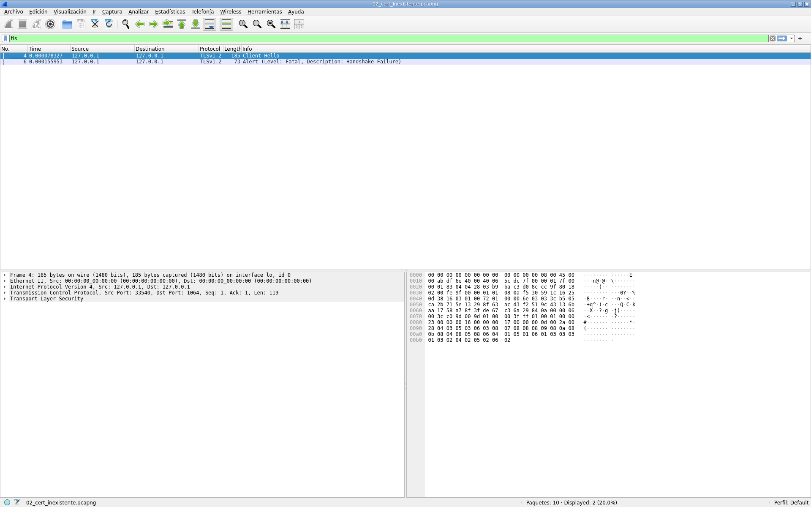
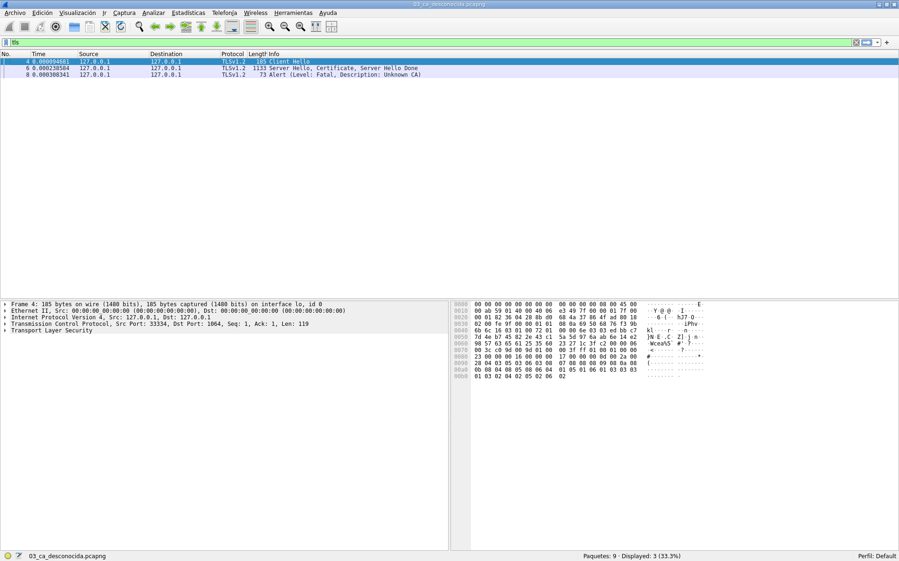

# 1. Introducción y objetivo

En este laboratorio hemos protegido con OpenSSL el protocolo de aplicación
`cli-infouser`/`serv-infouser`, que hasta ahora viajaba en claro sobre TCP, y
hemos analizado las alertas TLS que aparecen ante dos errores con los
certificados.

La aplicación original permite al administrador obtener la lista de usuarios
conectados. El cliente pide la información, el servidor ejecuta `w`, guarda la
salida en un fichero temporal y la envía; el cliente la almacena en el fichero
que se indica como segundo parámetro.

Estas son las tareas que hemos hecho:

1. Migrar el cliente y el servidor a la API de sockets seguros de OpenSSL.
2. Reproducir y capturar dos escenarios de error: certificado inexistente y
   certificado firmado por una CA que el cliente no reconoce.
3. Analizar las alertas TLS observadas.
4. Contabilizar el tiempo invertido y valorar la actividad.

Todo el código y los scripts de captura están en el repositorio
(`lab-ssl/source_files/` y `lab-ssl/run-lab.sh`), y la evidencia en
`lab-ssl/capturas/`.

# 2. Ejercicio 1: del protocolo TCP a OpenSSL

## 2.1. Protocolo de aplicación

Mantenemos el protocolo original y cambiamos solo el transporte. El servidor
escucha en el puerto fijo 1064 (`IPPORT_RESERVED + 40`), ejecuta
`w > /tmp/file_users` y envía al cliente una cabecera `OK:<tamaño>` seguida del
contenido del fichero por bloques. El cliente valida la cabecera y vuelca los
bytes recibidos en el fichero local.

En la versión segura hacemos las mismas operaciones con `SSL_accept`/
`SSL_connect`, `SSL_read` y `SSL_write` sobre el socket ya establecido.

## 2.2. Servidor

El servidor inicializa el contexto TLS, carga el certificado y la clave privada
y comprueba que coinciden:

```c
method = TLS_server_method();
ctx = SSL_CTX_new(method);
CHK_NULL(ctx);

err = SSL_CTX_use_certificate_file(ctx, CERTFILE, SSL_FILETYPE_PEM);
CHK_SSL(err);
err = SSL_CTX_use_PrivateKey_file(ctx, KEYFILE, SSL_FILETYPE_PEM);
CHK_SSL(err);
err = SSL_CTX_check_private_key(ctx);
CHK_ERR(err,"La clave privada no corresponde al certificado\n");
```

Como el cliente no presenta certificado, el servidor no carga la CA del cliente
ni pide verificación mutua: no llama a `SSL_CTX_load_verify_locations` ni a
`SSL_CTX_set_verify`. Añadimos `SO_REUSEADDR` para poder reiniciar el servidor
aunque queden sockets en `TIME_WAIT`.

El bucle de servicio es igual que antes, pero con el saludo TLS:

```c
do {
    c = accept(s, NULL, 0);
    ssl = SSL_new(ctx);
    SSL_set_fd(ssl, c);
    err = SSL_accept(ssl);          /* handshake TLS */
    enviar_usuarios(ssl);            /* SSL_write por bloques */
    SSL_shutdown(ssl);
    SSL_free(ssl);
    close(c);
} while (1);
```

## 2.3. Cliente

El cliente solo necesita confiar en la CA del servidor, así que no carga ningún
certificado de cliente:

```c
method = TLS_client_method();
ctx = SSL_CTX_new(method);

SSL_CTX_set_cipher_list(ctx, "AES128-SHA256:AES256-CCM:AES256-GCM-SHA384");
SSL_CTX_set_max_proto_version(ctx, TLS1_2_VERSION);   /* descifrable en Wireshark */

SSL_CTX_load_verify_locations(ctx, CA_CERT, NULL);    /* certificados/s-ca_cert.pem */
SSL_CTX_set_verify(ctx, SSL_VERIFY_PEER, NULL);
SSL_CTX_set_verify_depth(ctx, 1);

SSL_CTX_set_keylog_callback(ctx, key_log_cb);         /* exporta secretos TLS */
```

Fijamos TLS 1.2 y los cifrados para poder descifrar las tramas en Wireshark, que
solo descifra TLSv1.2 con un *keylog file*. El callback `key_log_cb` añade cada
secreto a `keylog-ssl.log`.

## 2.4. Compilación y prueba

```console
$ gcc -Wall -O2 -o serv-infouser serv-infouser.c -lssl -lcrypto
$ gcc -Wall -O2 -o cli-infouser  cli-infouser.c  -lssl -lcrypto
$ ./serv-infouser &
$ ./cli-infouser 127.0.0.1 /tmp/usuarios.txt
Conectado con cifrado AES128-SHA256
Verificacion del servidor: OK
```

El fichero que recibe el cliente coincide con la salida de `w` que generó el
servidor (mismo tamaño y contenido; en la captura de referencia, 221 bytes).

# 3. Ejercicio 2: análisis de las alertas TLS

## 3.1. Montaje de las capturas

Capturamos el tráfico en la interfaz de *loopback* de la máquina virtual con
`dumpcap -i lo -w captura.pcapng` y lo analizamos con `tshark`/Wireshark,
cargando `keylog-ssl.log` en *Edit → Preferences → Protocols → TLS →
(Pre)-Master-Secret log filename*. El script `lab-ssl/run-lab.sh` automatiza la
compilación, la reproducción de los tres escenarios y el análisis.

Los certificados que usamos son los del repositorio, sustituidos el 2026-10-19:
el de servidor (`s_cert.pem`, serial `865EE37EE2F16ABE`) y el de cliente
(`c_cert.pem`, serial `16B61DD2792713CF`) son válidos del 2026-10-19 al
2037-10-01, igual que las CAs `CA_SERV-SRDSI` y `CA_CLI-SRDSI`. El certificado
del servidor que aparece en `01_ok.pcapng` es el mismo que `s_cert.pem`.

## 3.2. Escenario correcto (referencia)

Cuando todo va bien, el handshake se completa y la información viaja cifrada,
aunque podemos leerla con el *keylog*:

```console
4   TLSv1    Client Hello
6   TLSv1.2  Server Hello, Certificate, Server Hello Done
8   TLSv1.2  Client Key Exchange, Change Cipher Spec, Finished
9   TLSv1.2  New Session Ticket, Change Cipher Spec, Finished
10  TLSv1.2  Application Data, Application Data, Alert (Close Notify)
```


Podemos volcar el contenido descifrado con `Follow → TLS Stream` (o
`tshark -z follow,tls,ascii,0`). Se reconoce el protocolo de la aplicación
(`OK:<tamaño>`) y la salida de `w`:

```console
$ tshark -r 01_ok.pcapng -o tls.keylog_file:01_ok.keylog -q -z follow,tls,ascii,0
Filter: tls.stream eq 0
Node 0: 127.0.0.1:33526
Node 1: 127.0.0.1:1064
        6
OK:221
        221
 17:18:43 up 0 min,  1 user,  load average: 0,78, 0,19, 0,06
USUARIO  TTY      DESDE            LOGIN@   IDLE   JCPU   PCPU  WHAT
user1             192.168.56.1     17:18           0.00s  0.01s sshd-session: user1 [priv]
```

## 3.3. Caso 1: certificado inexistente

Eliminamos (o renombramos) `certificados/s_cert.pem` y arrancamos el servidor.
Sin certificado, el servidor no puede negociar ninguno de los cifrados que fija
el cliente, porque todos usan intercambio de clave RSA, y responde al
`Client Hello` con una alerta fatal `handshake_failure` (40):

```console
4   TLSv1    Client Hello
6   TLSv1.2  Alert (Level: Fatal, Description: Handshake Failure)
```

El servidor muestra `no shared cipher` y el cliente registra
`ssl/tls alert handshake failure: SSL alert number 40`.



## 3.4. Caso 2: CA desconocida

Configuramos el cliente para que confíe en la CA equivocada
(`certificados/c-ca_cert.pem` en vez de `s-ca_cert.pem`). El handshake llega
hasta el `Certificate` del servidor, pero el cliente no puede construir una
cadena de confianza y aborta con una alerta fatal `unknown_ca` (48):

```console
4   TLSv1    Client Hello
6   TLSv1.2  Server Hello, Certificate, Server Hello Done
8   TLSv1.2  Alert (Level: Fatal, Description: Unknown CA)
```

El cliente registra `certificate verify failed` y el servidor recibe
`tlsv1 alert unknown ca: SSL alert number 48`.



## 3.5. Resumen de alertas

| Situación | Origen de la alerta | Alerta TLS |
|---|---|---|
| CA correcta | Ninguna | handshake correcto |
| Certificado inexistente | servidor | `handshake_failure` (40, fatal) |
| CA no reconocida | cliente | `unknown_ca` (48, fatal) |

# 4. Valoración de la actividad

La actividad nos ha parecido interesante. Pasar un protocolo TCP en claro a
OpenSSL obliga a entender cómo funciona un contexto SSL (`SSL_CTX`), cómo se
cargan los certificados y qué papel tiene la verificación. El segundo ejercicio
viene bien para ver en Wireshark la diferencia entre un fallo de negociación,
cuando el servidor no puede completar el saludo, y un fallo de confianza, cuando
es el cliente el que rechaza el certificado, porque en cada caso aparece una
alerta distinta. Fijar TLS 1.2 y exportar el *keylog* también ayuda a entender
las claves de sesión y cómo se descifra el tráfico. Como pega, la máquina virtual
no traía `libssl-dev` y hubo que instalarlo (`apt-get install libssl-dev`) antes
de compilar el código.

# 5. Tiempo dedicado

| Tarea | Responsable | Tiempo |
|---|---|---|
| Estudio del enunciado y del material de teoría | Jorge y Jon | 0,5 h |
| Ejercicio 1: migración del cliente y servidor a OpenSSL | Jorge y Jon | 2,0 h |
| Ejercicio 2: escenarios de error y capturas | Jon | 1,5 h |
| Análisis de las alertas y redacción del informe | Jorge | 1,5 h |
| **Total** | | **5,5 h** |

La teoría y la migración las hicimos entre los dos, así que sale 2,75 h por
persona.

# 6. Referencias

1. Enunciado del laboratorio: `Lab-ssl-actividad.pdf` y `Lab-ssl-teoria.pdf`.
2. OpenSSL Documentation. <https://www.openssl.org/docs/>
3. Wireshark: descifrado TLS con keylog file. <https://wiki.wireshark.org/TLS>
